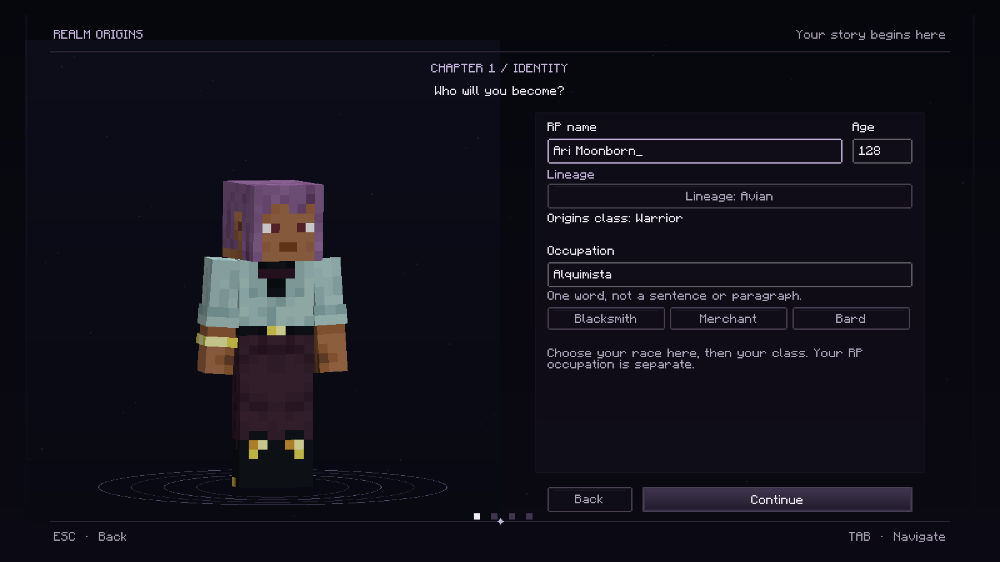

# Mods de Minecraft

Projetos de ROCKABITS para **Minecraft 1.21.1**, **NeoForge 21.1.256+** e **Java 21**. Nos mods de jogo, instala a mesma versão no servidor e nos clientes; substitui os JARs antigos. O **Season 8** é exclusivamente de cliente.

| Mod | Download | Funcionalidades |
| --- | --- | --- |
| **Season 8 0.1.0** | [JAR](https://github.com/ROCKABITS/Mods/raw/refs/heads/main/mod-pronto/season-eight-0.1.0.jar) · [ZIP](https://github.com/ROCKABITS/Mods/raw/refs/heads/main/mod-pronto/season-eight-0.1.0.zip) | Menu principal, carregamento de recursos, brasão, título e ícone da janela. Apenas nos clientes, sem dependências adicionais. |
| **Realm Marriage 0.1.0 Beta** | [JAR](https://github.com/ROCKABITS/Mods/raw/refs/heads/main/mod-pronto/realm-marriage-0.1.0.jar) · [ZIP](https://github.com/ROCKABITS/Mods/raw/refs/heads/main/mod-pronto/realm-marriage-0.1.0.zip) | Altar medieval, celebrante escolhido pelo casal, objeções com G, votos, testemunhas, três regimes financeiros e divórcio. |
| **Laws & Justice 0.4.0 Beta** | [JAR](https://github.com/ROCKABITS/Mods/raw/refs/heads/main/mod-pronto/laws-justice-0.4.0.jar) · [ZIP](https://github.com/ROCKABITS/Mods/raw/refs/heads/main/mod-pronto/laws-justice-0.4.0.zip) | Prisões, tribunal do Presidente, mandados, algemas, seis trabalhos, multas, fianças, Livro de Registos e pagamentos com recibos persistentes. |
| **Realm Economy 0.4.0 Beta** | [JAR](https://github.com/ROCKABITS/Mods/raw/refs/heads/main/mod-pronto/realm-economy-0.4.0.jar) · [ZIP](https://github.com/ROCKABITS/Mods/raw/refs/heads/main/mod-pronto/realm-economy-0.4.0.zip) | Mesa da Economia, preços do Presidente, comércio, XP substituído por euros, ferraria, lotes de poções e beacons pagos. |
| **Realm Casino 0.3.0 Beta** | [JAR](https://github.com/ROCKABITS/Mods/raw/refs/heads/main/mod-pronto/realm-casino-0.3.0.jar) · [ZIP](https://github.com/ROCKABITS/Mods/raw/refs/heads/main/mod-pronto/realm-casino-0.3.0.zip) | Doze jogos físicos, poker e mesas multiplayer, corridas em miniatura e imposto do lucro do proprietário. |
| **Realm Titles 0.1.0 Beta** | [JAR](https://github.com/ROCKABITS/Mods/raw/refs/heads/main/mod-pronto/realm-titles-0.1.0.jar) · [ZIP](https://github.com/ROCKABITS/Mods/raw/refs/heads/main/mod-pronto/realm-titles-0.1.0.zip) | Mesa do Selo Real, títulos personalizados, nomeações permanentes ou temporárias e registo público. |
| **Realm Notifications 0.1.1** | [JAR](https://github.com/ROCKABITS/Mods/raw/refs/heads/main/mod-pronto/realm-notifications-0.1.1.jar) · [ZIP](https://github.com/ROCKABITS/Mods/raw/refs/heads/main/mod-pronto/realm-notifications-0.1.1.zip) | Avisos medievais, agrupamento de rajadas à entrada, preferências e diário da sessão. |
| **Realm Rewards 0.1.2** | [JAR](https://github.com/ROCKABITS/Mods/raw/refs/heads/main/mod-pronto/realm-rewards-0.1.2.jar) · [ZIP](https://github.com/ROCKABITS/Mods/raw/refs/heads/main/mod-pronto/realm-rewards-0.1.2.zip) | Recompensas por conquistas Vanilla e de outros mods, carteira do Chronicles e configuração por conquista. |
| **Realm Origins 0.5.7** | [JAR](https://github.com/ROCKABITS/Mods/raw/refs/heads/main/mod-pronto/realm-origins-0.5.7.jar) · [ZIP](https://github.com/ROCKABITS/Mods/raw/refs/heads/main/mod-pronto/realm-origins-0.5.7.zip) | Criação por capítulos, personagem 3D, livro de pergaminho no P, economia e nomes RP. Substitui Chronicles RP; requer Origins e Jupiter. |
| **Realm Markets 0.2.1** | [JAR](https://github.com/ROCKABITS/Mods/raw/refs/heads/main/mod-pronto/realm-markets-0.2.1.jar) · [ZIP](https://github.com/ROCKABITS/Mods/raw/refs/heads/main/mod-pronto/realm-markets-0.2.1.zip) | Duas bancas medievais, stock real, vendas com o dono offline e imposto para a tesouraria. |
| **Realm Identity 0.1.2** | [JAR](https://github.com/ROCKABITS/Mods/raw/refs/heads/main/mod-pronto/realm-identity-0.1.2.jar) · [ZIP](https://github.com/ROCKABITS/Mods/raw/refs/heads/main/mod-pronto/realm-identity-0.1.2.zip) | Documento físico, escrivaninha, assinatura, consentimento e títulos atuais do Realm Titles. |
| **Realm Treasury 0.3.1** | [JAR](https://github.com/ROCKABITS/Mods/raw/refs/heads/main/mod-pronto/realm-treasury-0.3.1.jar) · [ZIP](https://github.com/ROCKABITS/Mods/raw/refs/heads/main/mod-pronto/realm-treasury-0.3.1.zip) | Tesouro, impostos, salários, contratos públicos, votações secretas e benefícios para o reino. |
| **Contracts & Bounties 0.4.0** | [JAR](https://github.com/ROCKABITS/Mods/raw/refs/heads/main/mod-pronto/contracts-bounties-0.4.0.jar) · [ZIP](https://github.com/ROCKABITS/Mods/raw/refs/heads/main/mod-pronto/contracts-bounties-0.4.0.zip) | Três murais 3D, contratos particulares/públicos e cinco quests RNG diárias com recompensas, impostos, reputação e celebrações RPG. |
| **Realm Council 0.2.2** | [JAR](https://github.com/ROCKABITS/Mods/raw/refs/heads/main/mod-pronto/realmcouncil-0.2.2.jar) · [ZIP](https://github.com/ROCKABITS/Mods/raw/refs/heads/main/mod-pronto/realmcouncil-0.2.2.zip) | Eleições, mandatos, juramentos e decisões públicas, através dos blocos. |

O [Realm Treasury 0.3.1](crown-ledger/README.md) substitui o Crown Ledger e preserva as contas e integrações. O Presidente escreve um título e uma descrição para votar sobre qualquer assunto; os cidadãos leem a proposta e votam com **F8**, sem bloquear o jogo. Os benefícios só são ativados com aprovação e dinheiro reservado. [Galeria](media/realm-treasury/README.md).

O ZIP é uma alternativa ao download direto do JAR. Extrai-o antes de instalar. Substitui os JARs antigos pelas versões indicadas na tabela, mantendo apenas uma versão de cada mod.

**Realm Economy 0.4.0 substitui Realm Villager Economy 0.1.0. Retira o JAR antigo.** Usa Realm Origins 0.5.7 e Realm Treasury 0.3.1 para carteira e impostos nos clientes e servidor. Realm Council identifica o Presidente; Realm Admin terá integração por fornecedor quando estiver disponível. O Realm Treasury migra para formato 8: conserva uma cópia conjunta do mundo e perfis antes de atualizar.

- [Guia do Realm Marriage](realm-marriage/README.md): casamentos, objeções, contas, certidões e divórcio; [API explícita de pagamentos](realm-marriage/API.md).
- [Guia do Laws & Justice](laws-justice/README.md): prisões, tribunal, trabalhos, multas, fianças, registos e integrações; [plano completo por versões](laws-justice/PLANO-COMPLETO.md).
- [Guia do Realm Economy](realm-economy/README.md): Mesa da Economia, impostos e serviços pagos. [Versão anterior](realm-villager-economy/README.md).
- [Guia do Realm Casino](realm-casino/README.md): doze jogos, receitas, regras, banca e recolha dos prémios.
- [Guia do Realm Titles](realm-titles/README.md): mesa, títulos, governante, validade e integração no documento.
- [Guia do Realm Notifications](realm-notifications/README.md): avisos no ecrã, tecla N, preferências, diário e API opcional.
- [Guia do Realm Rewards](realm-rewards/README.md): pagamentos por conquistas, valores padrão, administração e dinheiro pendente.
- [Guia do Realm Origins](realm-origins/README.md): personagens, nomes RP, dependências e economia.
- [Guia do Realm Markets](realm-markets/README.md): receitas, abastecimento, preços por unidade e recolha dos ganhos.
- [Guia do Realm Identity](realm-identity/README.md): emissão, segunda via, autenticidade e apresentação entre jogadores.
- [Guia do Realm Treasury](crown-ledger/README.md): receita do cofre, permissões, impostos, salários e ciclos.
- [Guia do Contracts](contracts-bounties/README.md) e [API de integração](contracts-bounties/TREASURY_API.md).
- [Guia do Realm Council](realm-council/README.md).
- [Guia do Season 8](season-eight/README.md): menu, carregamento, título e ícone da janela, exclusivamente nos clientes.
- [Plano dos próximos mods](PLANO-DOS-MODS.md).
- [Galerias para CurseForge](media/README.md).

Cada mod funciona independentemente nas suas funcionalidades base. O Realm Treasury usa esmeraldas sem Realm Origins. Com **Realm Origins 0.5.7**, pode usar a carteira digital e a reputação existentes. Com Realm Council, só o governante de um mandato ativo e jurado pode gerir o tesouro; sem ele, um operador designa um responsável. Com Contracts, o governante publica contratos pagos pelo reino.

O **Laws & Justice 0.4.0 Beta** está publicado, com [galeria real](media/laws-justice/README.md) e [validação aprovada](laws-justice/VALIDACAO-0.4.0.md). Inclui prisões construídas pelos jogadores, penas online, libertação automática e tribunal físico: o Presidente eleito e empossado analisa acusações e provas, abre audiências, absolve ou condena, emite mandados e perde os poderes imediatamente ao terminar o mandato. Algemas exigem um mandado válido para uma única detenção temporária. As intervenções administrativas de emergência são identificadas no histórico. Os seis trabalhos prisionais já estão disponíveis, com zonas, recursos finitos, produção temporizada, sacos selados e limite padrão de 50% de redução. As multas, fianças, registos públicos e integrações financeiras completam as quatro fases do [plano aprovado](laws-justice/PLANO-COMPLETO.md). O Livro de Registos permite consultar decisões finais; os pagamentos usam recibos persistentes e são entregues ao Realm Treasury quando instalado. Não são geradas prisões automaticamente.

O **Realm Casino 0.3.0 Beta** reúne os doze jogos do guião, com seis novos blocos medievais, interfaces, cartas privadas e mesas multiplayer financiadas. Inclui slots de cinco rolos, corridas de cavalos em miniatura, Texas Hold’em, vinte e um PvP, dados e cara ou coroa. O **Realm Treasury 0.3.1** recebe imposto sobre o lucro levantado pelo dono, após recuperar o capital depositado. [Guia](realm-casino/README.md) · [galeria](media/realm-casino/README.md) · [validação](realm-casino/VALIDACAO.md). A carteira Chronicles é necessária para apostar. Atualiza servidor e clientes em conjunto; Casino usa formato de dados 3 e Realm Treasury formato 8, com leitura dos mundos anteriores.

O [Realm Origins 0.5.7](realm-origins/README.md), anteriormente Chronicles RP, mantém a criação escura e lilás, com capítulos, personagem 3D e boas-vindas. A tecla P abre o livro original de pergaminho, incluindo a bolsa e o câmbio. A ocupação pode ser escrita numa palavra, com sugestões rápidas e validação no servidor. Preserva os perfis, o dinheiro, os nomes RP e as integrações, sem acrescentar personalidade ou atributos. Substitui o JAR anterior no servidor e em todos os clientes; o protocolo passa a 8 e exige 0.5.7 no servidor e em todos os clientes. Origins 0.3.2 e Jupiter 2.3.7 são necessários; Origins: Classes 0.3 é opcional.

[Galeria do Realm Origins: 23 imagens e ícone](media/realm-origins/README.md).

O [pacote Realm Titles + Realm Identity](https://github.com/ROCKABITS/Mods/raw/refs/heads/main/mod-pronto/realm-titles-0.1.0-suite.zip) contém os dois JARs desta atualização. Instala o Titles no servidor e em todos os clientes. Se usas Identity, substitui a versão anterior pela 0.1.1 em todos os lados: o protocolo passou para 2. Os documentos existentes mantêm-se válidos.

A **Mesa do Selo Real** abre o registo público de títulos. Com Realm Council, só o governante do mandato ativo e jurado pode gerir nomeações; sem Council, um operador designa um responsável. Os títulos podem ser permanentes ou durar 1–365 dias reais, mantêm-se quando muda o governante e aparecem numa nova consulta do documento do Identity, sem segunda via. Realm Origins fornece os nomes públicos e Notifications apresenta os avisos opcionais.

O Realm Notifications mostra os eventos dos seis mods atualizados e deixa o chat como alternativa para clientes sem o canal opcional. A tecla **N** abre o diário e as preferências; os menus de contratos, lojas e governação continuam a usar os seus blocos. O histórico é privado e pertence à sessão.

O Realm Rewards paga conquistas novas uma única vez por jogador. Um operador configura os valores com `/rewards`. A carteira do Chronicles recebe o pagamento; sem carteira disponível, a quantia fica pendente. Receitas e avanços internos começam com valor zero. Conquistas anteriores à instalação não pagam retroativamente.

O Realm Markets usa esmeraldas em modo independente ou a carteira digital do Chronicles nas bancas novas quando esse mod está instalado. Os ganhos ficam guardados na banca até o proprietário os recolher. As vendas podem pagar uma percentagem própria definida pelo governante no Realm Treasury; o comprador paga o preço anunciado e o vendedor recolhe o líquido. A taxa começa em 0%, e os ganhos anteriores mantêm-se. Esta versão vende itens sem dados personalizados.

A compilação e os testes nativos/visuais são executados pelo GitHub Actions, com proveniência e checksums em `mod-pronto/*.build.json`. Cada projeto documenta em `VALIDACAO.md` os resultados efetivos e os respetivos limites. Os testes anteriores do Crown Ledger, Realm Markets e Realm Identity não incluíram o runtime do Chronicles; a atualização 0.5.3 tem uma validação própria com as dependências reais. O projeto do Chronicles foi importado para esta atualização a pedido do utilizador; o JAR original 0.5.2 continua apenas como referência local.

A [validação conjunta das notificações](https://github.com/ROCKABITS/Mods/actions/runs/39009308013) aprovou os sete JARs novos, **275 testes unitários**, as suites nativas individuais e os 15 GameTests do Notifications com os companheiros novos, Origins e Jupiter. O HUD, as preferências e o diário passaram no cliente Minecraft real. Consulta o [âmbito e os limites](realm-notifications/VALIDACAO.md), incluindo quais as operações financeiras exercitadas.

A [validação conjunta de Titles e Identity](https://github.com/ROCKABITS/Mods/actions/runs/39029117475) aprovou **83 testes unitários**, 22 + 23 GameTests em cada um dos dois modos e o cliente real, incluindo edição/pesquisa por rede e revogação de títulos num documento sem segunda via. [Resultados e limites](realm-titles/VALIDACAO.md).

O **Realm Marriage 0.1.0** permite cerimónias com dois noivos e um celebrante escolhido por ambos, sem cargo especial. O altar fornece as interfaces físicas; G permite uma objeção durante os 10 segundos sincronizados. O casal aprova o regime e a taxa antes da cerimónia. O saldo conjunto tem depósitos, levantamentos, consolidação e API explícita para compras suportadas; os outros mods continuam a usar as carteiras pessoais. O divórcio unilateral divide o saldo segundo o acordo e conserva créditos para jogadores offline. **Realm Treasury 0.3.1** recebe a taxa opcional e **Realm Identity 0.1.2** mostra o estado civil e verifica a certidão. [Validação e limites](realm-marriage/VALIDACAO.md).
