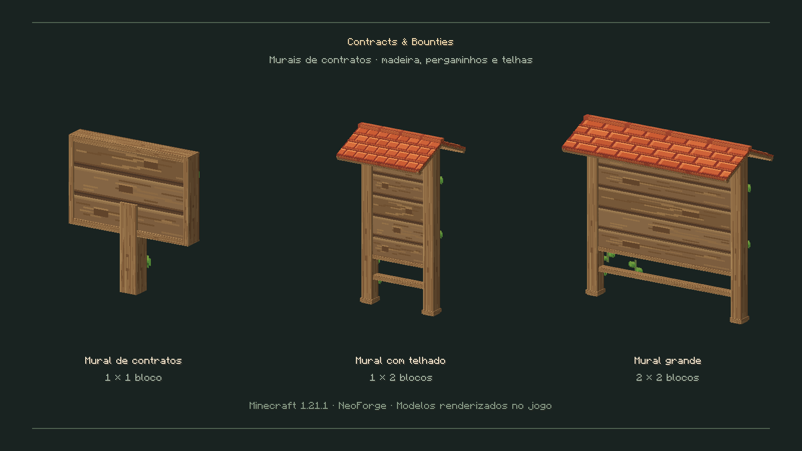

# Contracts & Bounties — 0.2.0

Mod de contratos de materiais para Minecraft **1.21.1**, **NeoForge 21.1.256** e **Java 21**. Deve estar instalado no cliente e no servidor.

**Estado desta entrega:** três murais 3D com texturas originais de madeira, pergaminhos, telhas e hera. Compilação, 23 testes unitários, 25 testes de servidor e validação dos modelos num cliente Minecraft real aprovados. A integração com o Crónicas RP ainda precisa de validação com esse mod instalado. Ver [VALIDACAO.md](VALIDACAO.md).

[Descarregar o JAR 0.2.0](https://github.com/ROCKABITS/Mods/raw/refs/heads/main/mod-pronto/contracts-bounties-0.2.0.jar) ou [descarregar o ZIP](https://github.com/ROCKABITS/Mods/raw/refs/heads/main/mod-pronto/contracts-bounties-0.2.0.zip). Ficheiros, checksums e identificação da compilação estão em `mod-pronto`.



Um jogador publica um pedido, reserva a recompensa e recebe os materiais quando outro jogador faz a entrega. A interface usa um mural de madeira e pergaminho. As decisões sobre inventários e pagamentos são tomadas no servidor.

## Instalar e abrir

1. Colocar o JAR de `build/libs/` na pasta `mods` do cliente e do servidor.
2. Para usar dinheiro, instalar também **Crónicas RP 0.5.2** nos dois lados. Sem esse mod, as recompensas usam esmeraldas.
3. Abrir o mural com o botão direito ou usar `/contracts`.

No criativo, os três murais aparecem na aba **Contracts & Bounties** e na pesquisa. Para atualizar, fechar o jogo/servidor e substituir o JAR antigo pelo novo, mantendo apenas uma versão instalada.

| Mural | Identificador | Espaço ocupado (largura × altura) |
| --- | --- | --- |
| Pequeno, num poste | `contracts:contract_board` | 1 × 1 bloco |
| Alto, com telhado | `contracts:tall_contract_board` | 1 × 2 blocos |
| Grande, com telhado | `contracts:wide_contract_board` | 2 × 2 blocos |

Os murais cobertos precisam de chão firme e espaço livre para a estrutura completa. Rodam conforme a direção de colocação. Todas as partes abrem o mesmo mural de contratos; partir qualquer secção remove a estrutura inteira e devolve um único item em sobrevivência. O mural pequeno mantém o identificador antigo, pelo que os blocos já colocados passam a ter o novo aspeto sem criar partes adicionais à sua volta.

O mural tem o identificador `contracts:contract_board`. A receita usa **3 papéis na linha superior e 6 tábuas de carvalho nas duas linhas inferiores**:

```text
P P P    P = papel
T T T    T = tábuas de carvalho
T T T
```

O mural coberto usa 3 lajes de tijolos na linha superior, papel–mural pequeno–papel na linha central e um tronco de carvalho em cada canto inferior. Dois murais cobertos lado a lado dão um mural grande.

Um operador pode usar `/contracts board` para obter o mural pequeno ou `/contracts boards` para receber os três modelos.

## Usar os contratos

- Publicar um pedido de um item pelo seu identificador, quantidade e recompensa. A recompensa é retirada no momento da publicação e fica reservada.
- Outro jogador entrega a quantidade completa a partir do seu inventário. O autor não pode concluir o próprio contrato.
- Depois da entrega, a recompensa fica disponível para o trabalhador levantar e o autor pode recolher os materiais no mural. Créditos e materiais pendentes permanecem guardados até serem recolhidos.
- O autor pode cancelar um contrato ainda aberto para recuperar a recompensa reservada.

Os pedidos aceitam itens comuns, identificados por ID, como `minecraft:oak_log`. Não aceitam objetos personalizados com nome, encantamentos ou outros dados específicos. Não há entregas parciais.

São usados apenas os 36 espaços do inventário principal, sem consumir a mão secundária ou equipamento. Se uma recolha não couber por inteiro, o restante fica guardado. Cada autor pode ter até 16 contratos abertos; a quantidade por contrato vai de 1 a 4096. O arquivo mantém até 2048 contratos e substitui o histórico mais antigo já concluído/cancelado quando necessário, preservando os créditos e entregas pendentes.

Na integração com Crónicas RP, os montantes têm duas casas decimais e são guardados em cêntimos. Com esmeraldas, a recompensa é um número inteiro de esmeraldas. Os créditos de jogadores offline ficam guardados neste mod para recolha quando voltarem a entrar; o mod não altera os ficheiros offline do Crónicas RP.

Esta versão não inclui expiração, recompensas por mortes, tesouraria, contratos de grupo ou integração política com Realm Council.

## Compilar e testar

Com o JDK 21 disponível:

```bash
./gradlew build
```

O JAR do mod é gerado em `build/libs/`. Para executar os testes de servidor:

```bash
./gradlew -PcontractGameTests runGameTestServer
```

Os testes da lógica de contratos também podem correr sem descarregar o Minecraft:

```bash
python3 tools/test_domain.py
```

Neste ambiente cloud, o JDK e a configuração segura do proxy são preparados por:

```bash
python3 tools/bootstrap_cloud.py
python3 tools/cloud_gradle.py build --console=plain
python3 tools/cloud_gradle.py -PcontractGameTests runGameTestServer --console=plain
```

Para testar a integração real, colocar o JAR fornecido do Crónicas RP e as suas dependências Origins/Jupiter compatíveis em `compat-libs/` e acrescentar `-PcontractsCompat` ao comando de GameTests. Esses ficheiros não são incluídos nem redistribuídos neste projeto.

Para desenvolvimento, os ambientes habituais do NeoForge estão disponíveis por `./gradlew runClient` e `./gradlew runServer`. A primeira execução do servidor requer aceitar o EULA do Minecraft em `run/eula.txt`.

Os modelos foram carregados e fotografados num cliente Minecraft automático. Para testar a utilização com vários jogadores num mundo de teste: publicar, entregar, recolher, cancelar e reiniciar o servidor com entregas pendentes. Repetir com esmeraldas e, separadamente, com Crónicas RP instalado.

Os dados são guardados em `data/contracts_ledger.dat` do mundo, pelos salvamentos normais do Minecraft. Não há transação atómica de disco entre esse ficheiro e os dados de jogador; uma interrupção abrupta durante a gravação exige verificar os backups do mundo. Um arquivo de contratos ilegível bloqueia o carregamento dos contratos, em vez de ser substituído silenciosamente por um arquivo vazio.

## Recursos

Os modelos e as texturas são originais, inspirados no conceito visual fornecido pelo utilizador. A geometria usa modelos JSON nativos, sem dependências de animação ou renderizadores próprios.

`tools/generate_board_assets.py` reproduz os recursos. `tools/render_board_preview.py` produz uma pré-visualização externa dos modelos; estas ferramentas opcionais usam Pillow e NumPy. Para a captura real do Minecraft, executar `./gradlew -PboardVisualTests runClient` com um ambiente gráfico; o cliente de teste fecha automaticamente e escreve o resultado em `qa-results/boards-client/`.
