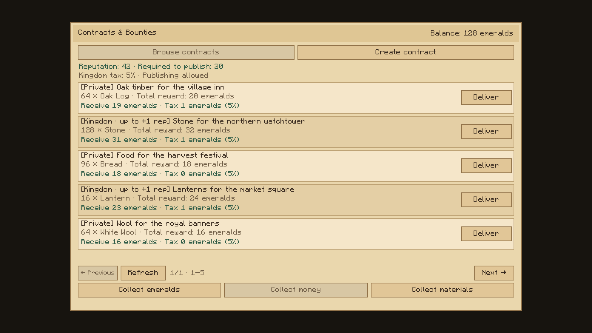
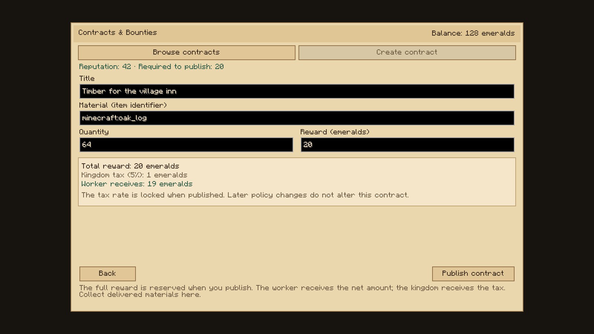
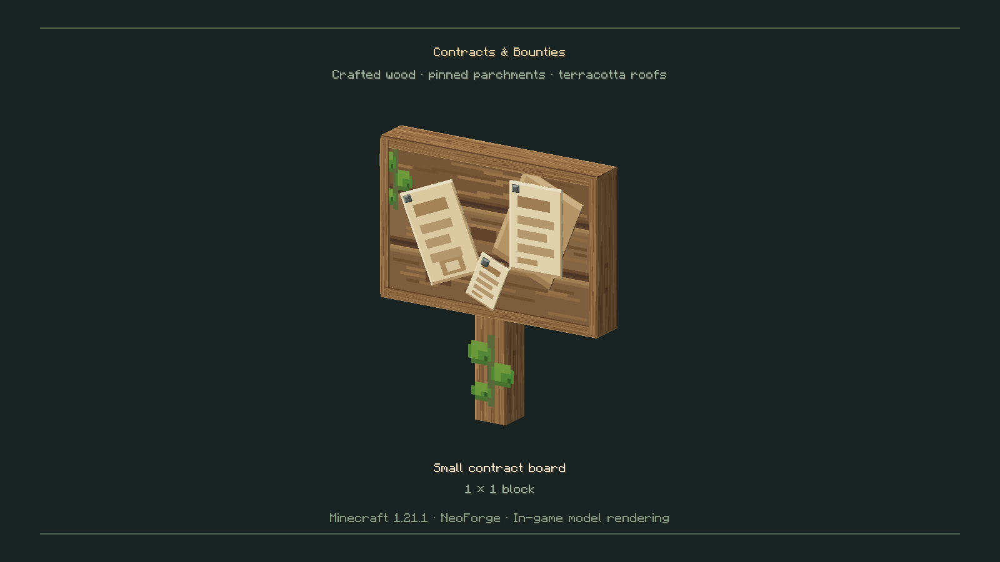
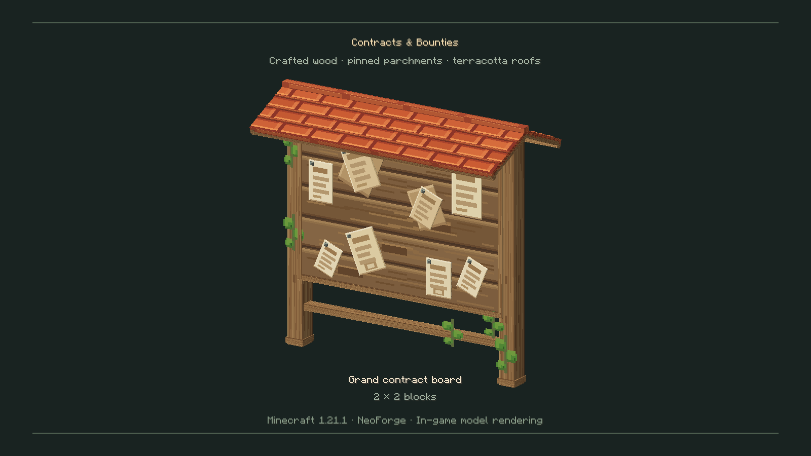

# Mod galleries

**Laws & Justice 0.3.0 Beta — publicação aprovada:** [Seleção visual](laws-justice/README.md) · [Download dos 37 PNGs](laws-justice/0.3.0/laws-justice-0.3.0-media.zip). Capturas reais de prisões, tribunal, mandados, sete blocos de trabalho e seis tarefas completas com produção temporizada e entregas seladas. A prisão e as regras de uma unidade por tarefa são demonstrações; não são geradas construções ou recursos. Multas e fianças seguem na fase 0.4.

**Realm Casino 0.2.0 Beta:** [Seleção visual](realm-casino/README.md) · [Download dos 31 PNGs](realm-casino/0.2.0/realm-casino-0.2.0-media.zip). Capturas reais dos seis blocos medievais, slots, roleta, blackjack, Plinko, Roda da Fortuna, Travessia Real e menus de regras e proprietário, com personagens e fundos virtuais de demonstração.

**Realm Titles 0.1.0:** [Seleção visual](realm-titles/README.md) · [Download PNG](realm-titles/0.1.0/realm-titles-0.1.0-media.zip). Capturas reais da Mesa do Selo Real nas quatro direções, registo público, menus do governante e títulos atuais num documento autêntico do Identity; personagens e nomeações de demonstração.

**Realm Rewards:** [Administration screenshots](realm-rewards/0.1.1/README.md) · [Download PNG gallery](realm-rewards/0.1.1/realm-rewards-0.1.1-media.zip). Actual production administration screens rendered by Minecraft, using demonstration advancement data.

**Chronicles RP:** [RP names screenshots](chronicles-rp/0.5.3/README.md) · [Download PNG gallery](chronicles-rp/0.5.3/chronicles-rp-0.5.3-media.zip). Actual Minecraft name tags, TAB, player chat and character profile; gallery characters are demonstration fixtures.

**Realm Markets logo:** [Download PNG](../mod-pronto/realm-markets-icon.png). Original illustrated square project icon for CurseForge; separate from the in-game screenshots.

**Realm Markets:** [Screenshots](realm-markets/0.2.0/README.md) · [Download PNG gallery](realm-markets/0.2.0/realm-markets-0.2.0-media.zip). Actual Minecraft stall models and production owner/buyer screens; interface stock and balances are demonstration data.

**Realm Identity logo:** [Download PNG](../mod-pronto/realm-identity-icon.png). Original illustrated square project icon for CurseForge; separate from the in-game screenshots.

**Realm Identity:** [Screenshots](realm-identity/0.1.0/README.md) · [Download PNG gallery](realm-identity/0.1.0/realm-identity-0.1.0-media.zip). Actual Minecraft writing desk, document and interface; sample identities and drawing are demonstration data.

**Crown Ledger logo:** [Download PNG](../mod-pronto/crown-ledger-icon.png). Original illustrated square project icon for CurseForge; separate from the in-game screenshots.

**Crown Ledger:** [Screenshots](crown-ledger/0.2.0/README.md) · [Download PNG gallery](crown-ledger/0.2.0/crown-ledger-0.2.0-media.zip). Actual Minecraft chest and menus; menu balances are demonstration data.

## Contracts & Bounties

[Open the 0.3.1 gallery](0.3.1/README.md) · [Download all six PNG images](0.3.1/contracts-bounties-media-0.3.1.zip)

Extract the ZIP and upload the PNG files individually to CurseForge's Media gallery. Suggested English titles and captions are included in the gallery README.

The images are real Minecraft client captures of the mod's models and interface. The contract menu uses demonstration contracts and policy data. Tax and publication reputation rules use the separate Crown Ledger integration; standalone defaults are zero tax and no reputation threshold. The board showcase screen is development-only and is excluded from the downloadable mod.

[Project icon (PNG)](../mod-pronto/contracts-bounties-icon.png)

## Three medieval noticeboards

## Browse material contracts

## Create a material contract

## Small noticeboard

## Roofed noticeboard

## Wide noticeboard

## Realm Notifications

[Galeria 0.1.0](realm-notifications/0.1.0/README.md): HUD real dentro do mundo, posição central, preferências e diário. O conteúdo dos avisos nas imagens é demonstrativo; as capturas usam o cliente Minecraft e o transporte S2C reais.
