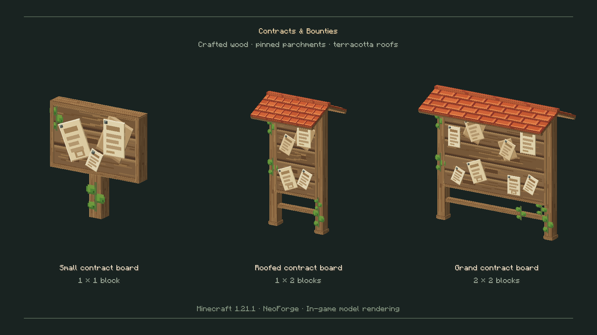
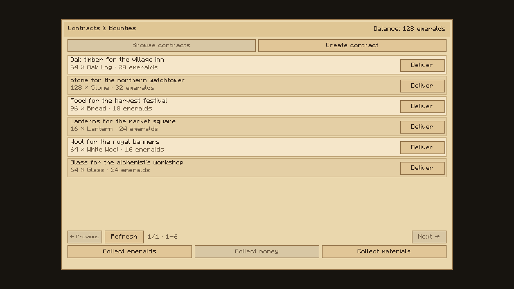
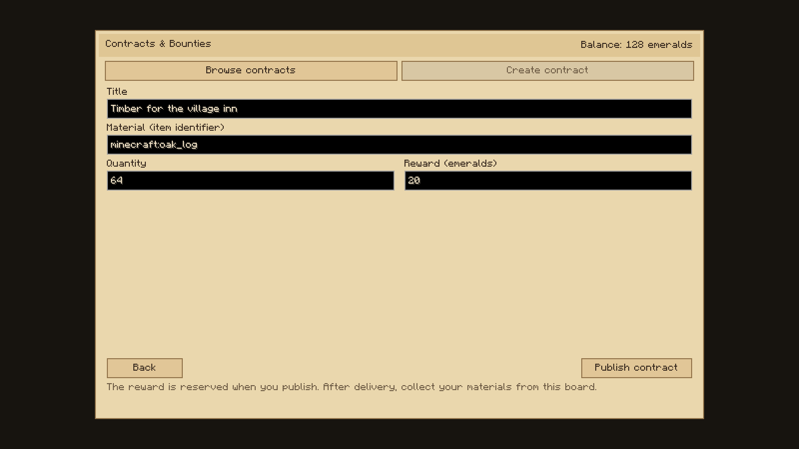
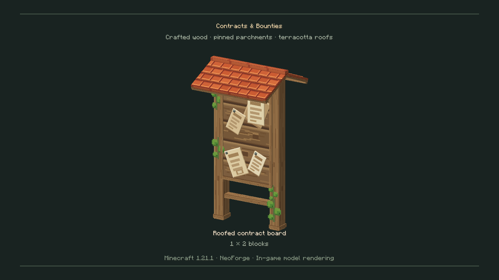

# Contracts & Bounties — media

[Open the 0.2.0 gallery](0.2.0/README.md) · [Download all six PNG images](0.2.0/contracts-bounties-media-0.2.0.zip)

Extract the ZIP and upload the PNG files individually to CurseForge's Media gallery. Suggested English titles and captions are included in the gallery README.

The images are real Minecraft client captures of the mod's models and interface. The contract menu uses demonstration data. The board showcase screen is development-only and is excluded from the downloadable mod.

[Project icon (PNG)](../mod-pronto/contracts-bounties-icon.png)

## Three medieval noticeboards

## Browse material contracts

## Create a material contract

## Small noticeboard

## Roofed noticeboard

## Wide noticeboard

