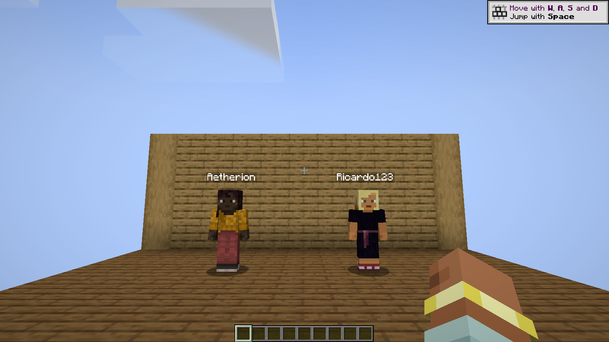
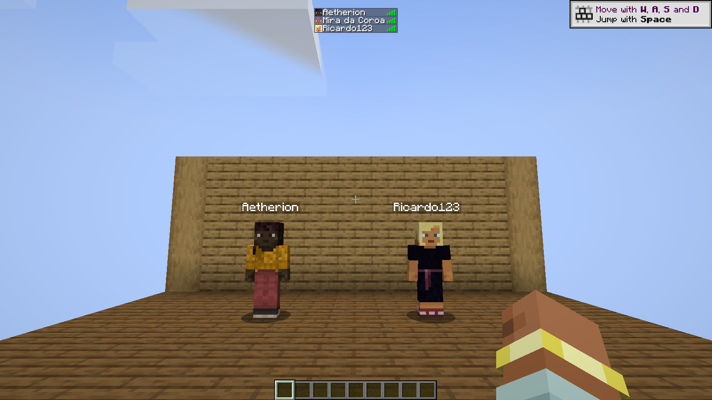
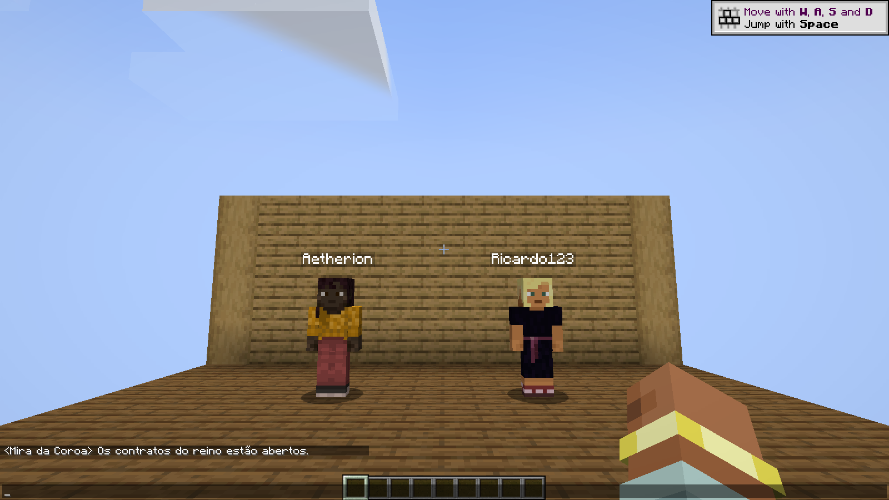
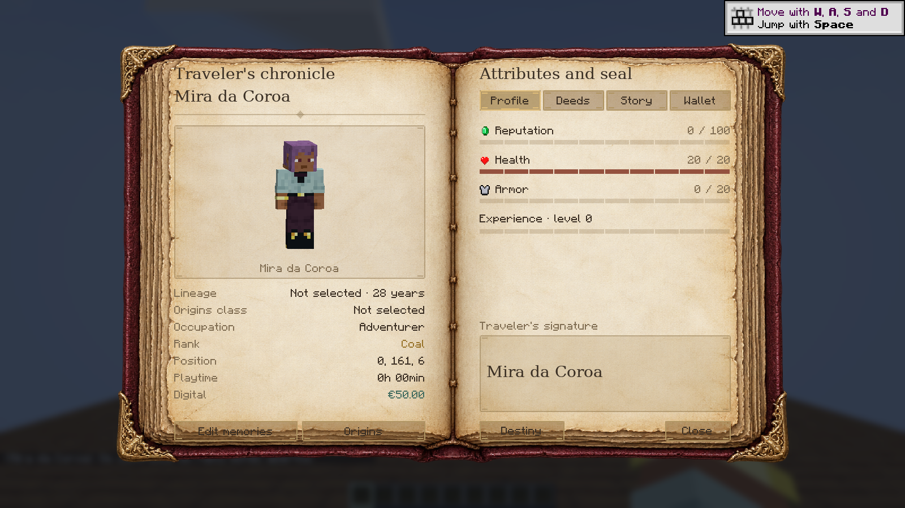

# Chronicles RP — RP names

Actual Minecraft 1.21.1 NeoForge screenshots, captured with real Origins, Jupiter and Origins: Classes plus the released roleplay companion mods. Demonstration characters are used for the gallery.

[Download all four PNGs](chronicles-rp-0.5.3-media.zip).

RP names above characters. Aetherion has a character; Ricardo123 demonstrates the username fallback without a character.

RP names in the vanilla player list.

Normal player chat decorated with the RP name.

Character profile used in the demonstration; the identity below the portrait also uses the RP name. Gallery values are demonstration data.

The underlying Minecraft account names and UUIDs remain unchanged. Other mods can implement their own player-name interfaces.
