# Contracts & Bounties 0.4.0

Actual Minecraft 1.21.1 / NeoForge 21.1.256 client, integrated server opened to LAN, Chronicles wallet and Crown treasury. Quest quantities and scene are controlled test fixtures; all menus, progress events, payments and celebrations are real. The test closes/reopens the world. A second authenticated client was not tested.

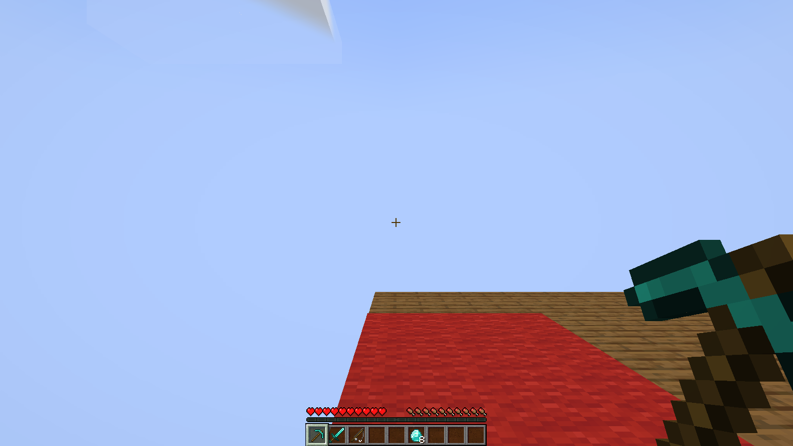

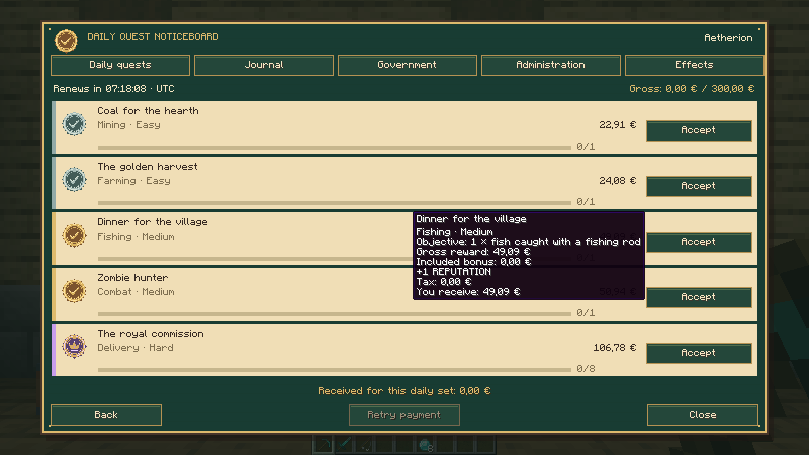

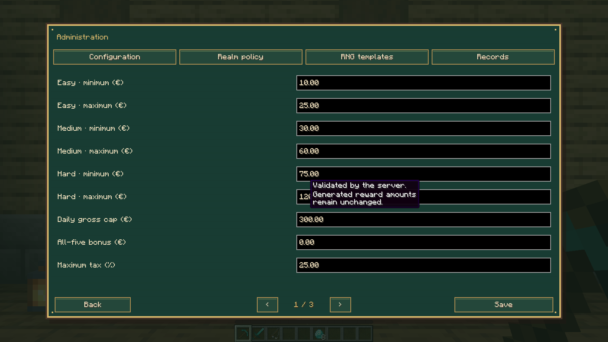

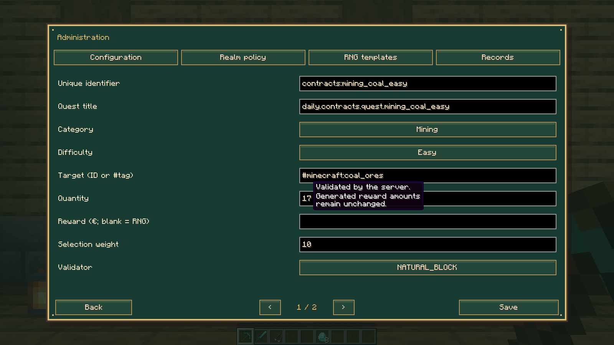

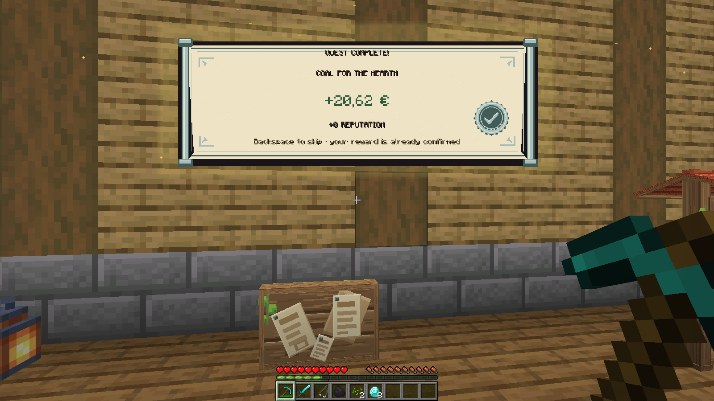

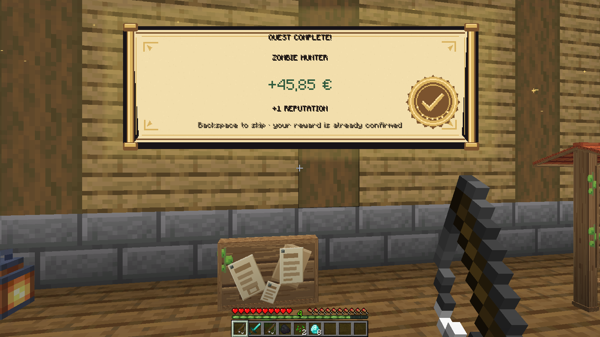

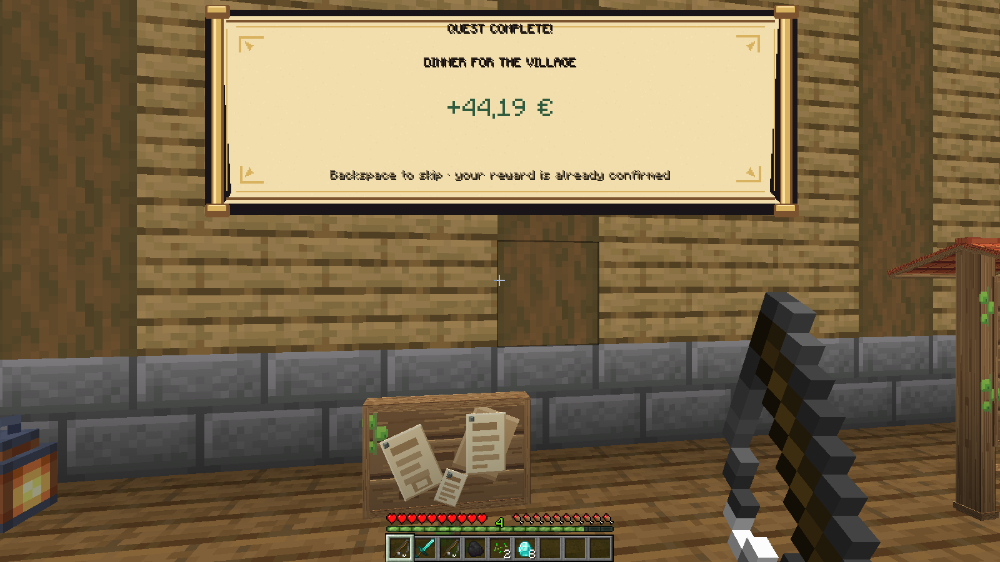

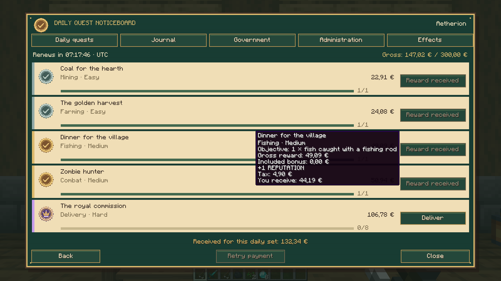

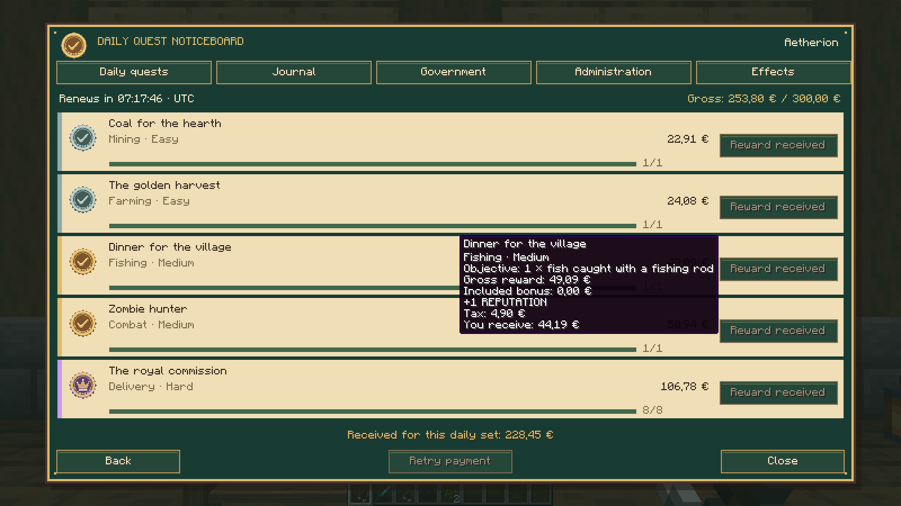

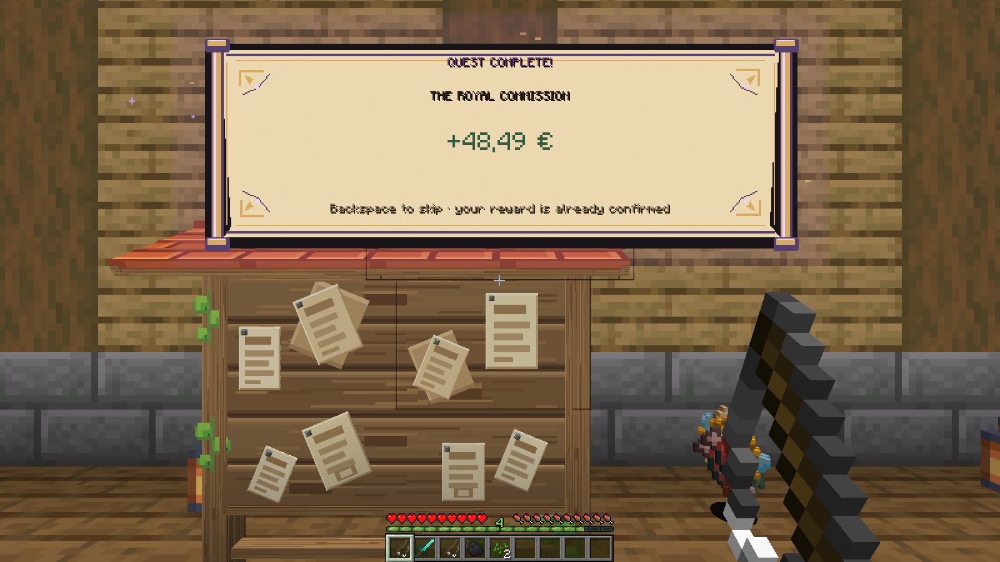

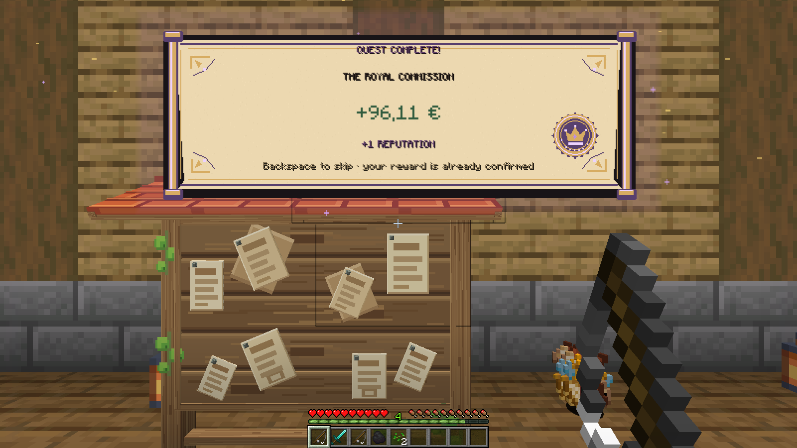

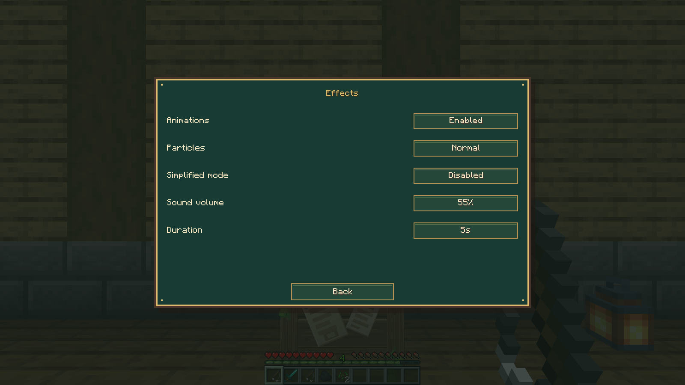

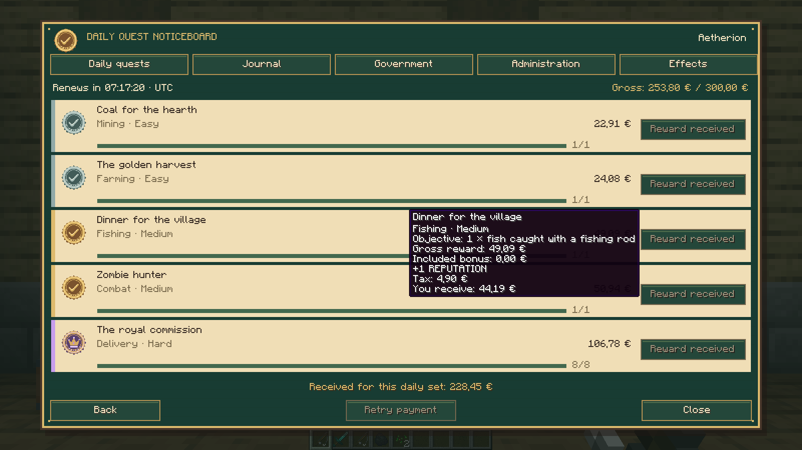

