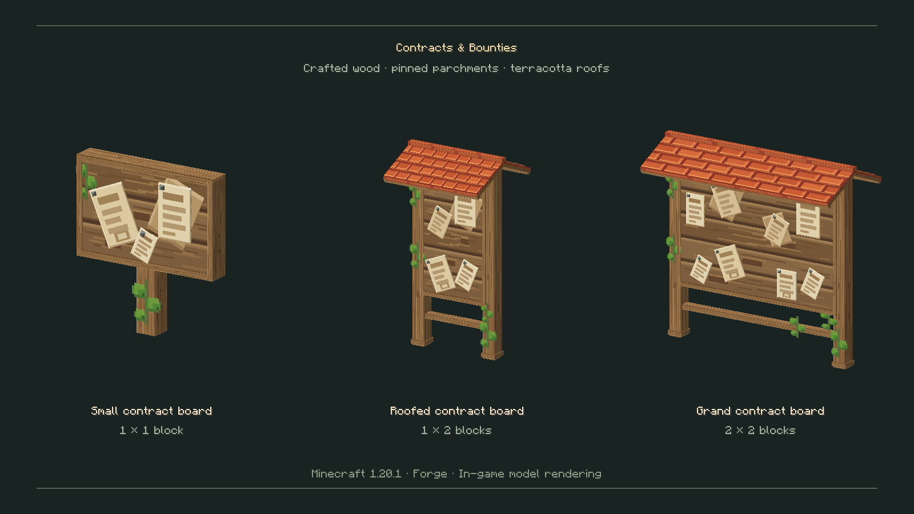
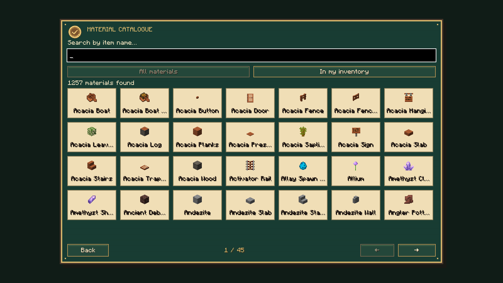
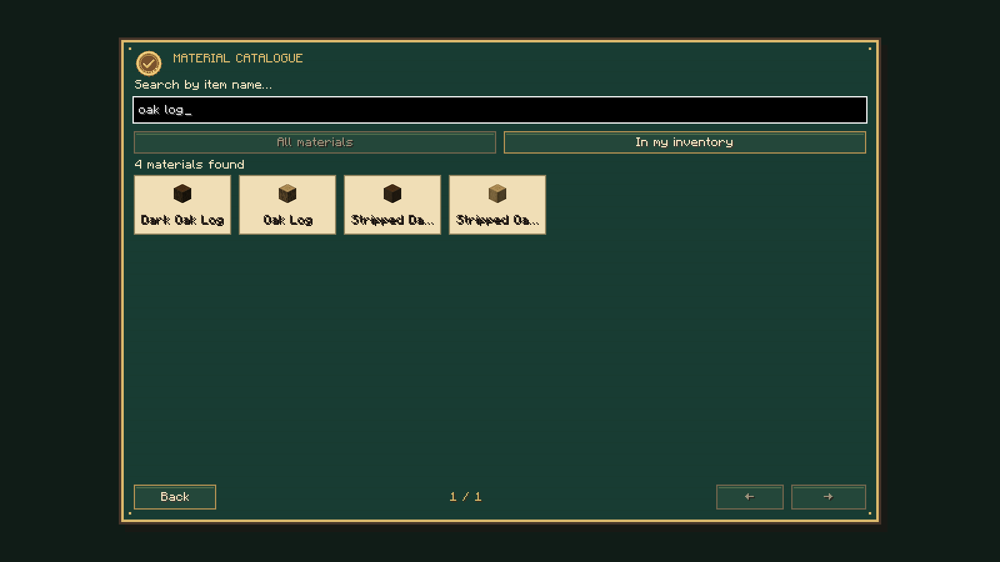
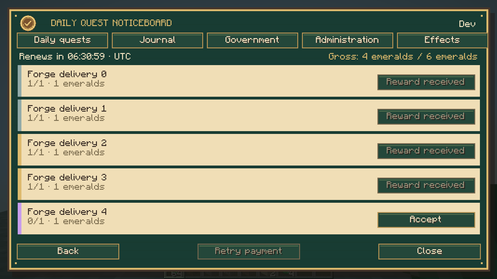
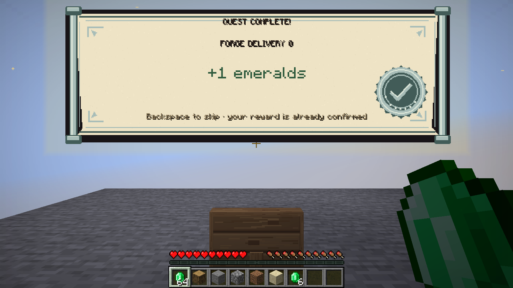

# Contracts & Bounties — Forge 1.20.1

Capturas do cliente Minecraft 1.20.1 com Forge 47.4.0 e Java 17. [Validacao CI](https://github.com/ROCKABITS/Mods/actions/runs/43268814554).

As onze capturas dos quadros e contratos usam dados de apresentacao para testar modelos, traducoes, selecao e dimensoes da interface. As duas capturas das missoes usam um jogador e servidor integrado reais, com quantidades/recompensas de teste controladas. Os relatórios `visual-result.json` e `integration-result.json` registam o respetivo alcance.
