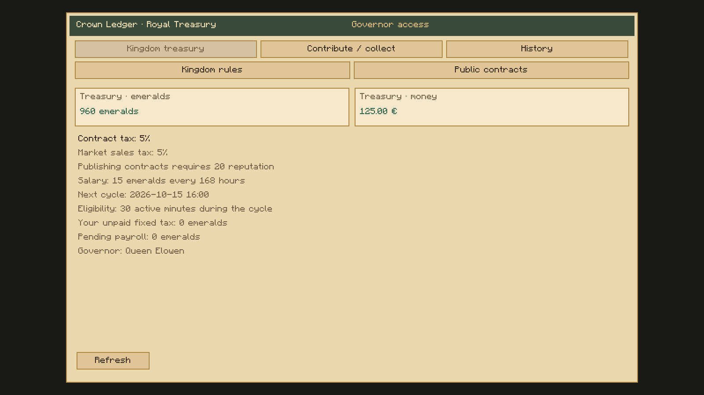

# Crown Ledger — Minecraft screenshots

These images were captured from the actual Minecraft 1.21.1 NeoForge client. The chest uses the packaged model and textures. Menu screenshots use demonstration balances and policy values, rather than a live player economy.

[Download all three PNGs](crown-ledger-0.2.0-media.zip).

Original crown chest model rendered by Minecraft.

Public treasury overview with demonstration values and the market sales-tax rate.

Governor policy screen, including the independent market sales-tax rate.

All images may be used for the ROCKABITS Crown Ledger project gallery.
