# Laws & Justice 0.3.0 Beta

**Publicação testada e aprovada.** [Resultados e limites da validação](../../laws-justice/VALIDACAO-0.3.0.md).

Prisões construídas pelos jogadores, celas, penas online e libertação automática em Minecraft 1.21.1/NeoForge. Esta seleção usa capturas do cliente Minecraft real, com uma prisão e personagem de demonstração preparadas apenas para teste. O mod não gera esta construção.

[Guia de instalação e utilização](../../laws-justice/README.md) · [Plano completo por versões](../../laws-justice/PLANO-COMPLETO.md) · [Galeria completa e relatório](0.3.0/README.md) · [Download dos 37 PNGs](0.3.0/laws-justice-0.3.0-media.zip).

## Oficinas e postos de trabalho

Sete blocos originais com madeira, ferro, tecidos verdes, pergaminhos, caixotes, ferramentas e materiais de demonstração. As tarefas são validadas no servidor e as entregas reduzem a pena dentro do limite configurado.

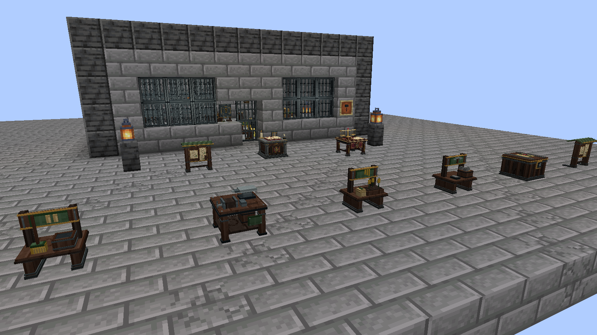

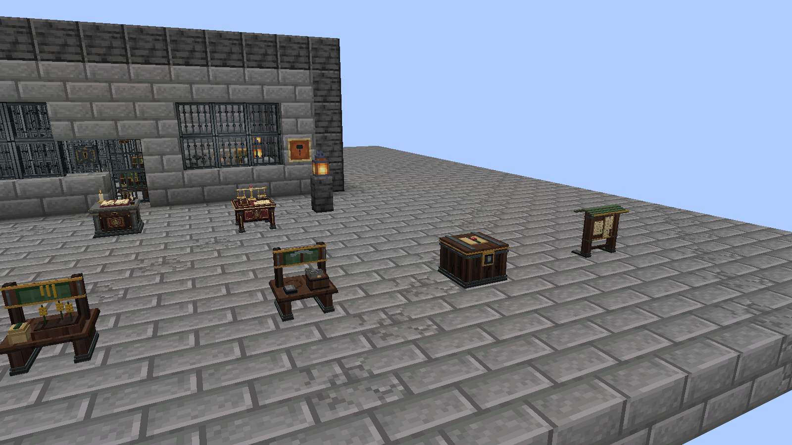

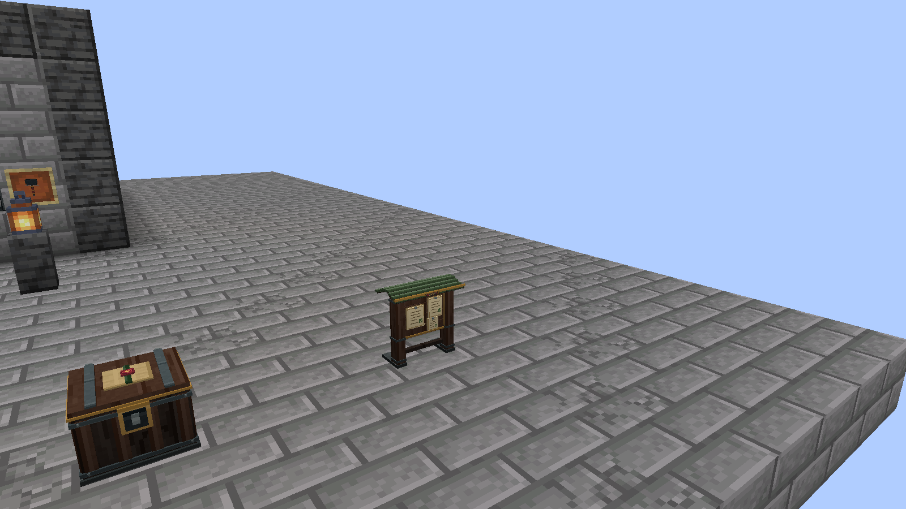

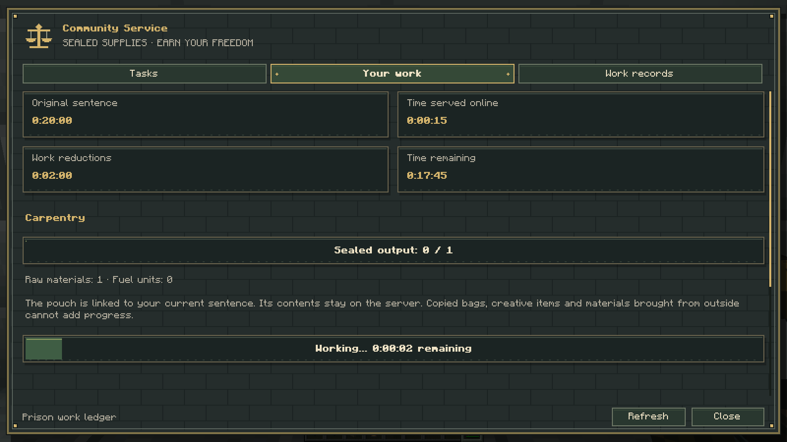

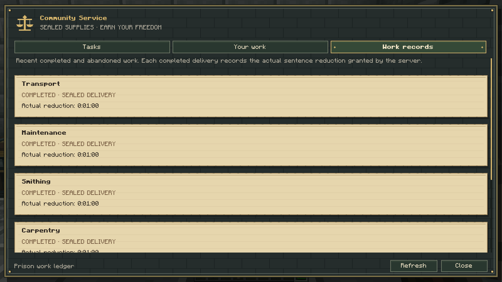

As regras das imagens foram configuradas para uma unidade e um minuto de recompensa por tarefa. As quantidades e recompensas padrão são superiores e estão no guia. Nenhum contador de progresso ou snapshot S2C foi injetado.

## Mesa de Justiça e tribunal

Madeira escura, ferro, pormenores dourados, balança, malhete e livro com selo. O Presidente utiliza os menus físicos; os mandados são pergaminhos validados pelo servidor.

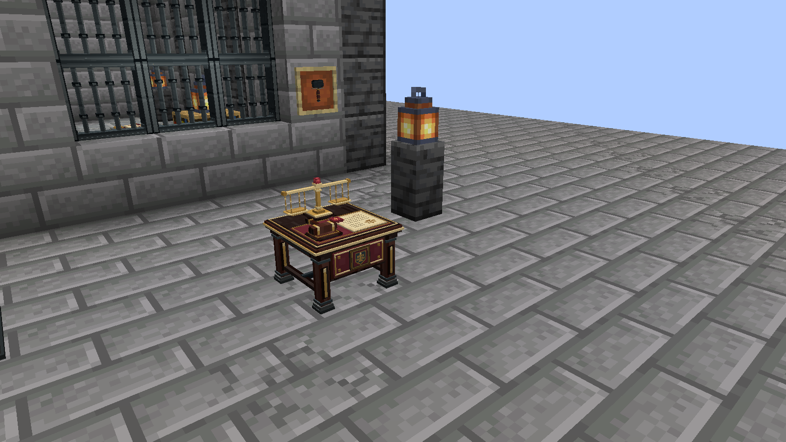

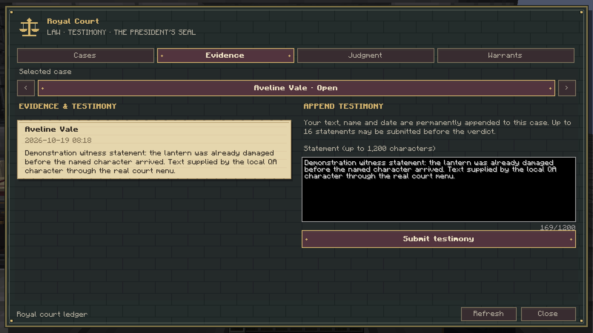

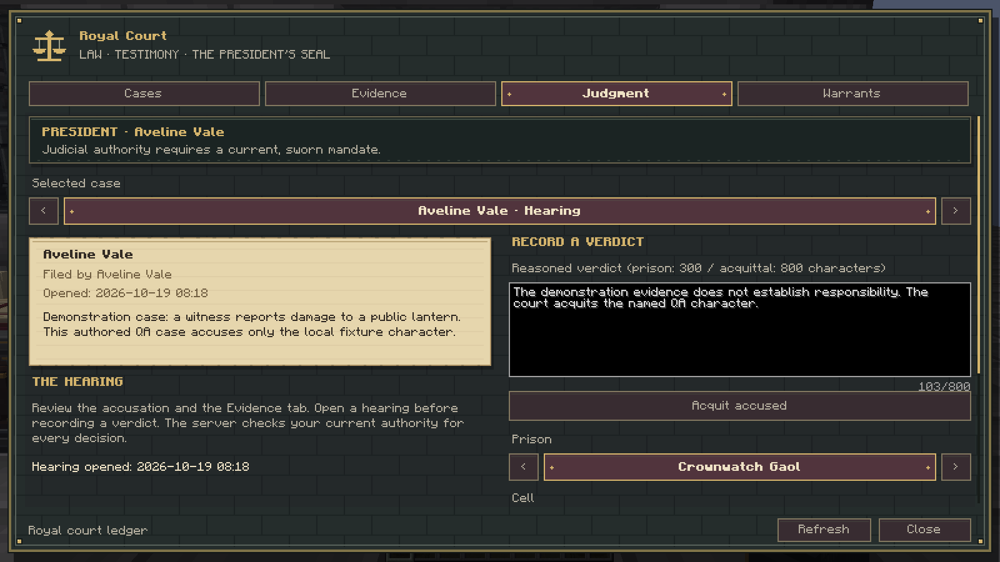

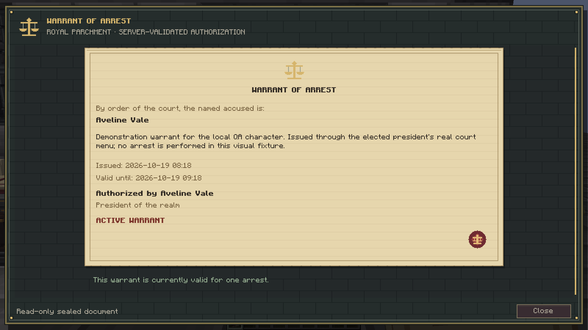

## Livro de controlo da prisão

Gabinete de pedra e madeira, livro aberto com selo de cera, chaves de ferro, vela e tinteiro. O bloco abre a administração física e a consulta da própria pena. A primeira versão inclui **quatro blocos e uma ferramenta**, o Agrimensor Prisional.

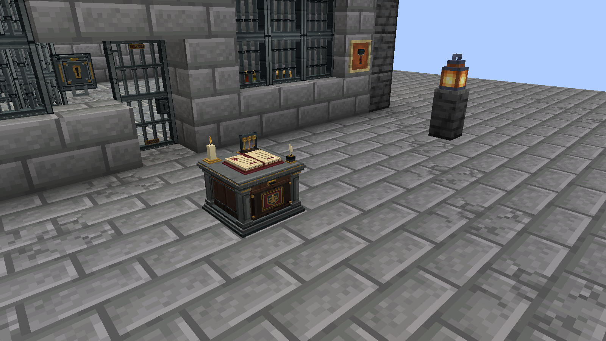

## Porta, grades e fechadura

Ferro trabalhado, dobradiças e rebites em modelos 3D próprios. A porta tem duas metades; as grades mantêm aberturas reais. A Fechadura Reforçada funciona como acesso auxiliar ao livro de controlo nesta versão.

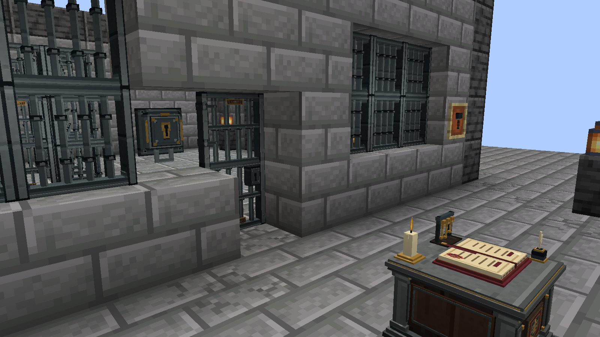

## Registar prisões e celas

O administrador seleciona os cantos no mundo e utiliza os menus para registar a prisão, marcar a saída segura e configurar as celas e os seus pontos de chegada. Os edifícios continuam a ser construídos pelos jogadores.

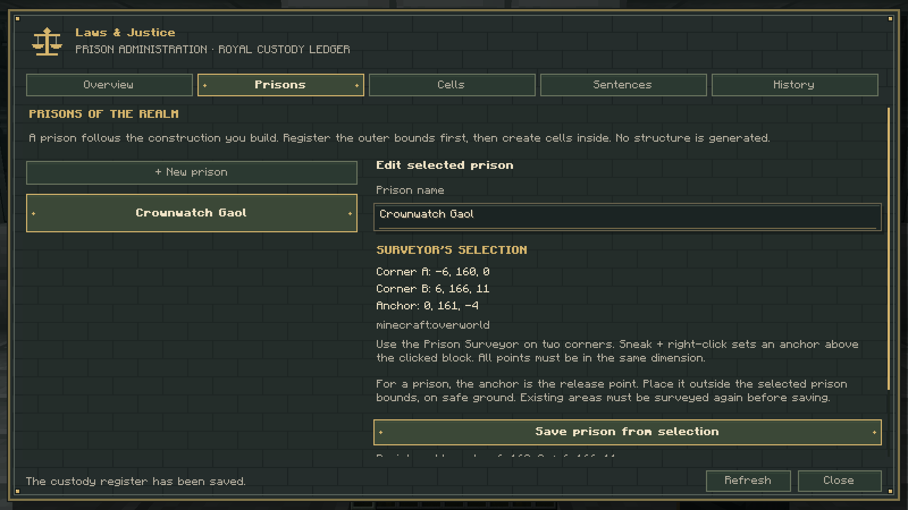

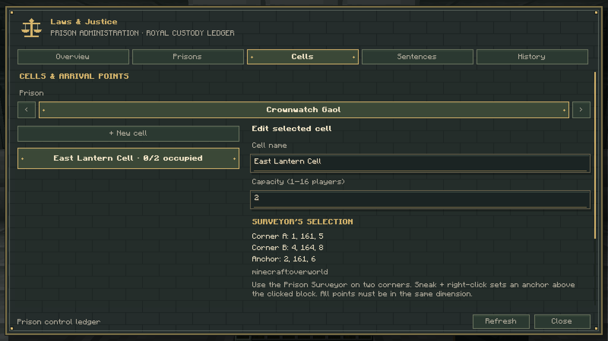

## Acompanhar a própria pena

O prisioneiro consulta o tempo original, o tempo cumprido online e o restante. Pode circular pela área da prisão; o servidor mantém a detenção após tentativas de saída e após morte. As reduções de pena ainda não estão disponíveis nesta fase.

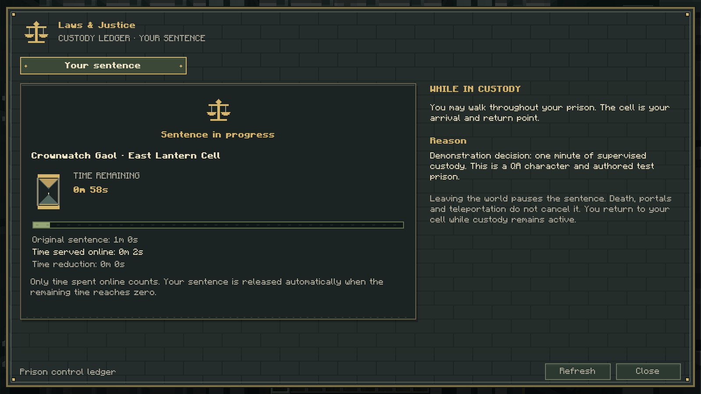

## Persistência do mundo

A demonstração acompanha a mesma pena num mundo integrado/LAN depois de o mundo ser encerrado e novamente carregado. O tempo offline não foi contado para a condenação; a prova inclui a mesma pena após encerrar e reabrir o mundo.

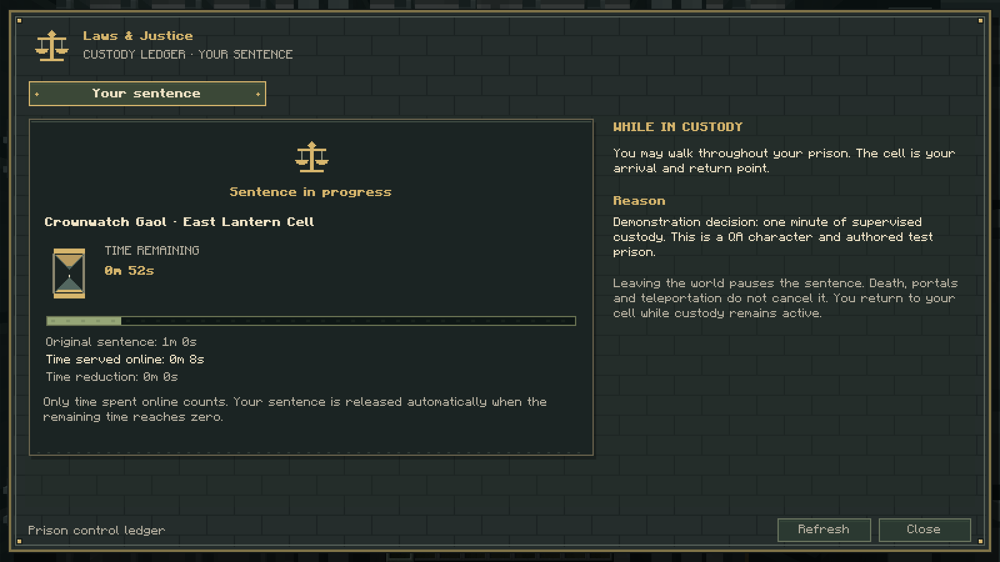

## Cumprimento e libertação

O histórico de custódia regista a aplicação da pena, o seu cumprimento e eventuais libertações administrativas. A imagem destinada a esta secção mostra a consulta depois da libertação automática de uma pena de demonstração.

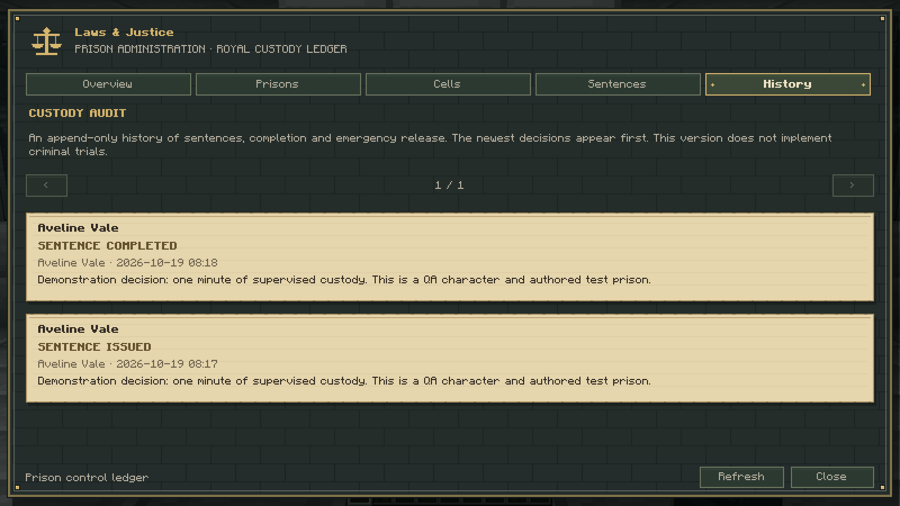

## Ficheiros da galeria

Extrai o ZIP e envia os PNGs individualmente para a secção **Media** do CurseForge. Os títulos abaixo estão em inglês para facilitar a publicação.

| Ficheiro | Título sugerido |
| --- | --- |
| [laws-justice-control-ledger.png](0.3.0/laws-justice-control-ledger.png) | Prison Control — Ledger, Keys and Candle |
| [laws-justice-door-bars-lock.png](0.3.0/laws-justice-door-bars-lock.png) | Medieval Cell Door, Bars and Reinforced Lock |
| [laws-justice-prison-courtyard.png](0.3.0/laws-justice-prison-courtyard.png) | A Player-Built Prison Courtyard |
| [laws-justice-admin-overview.png](0.3.0/laws-justice-admin-overview.png) | Physical Prison Administration |
| [laws-justice-admin-prisons.png](0.3.0/laws-justice-admin-prisons.png) | Register a Prison Area |
| [laws-justice-admin-cells.png](0.3.0/laws-justice-admin-cells.png) | Configure Cells and Arrival Points |
| [laws-justice-admin-sentence-form.png](0.3.0/laws-justice-admin-sentence-form.png) | Administrative Sentence Form |
| [laws-justice-custody-history.png](0.3.0/laws-justice-custody-history.png) | Custody Decision History |
| [laws-justice-prisoner-status.png](0.3.0/laws-justice-prisoner-status.png) | Prisoner Status — Online Time Remaining |
| [laws-justice-prisoner-after-respawn.png](0.3.0/laws-justice-prisoner-after-respawn.png) | The Sentence Continues After Respawning |
| [laws-justice-prisoner-after-world-restart.png](0.3.0/laws-justice-prisoner-after-world-restart.png) | Persistent Custody After Reloading the World |
| [laws-justice-release-courtyard.png](0.3.0/laws-justice-release-courtyard.png) | Automatic Release After Time Served |
| [laws-justice-history-after-release.png](0.3.0/laws-justice-history-after-release.png) | Completed Sentence in the Custody History |

A versão 0.3.0 reserva as decisões a administradores. Presidente como juiz, Mesa de Justiça e mandados estão previstos para a 0.2; trabalhos e zonas para a 0.3; multas, fianças e integrações financeiras para a 0.4. As imagens não apresentam estas fases como funcionalidades já disponíveis.

Esta prova visual usa um cliente com servidor integrado e publicação LAN. Não representa uma sessão autenticada com dois clientes remotos. Os ficheiros do cenário e os auxiliares de teste não acompanham o JAR de produção.

Os sete ficheiros adicionais da 0.2 mostram a Mesa de Justiça, processos, provas, julgamento, mandados, documento selado e o antigo Presidente sem poderes. Consulta a [galeria completa](0.3.0/README.md).
