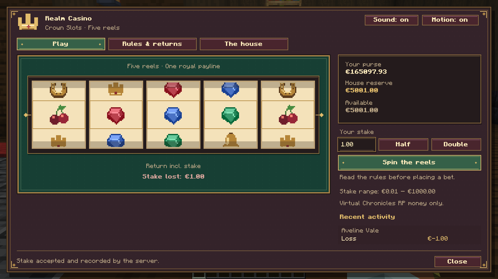
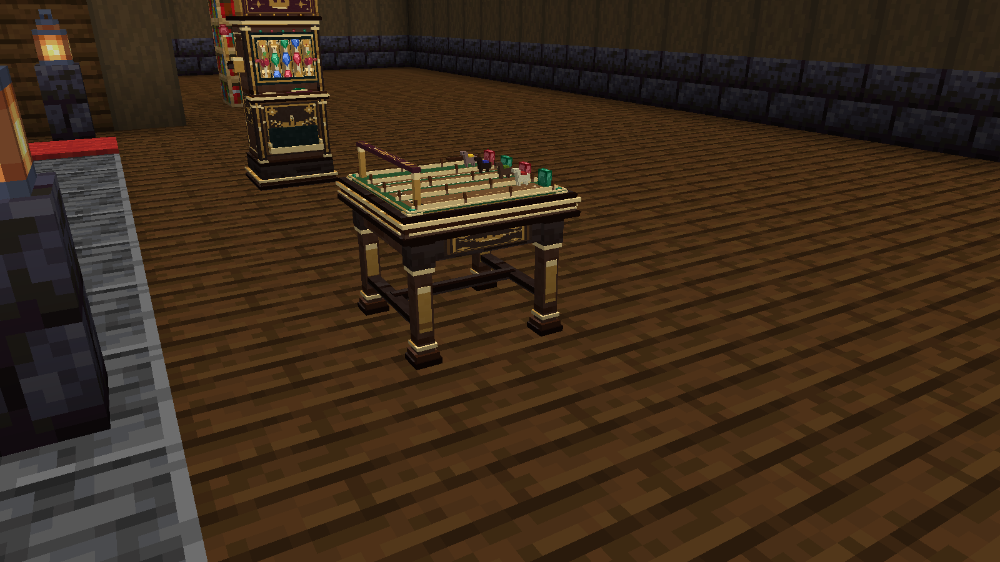
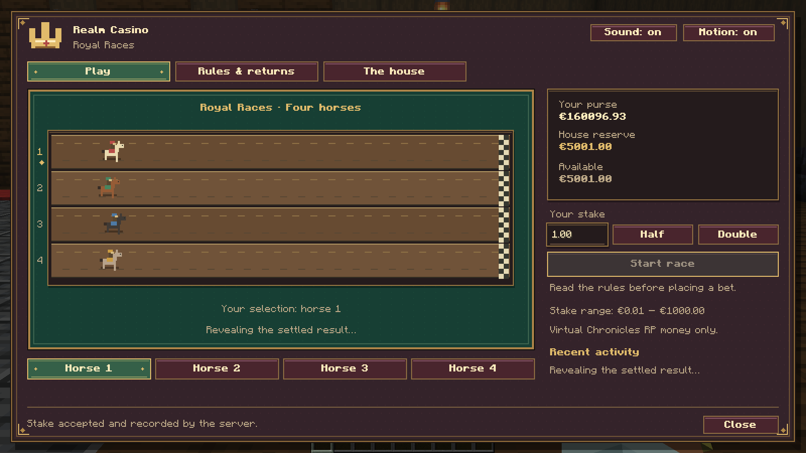
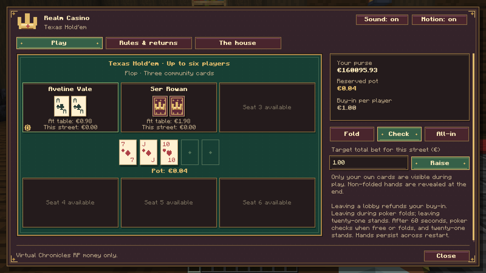
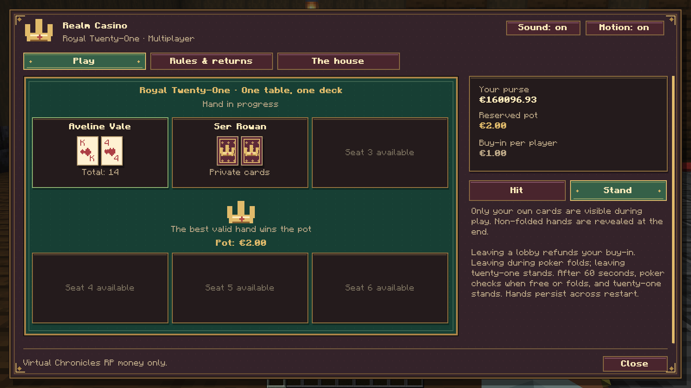
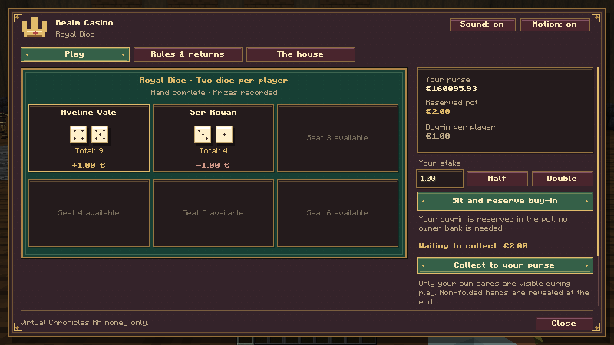
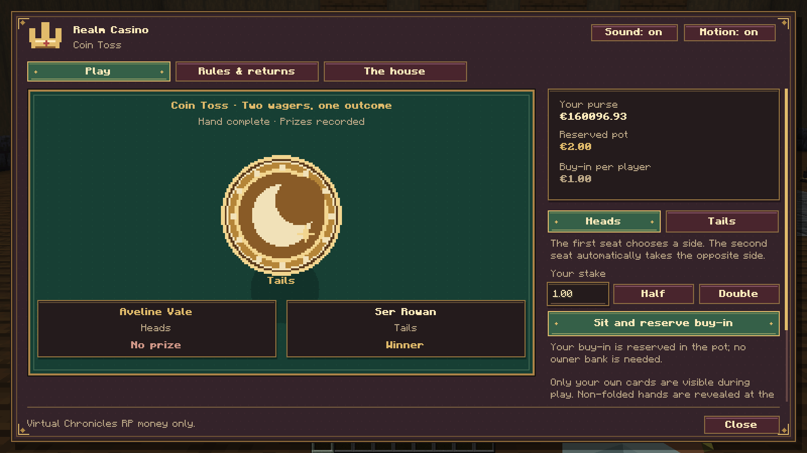

# Realm Casino 0.3.0 — Galeria

Capturas reais do Minecraft 1.21.1/NeoForge, com modelos e menus do mod. Personagens, construção e dinheiro virtual são de demonstração. O servidor escolheu os resultados normalmente, sem substituir o sorteio ou os dados financeiros dos menus. As mesas usam um anfitrião real e uma contraparte de teste do servidor; não são dois clientes autenticados.

[Todos os 63 PNGs](0.3.0/realm-casino-0.3.0-media.zip) · [Galeria completa](0.3.0/README.md) · [Validação](https://github.com/ROCKABITS/Mods/actions/runs/39347074971)

**Mobiliário medieval e mesas do casino**

**Slots de cinco rolos**

**Pista com cavalos em miniatura**

**Corridas Reais**

**Poker com cartas privadas e comunitárias**

**Vinte e um entre jogadores**

**Dados multiplayer**

**Coroa ou lua**

