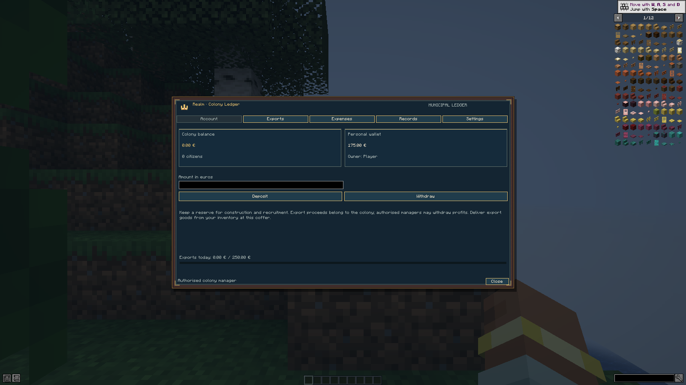

# Realm Economy 0.5.1 — JEI GUI fix

Actual Minecraft 1.21.1, NeoForge 21.1.256 and JEI 19.70.0.469 client captures. Financial values are presentation fixtures; no money was transferred.

[Legacy-bounds reproduction](colony-jei-legacy-reproduction.png) deliberately restores the old 176 × 166 metadata on the current screen to reproduce the overlap. The [regression report](result.json) verifies real JEI bounds for colony, trading and service screens, resizing, and normal vanilla inventory before/after.

[Validation run](https://github.com/ROCKABITS/Mods/actions/runs/43261766964).
