# Realm Fitness 0.2.0 Beta

Capturas do Minecraft 1.21.1 com NeoForge 21.1.256 e Java 21. [Validacao CI](https://github.com/ROCKABITS/Mods/actions/runs/43436980490).

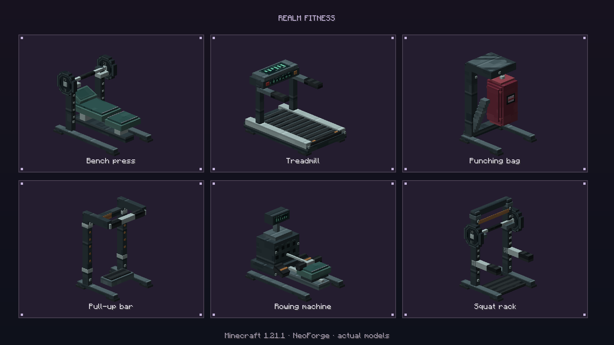
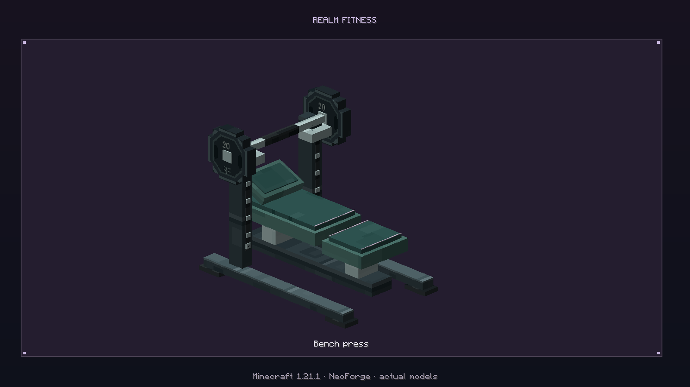
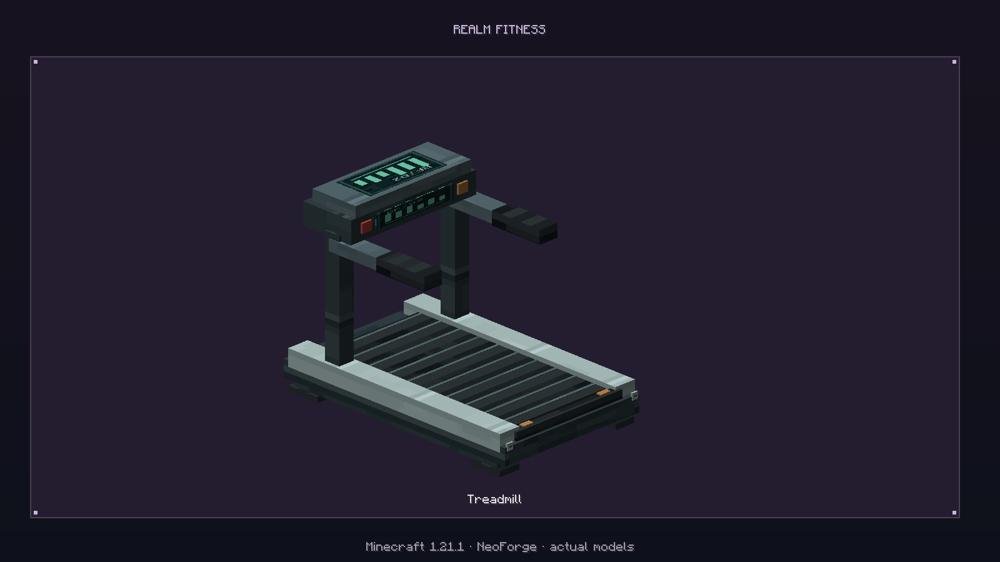
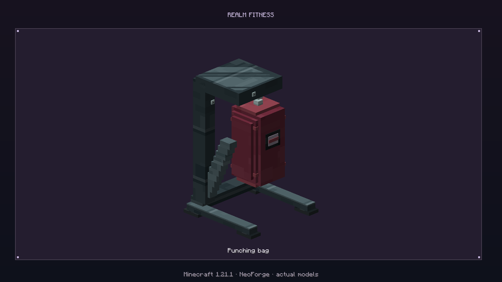
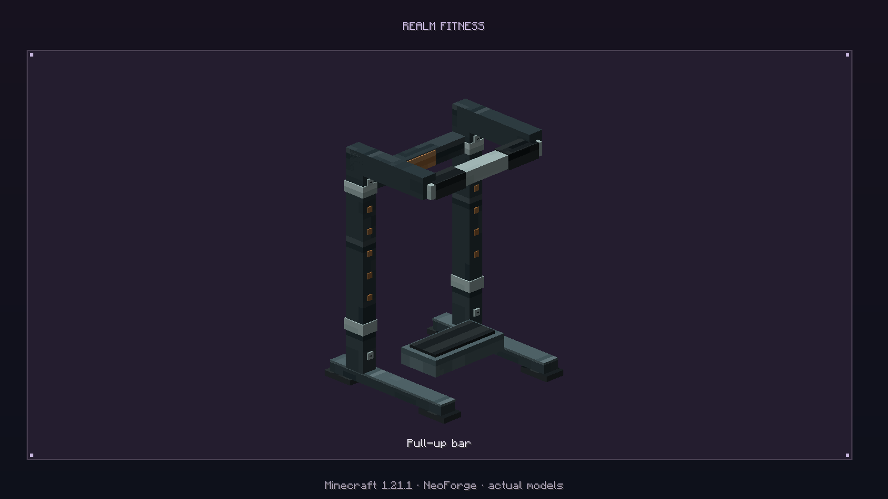
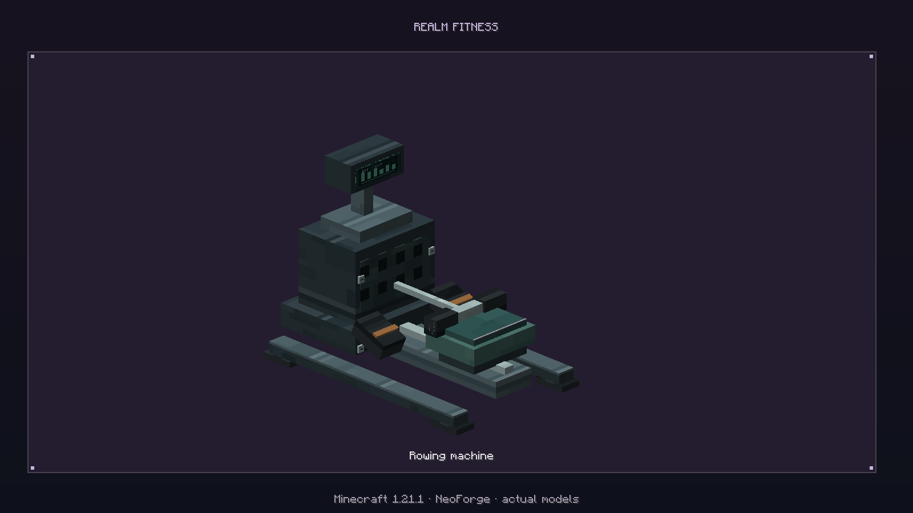
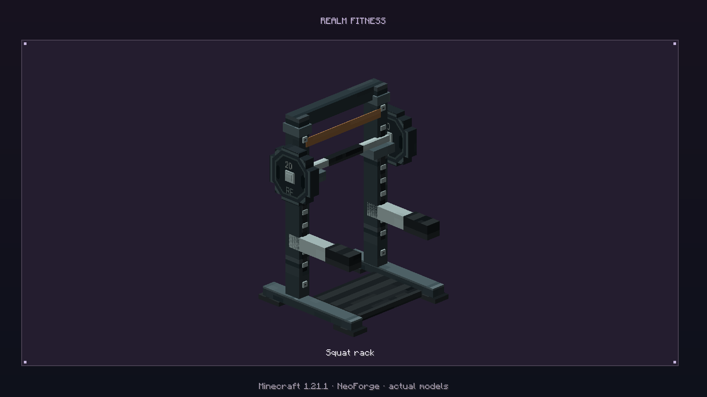
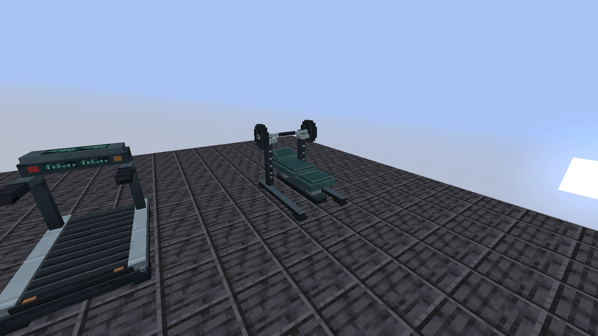
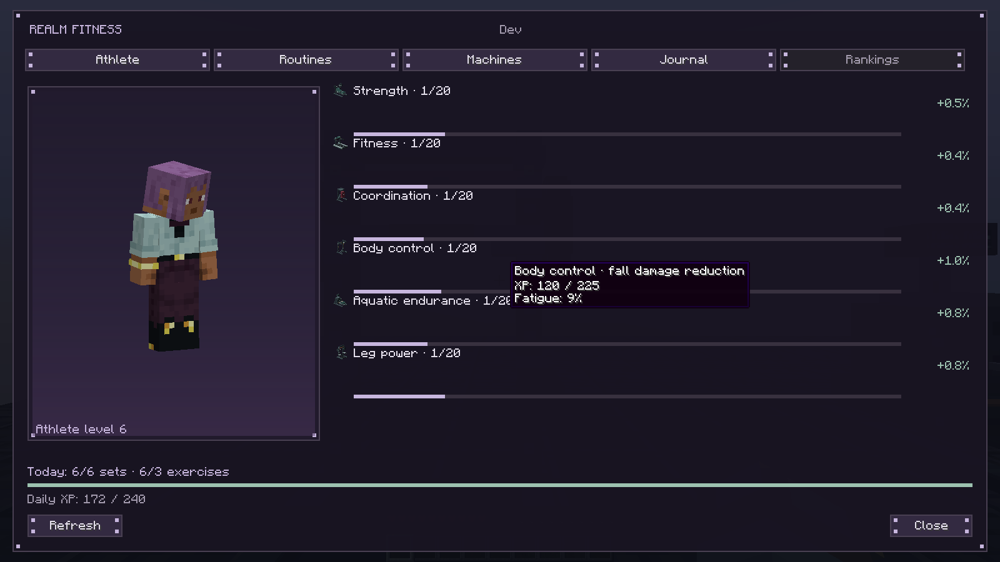
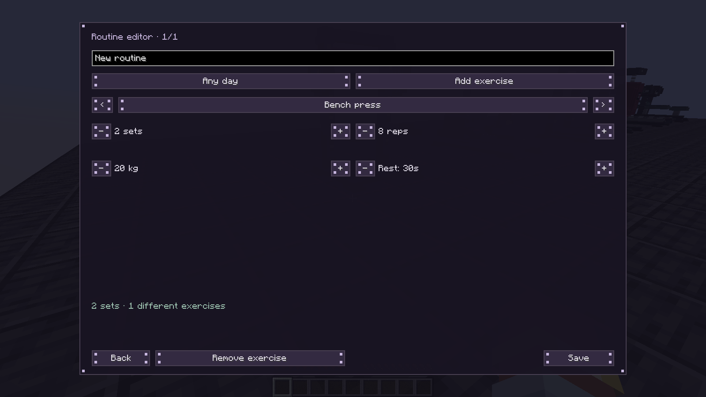
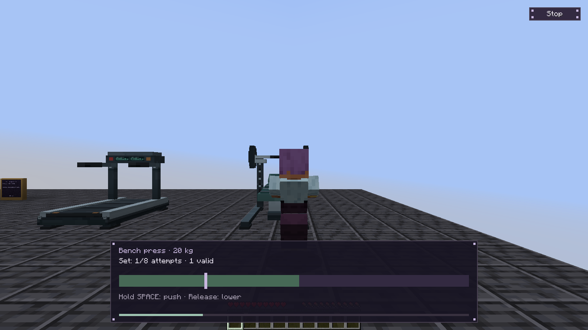
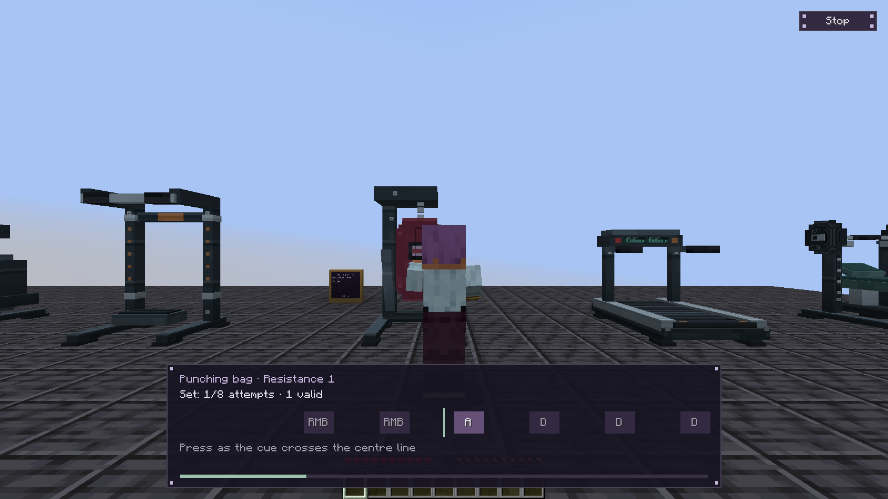
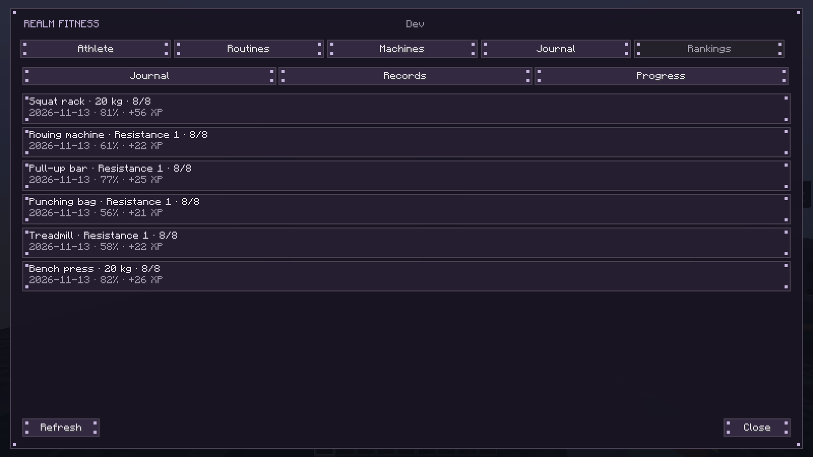
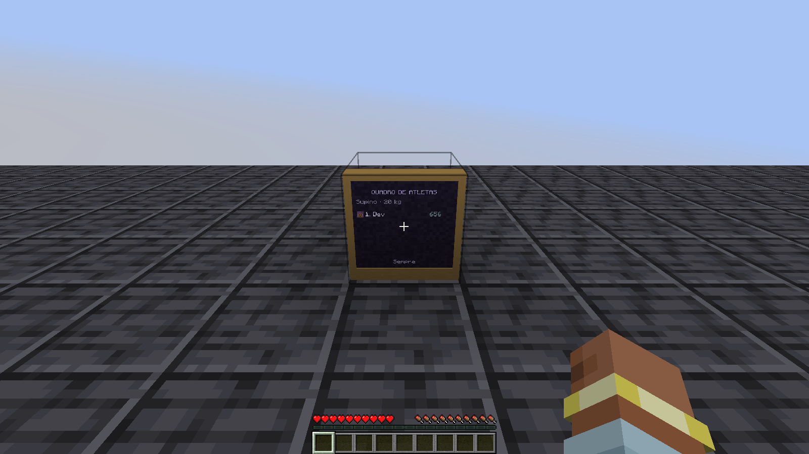
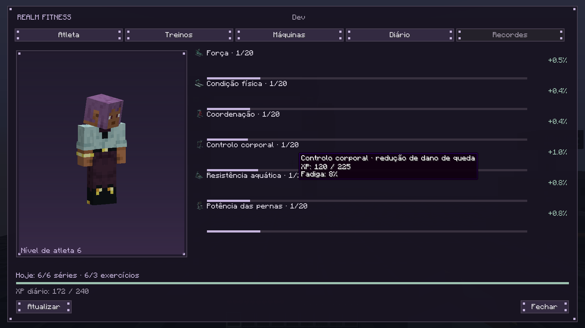

O jogador comeca com uma base controlada de 90 XP por atributo para tornar visivel a subida de nivel. As seis series e os seus resultados usam efetivamente os controlos do cliente e os canais de rede, sem enviar pontuacoes inventadas. O teste verifica o plano personalizado, bonus diario, persistencia e reabertura do mundo. A galeria das maquinas usa os modelos de producao no renderizador Minecraft.
