# Realm Gym 0.5.1 Beta

Capturas do Minecraft 1.21.1 com NeoForge 21.1.256 e Java 21. [Validacao CI](https://github.com/ROCKABITS/Mods/actions/runs/43490101615).

Botão direito: montar e treinar. Agachar + botão direito: aumentar carga. SHIFT durante o treino: sair. F5: câmara.

Supino: toques repetidos contra a pressão. Boxe: marcador móvel, centro perfeito e sequências. Passadeira: ritmo e fôlego. Elevações: pega e equilíbrio. Remo: força e recuperação. Agachamentos: profundidade, pausa e subida.

Modelos originais redesenhados com armações finas em aço azul-escuro, estofos azul-acinzentados e pontos de contacto partilhados com a animação. As mãos acompanham as barras e a pega; o saco oscila, o tapete desliza e a roda do remo gira.

As cargas baixas tornam-se mais fáceis conforme o nível do respetivo atributo; a fadiga e as cargas próximas do limite continuam a exigir mais.

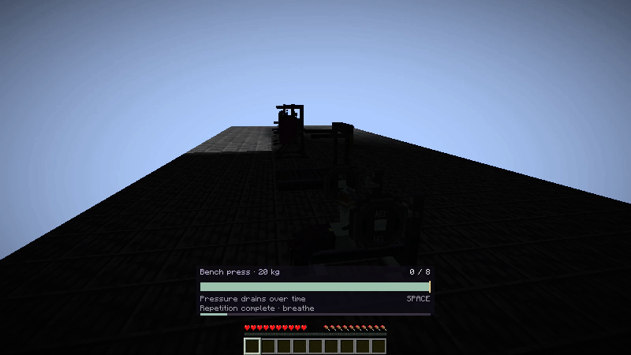

Vídeos capturados no cliente real (24 frames por exercício, amostras a 10 fps): [supino](fitness-motion-bench.mp4) · [passadeira](fitness-motion-run.mp4) · [boxe](fitness-motion-box.mp4) · [elevações](fitness-motion-pull.mp4) · [remo](fitness-motion-row.mp4) · [agachamentos](fitness-motion-squat.mp4).

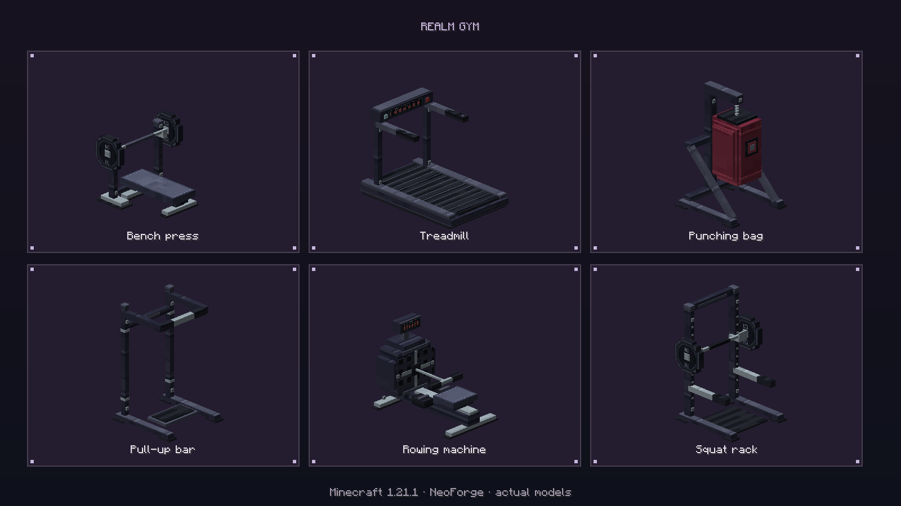
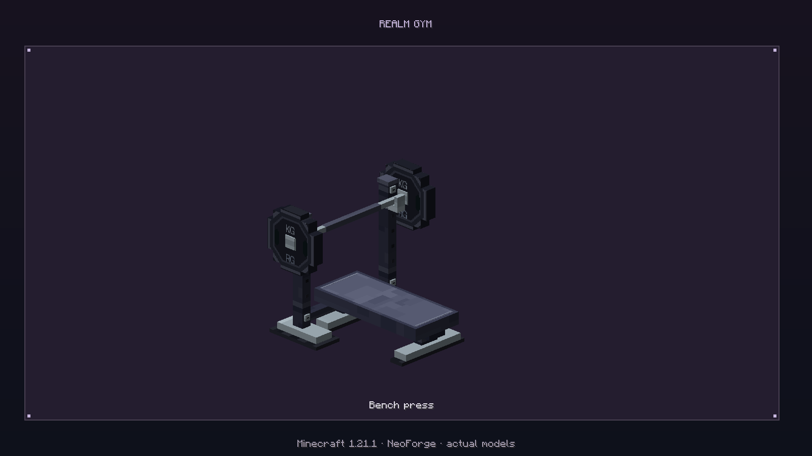
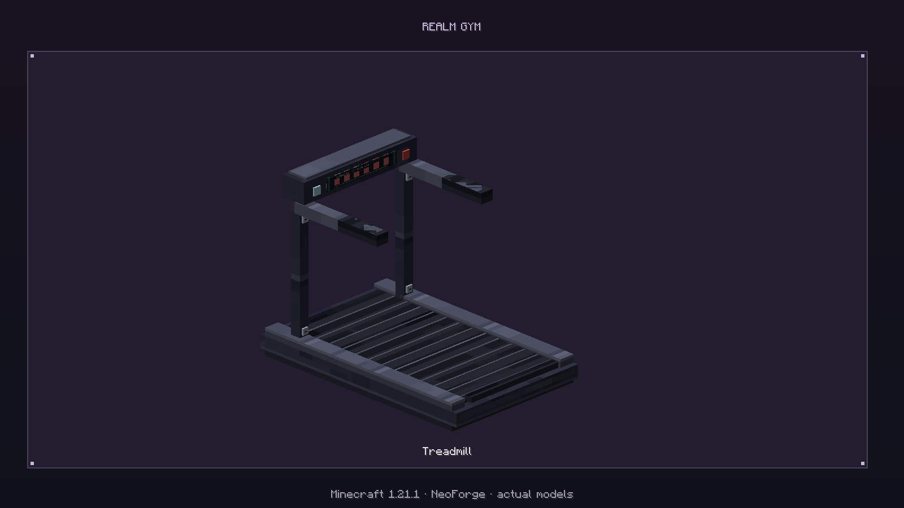
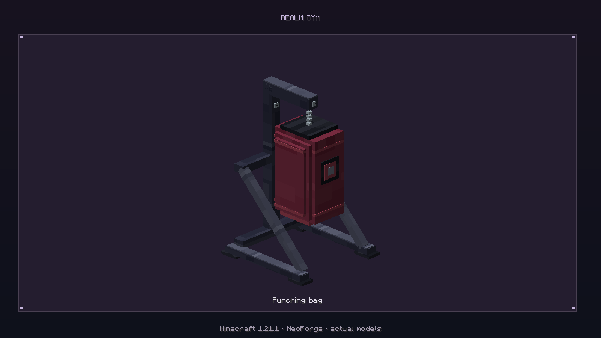
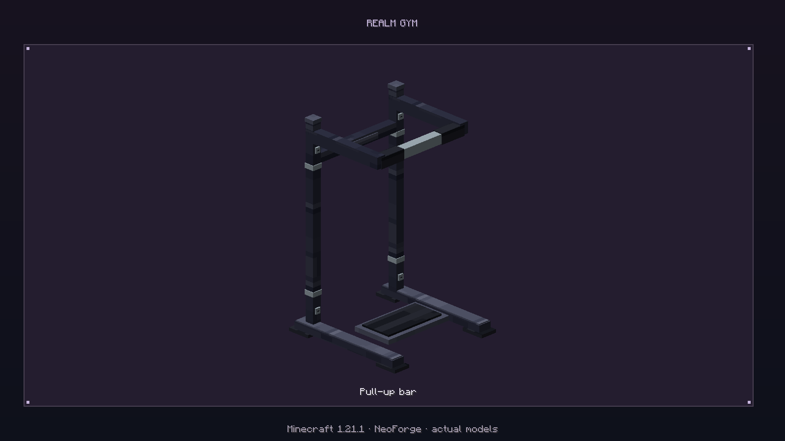
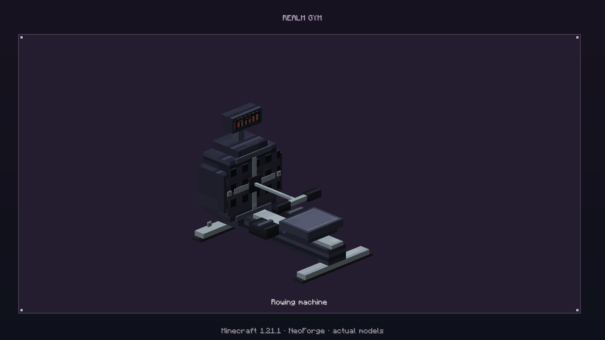
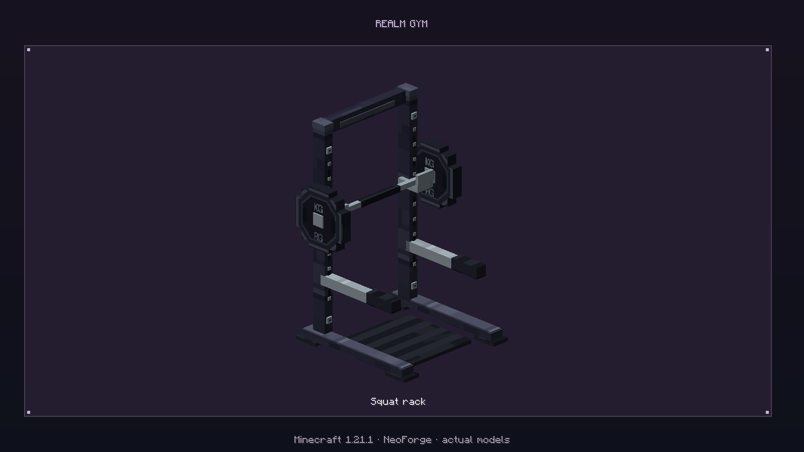
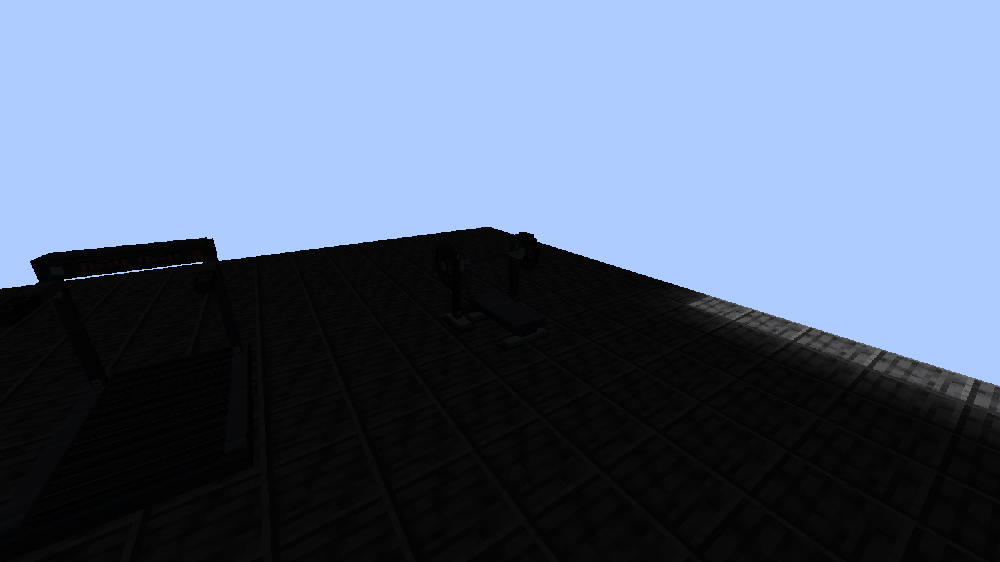

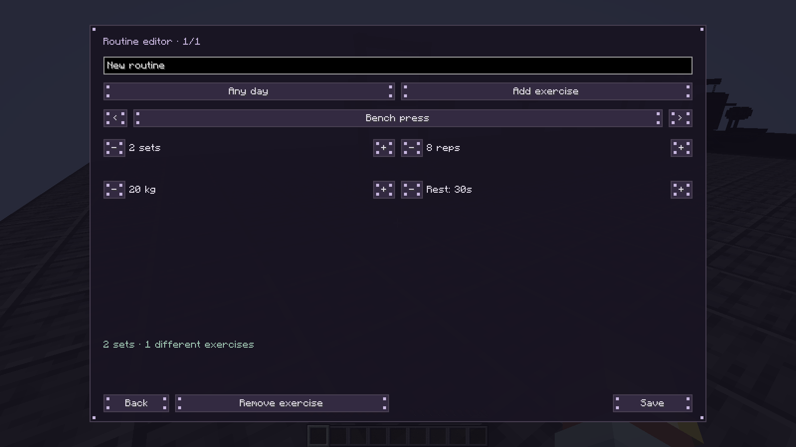
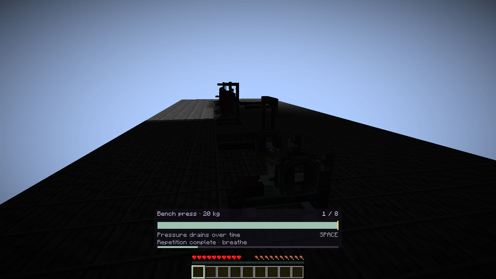
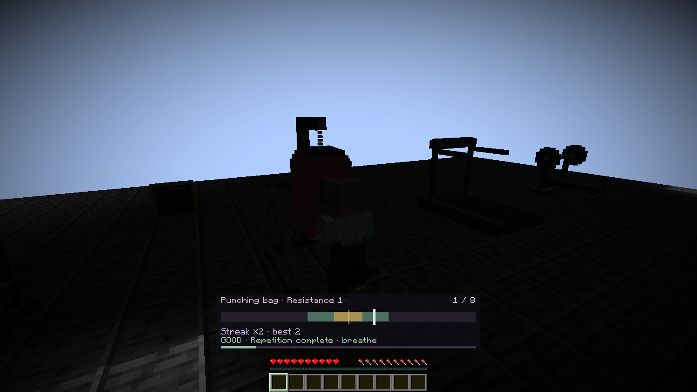
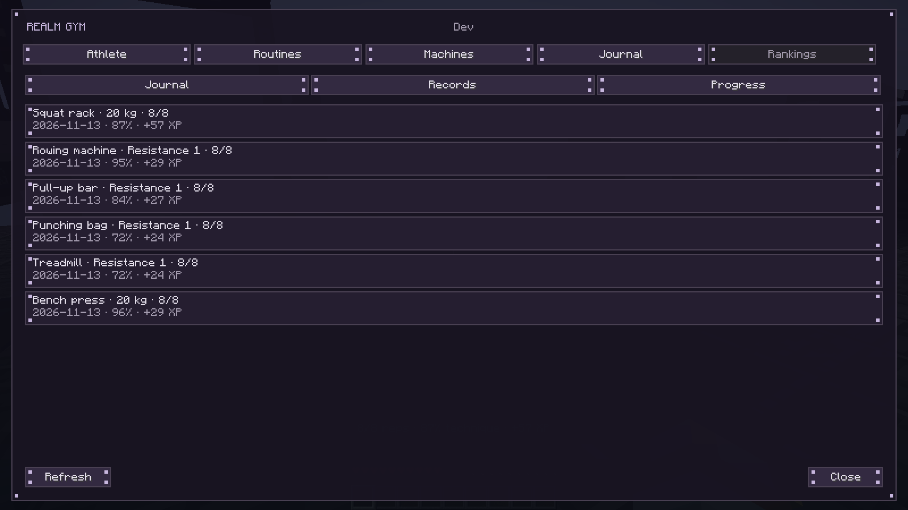
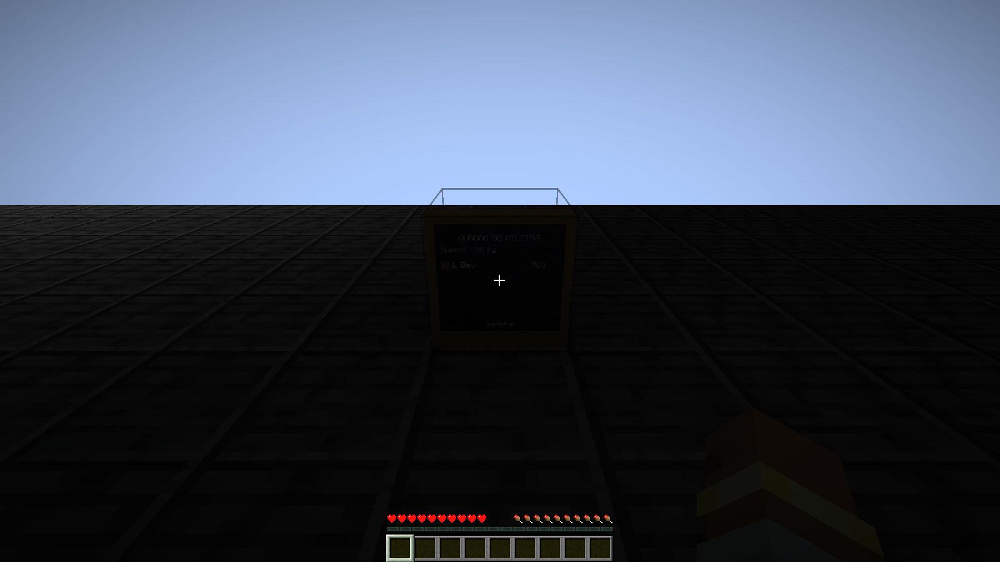
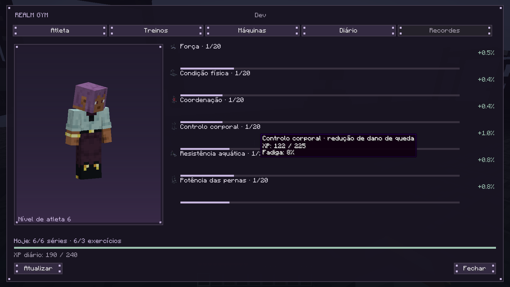

O teste de carga usa temporariamente 100 XP no supino para desbloquear 25 kg e repõe esse valor antes das séries. O jogador inicia as séries com uma base controlada de 90 XP por atributo para tornar visivel a subida de nivel. As seis series e os seus resultados usam efetivamente os controlos do cliente e os canais de rede, sem enviar pontuacoes inventadas. O teste verifica o plano personalizado, bonus diario, persistencia e reabertura do mundo. A galeria das maquinas usa os modelos de producao no renderizador Minecraft.
