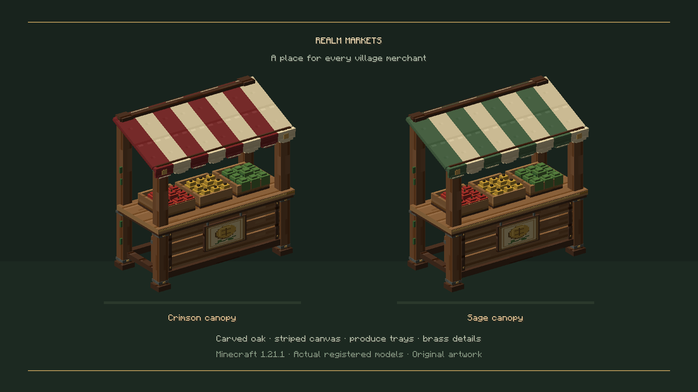
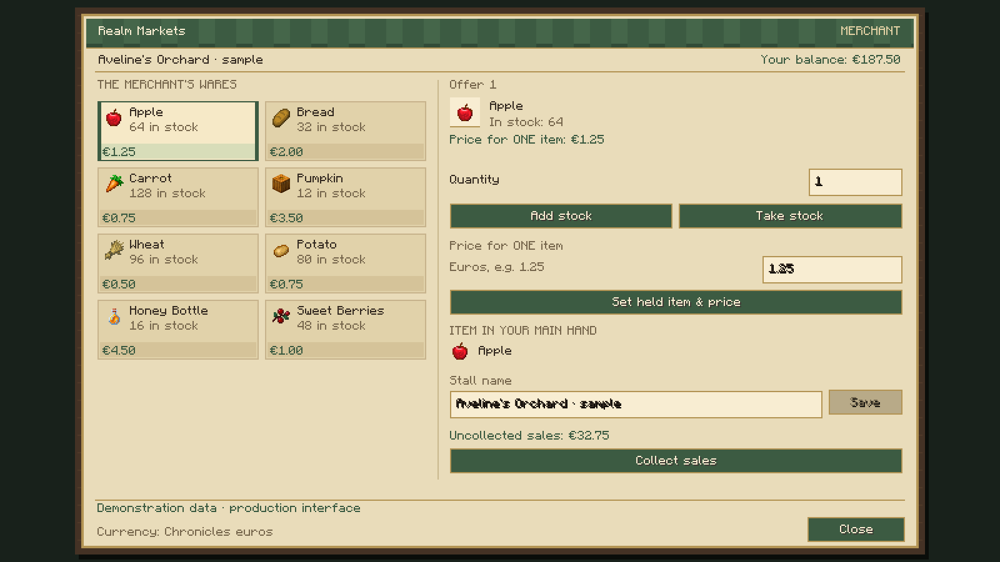
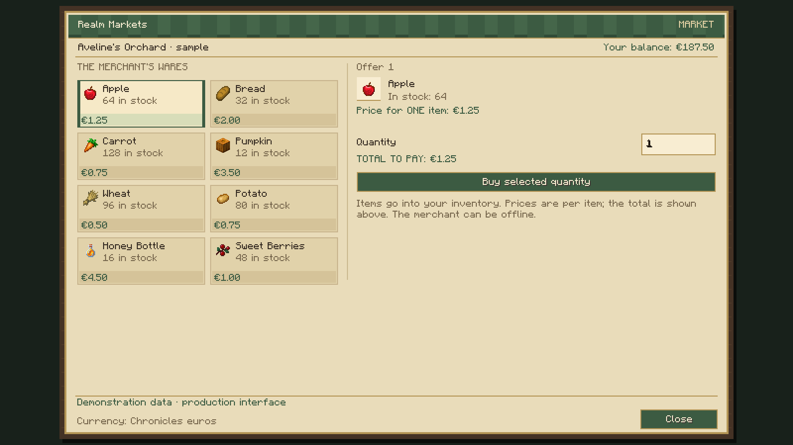

# Realm Markets — Minecraft screenshots

These images were captured from the actual Minecraft 1.21.1 NeoForge client, using the packaged stall models, textures and production market screen. The interface images use demonstration listings and balances, rather than live player accounts.

[Download all three PNG images](realm-markets-0.1.1-media.zip). Extract the ZIP and upload the PNG files individually to the CurseForge Media gallery.

## Medieval market stalls

Suggested caption: Two original craftable stalls with crimson and sage striped awnings, wooden counters, produce trays and brass signs. The actual registered item models are rendered by Minecraft; placed stalls use four physical blocks with the same artwork.

## Manage your stall

Suggested caption: Set a price per item, deposit real stock, withdraw goods, rename your stall and collect retained sales earnings. Demonstration listings and funds shown in the production interface.

## Buy from other players

Suggested caption: Browse eight offers, choose a quantity and review the total price before buying. Owners can be offline. Demonstration listings and funds shown in the production interface.

All images may be used for the ROCKABITS Realm Markets project gallery.
