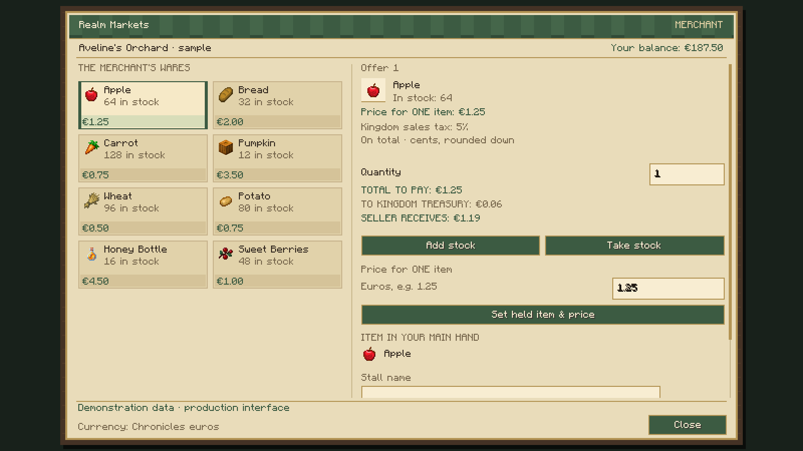
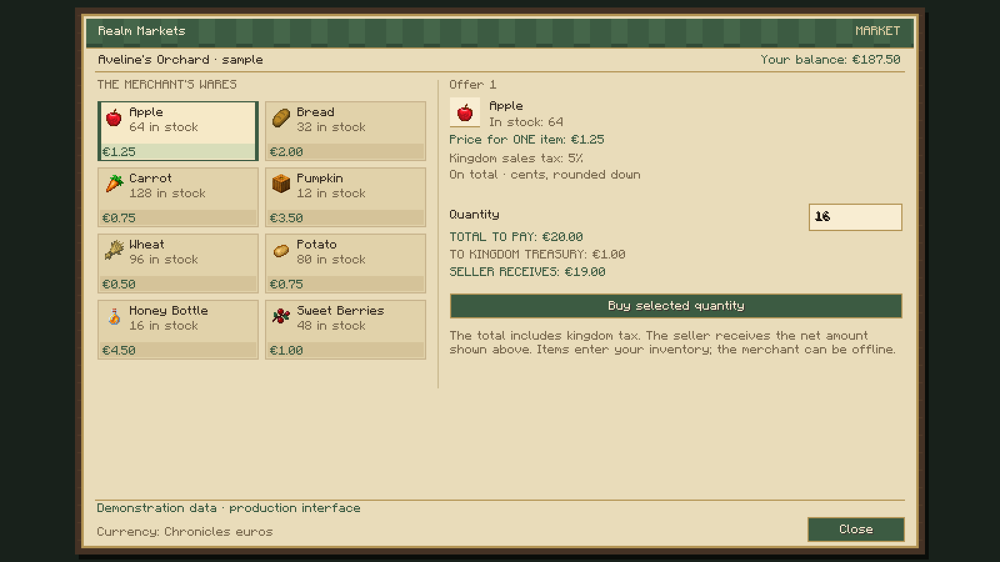

# Realm Markets — Minecraft screenshots

These images were captured from the actual Minecraft 1.21.1 NeoForge client, using the packaged stall models, textures and production market screen. The interface images use demonstration listings and balances, rather than live player accounts.

[Download all three PNGs](realm-markets-0.2.0-media.zip).

Both original 3D market stalls rendered by Minecraft.

Production owner screen with demonstration stock and net earnings. Scroll to reach the lower management controls.

Production buyer screen showing a €20.00 purchase: €1.00 sales tax and €19.00 seller net earnings at 5%.

All images may be used for the ROCKABITS Realm Markets project gallery.
