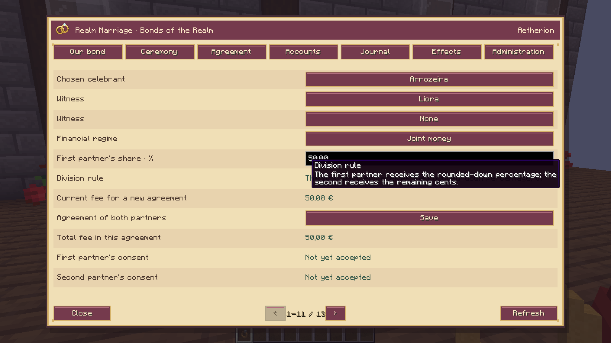
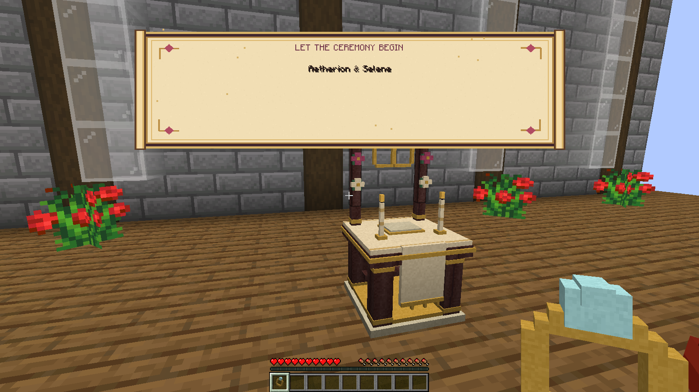
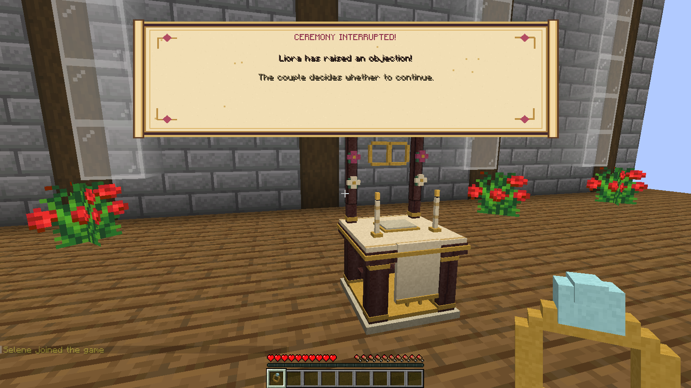
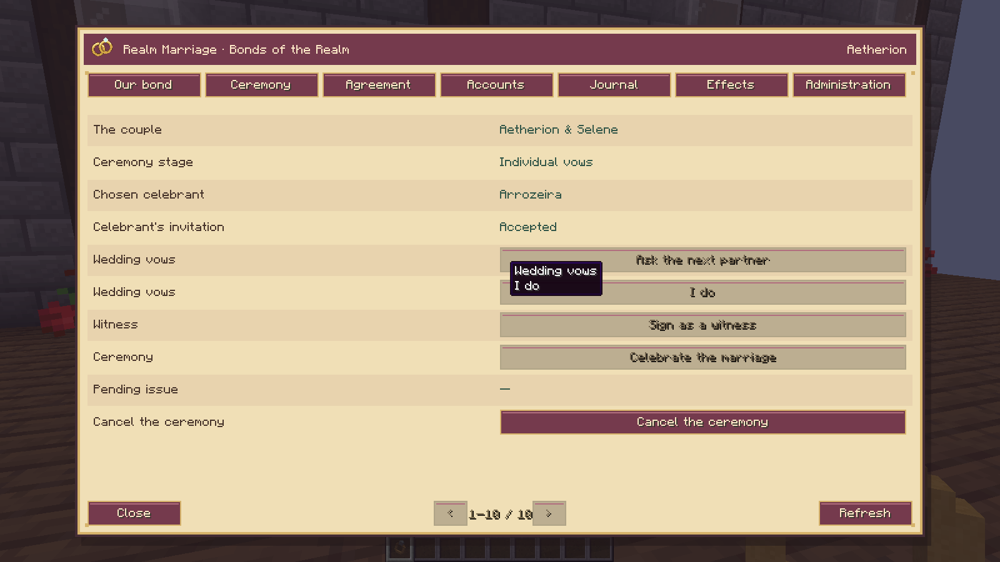
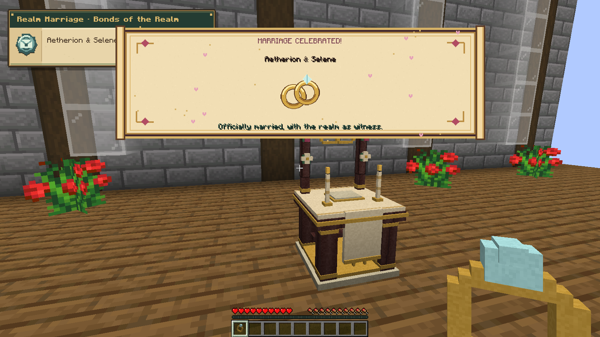
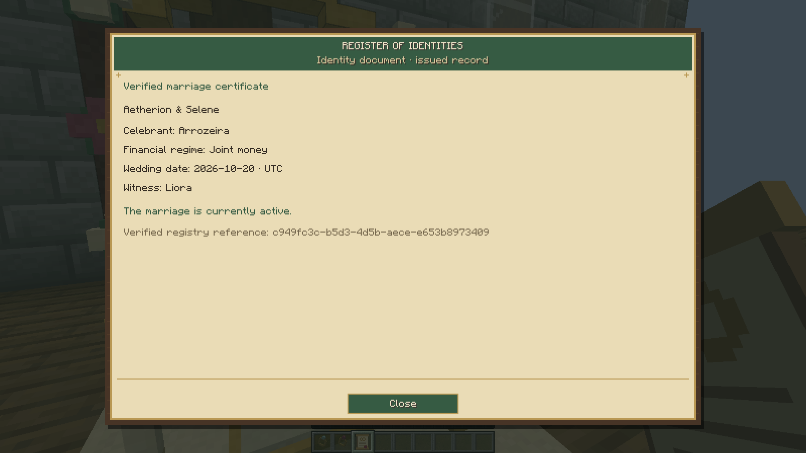
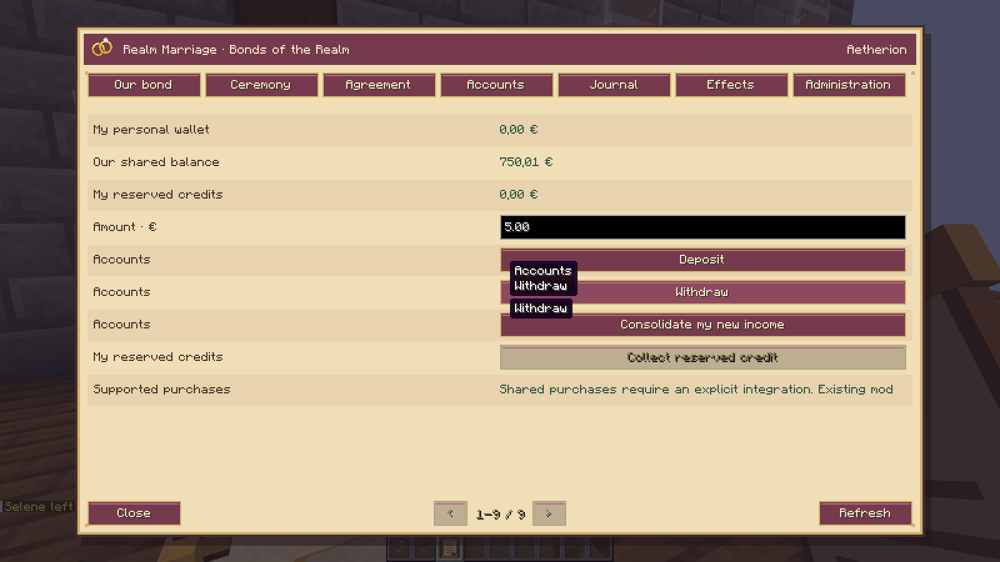
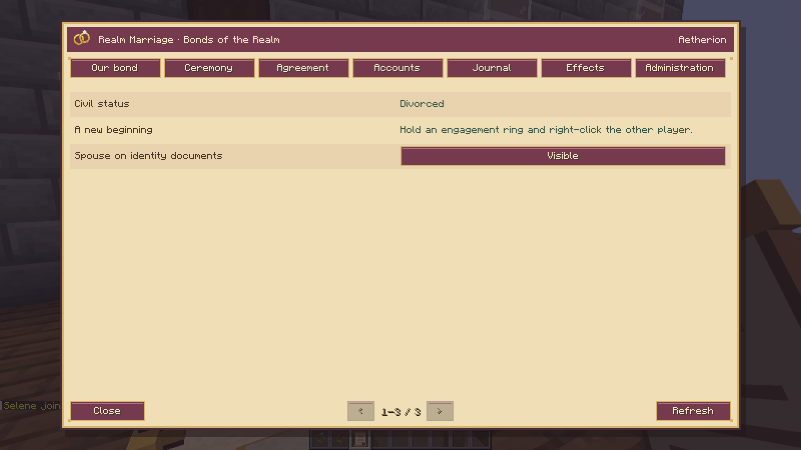
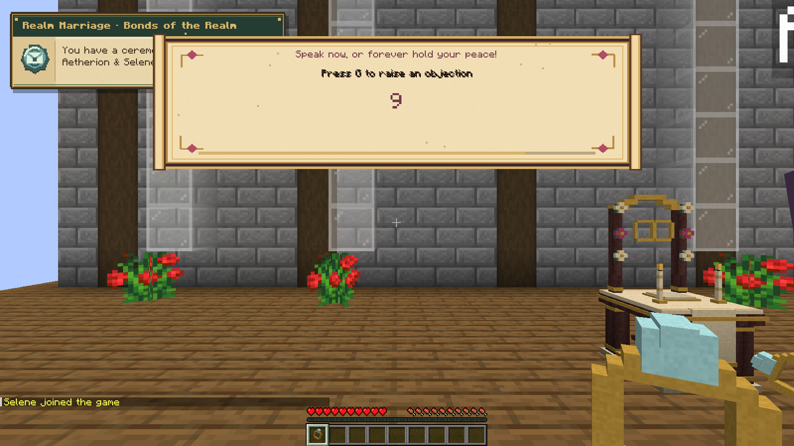

# Realm Marriage 0.1.0

Real Minecraft 1.21.1 / NeoForge 21.1.256, four separate client processes on an integrated TCP LAN server using offline test identities. The set, names and starting funds are fixtures; menus, input, vows, objection, wallets, treasury, documents, disconnections and world reopen are real. This is not an authenticated Mojang-account test.

