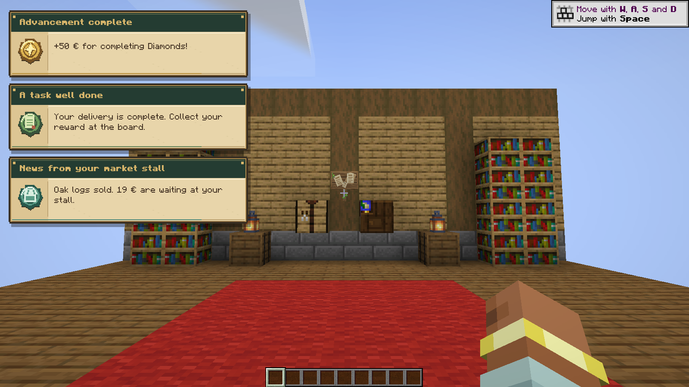
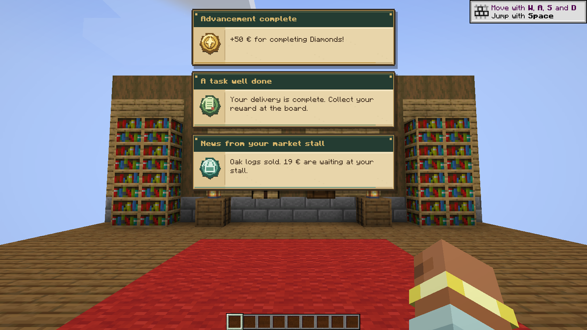
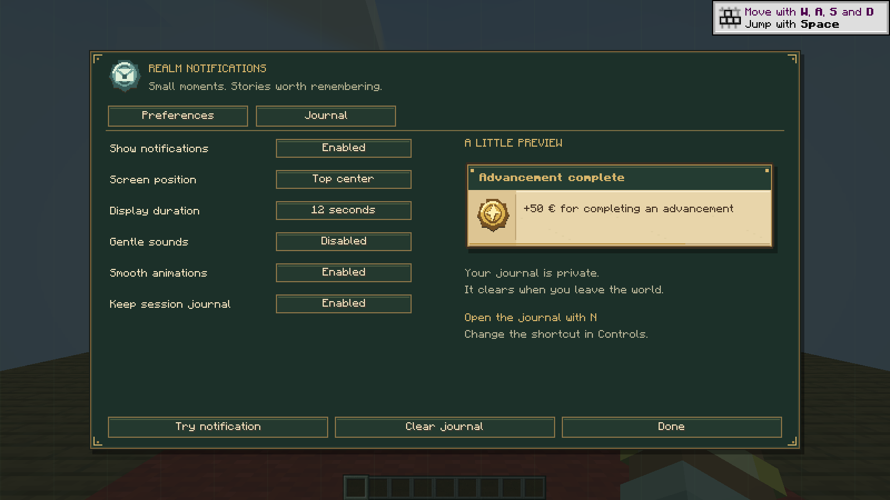
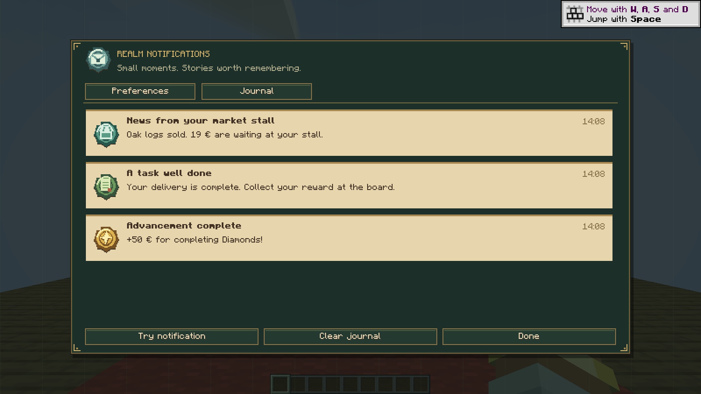
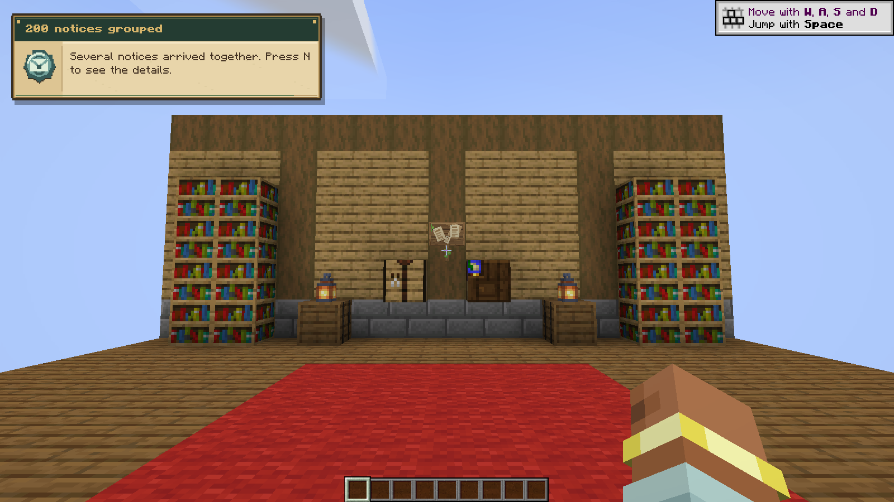

# Realm Notifications 0.1.1

Actual Minecraft 1.21.1 / NeoForge client and integrated host. Flood screenshot: 200 real S2C notices grouped by the production HUD. Demonstration texts; no financial transactions in these screenshots.

