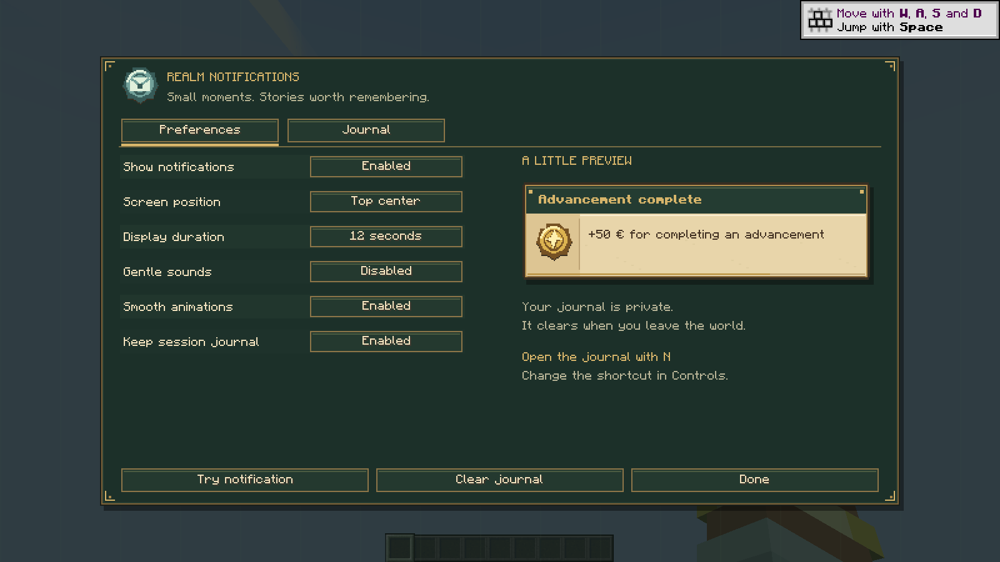
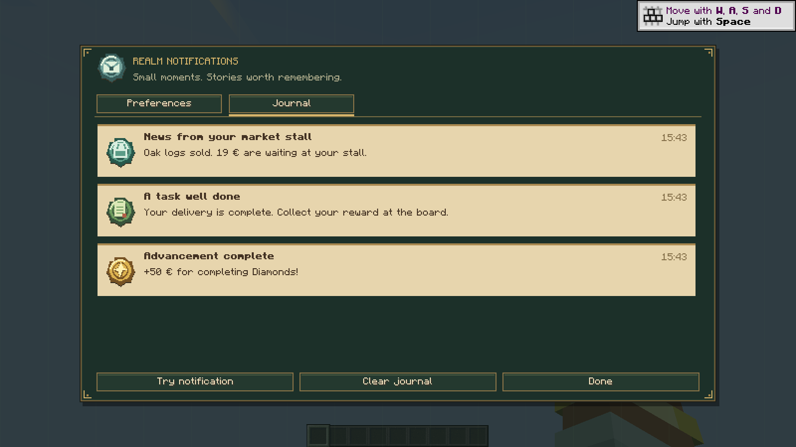

# Revisão visual — 12 de novembro de 2026

Capturas do cliente Minecraft 1.21.1 / NeoForge 21.1.256 real, com servidor integrado, a partir do código desta revisão. São imagens de desenvolvimento; não substituem a galeria ou os JARs publicados da 0.1.1.

O [relatório do ensaio](result.json) confirma navegação nas três páginas de um ecrã lógico forçado de 320 × 180, controlos sem sobreposição, alterações reais de preferências e redimensionamento para uma página. Esse tamanho foi aplicado diretamente ao ecrã de teste; as capturas apresentadas usam o tamanho normal de 800 × 450, num framebuffer de 1600 × 900.

O mesmo ensaio repetiu o HUD, os cinco pontos de ancoragem, deslocação e limpeza do diário, persistência das preferências, limpeza da sessão e uma rajada real de 200 mensagens pela API do servidor e pelo canal S2C. Os textos financeiros são exemplos; não foram realizadas novas operações financeiras neste ensaio visual. Não houve clientes autenticados nem o modpack completo.

Outras capturas: [HUD](realm-notifications-hud.png), [posição central](realm-notifications-center.png), [resumo da rajada](realm-notifications-burst.png).

**Limite do processo:** todas as verificações terminaram com `success: true`; durante o encerramento posterior, o servidor integrado ficou a gravar/descarregar chunks e o processo de desenvolvimento foi terminado. O relatório comprova as verificações visuais concluídas, não uma saída normal do comando `runClient`.
