# Realm Origins — galeria

[Projeto e instalação](../../realm-origins/README.md) · [English](../../realm-origins/README_EN.md) · [Descarregar as 23 imagens](0.5.7/realm-origins-0.5.7-media.zip) · [Ícone PNG](0.5.7/icon.png)

Capturas reais do **Realm Origins 0.5.7**, no Minecraft 1.21.1 / NeoForge. Os nomes e histórias das personagens são dados de demonstração. Os ecrãs foram renderizados no cliente Minecraft.

## Criação por capítulos

## Ocupação numa palavra

O jogador escreve a ocupação e pode usar as sugestões rápidas.

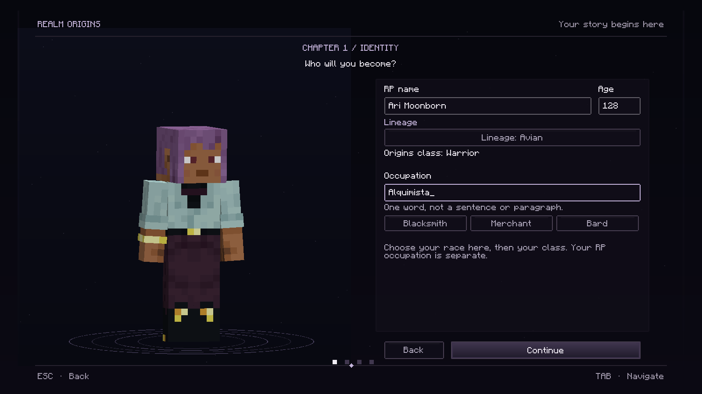

## História e assinatura

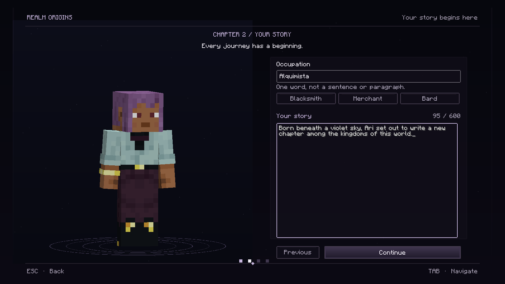

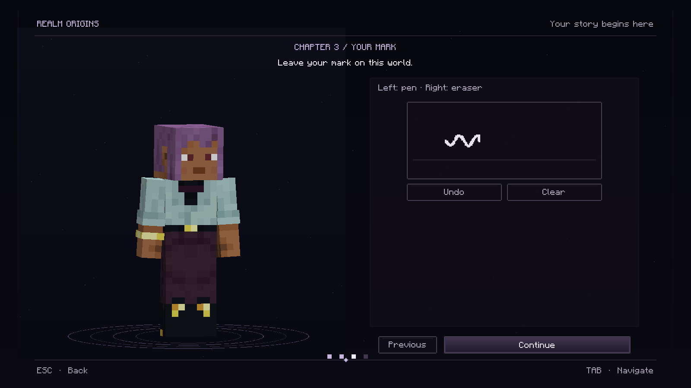

## Confirmar e entrar no mundo

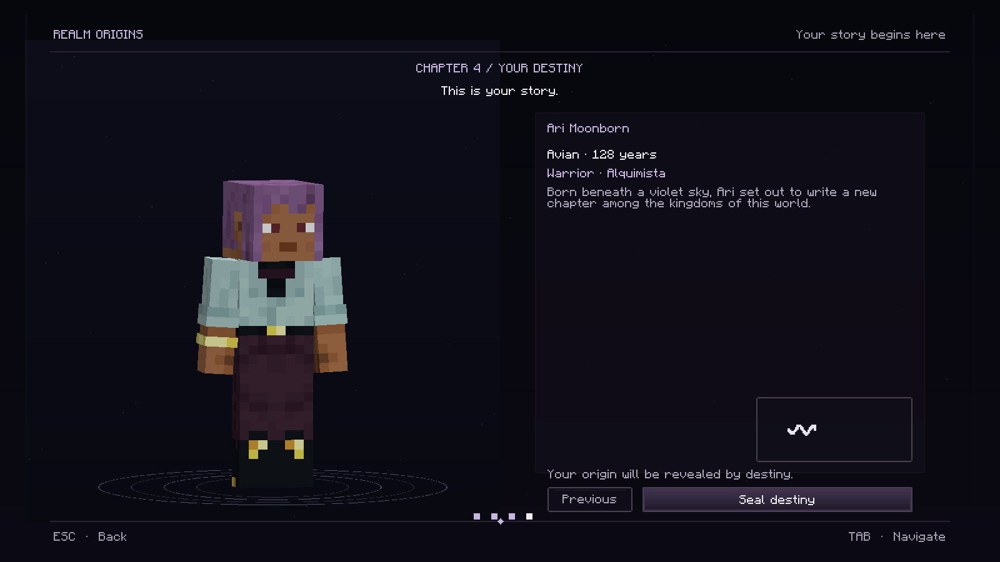

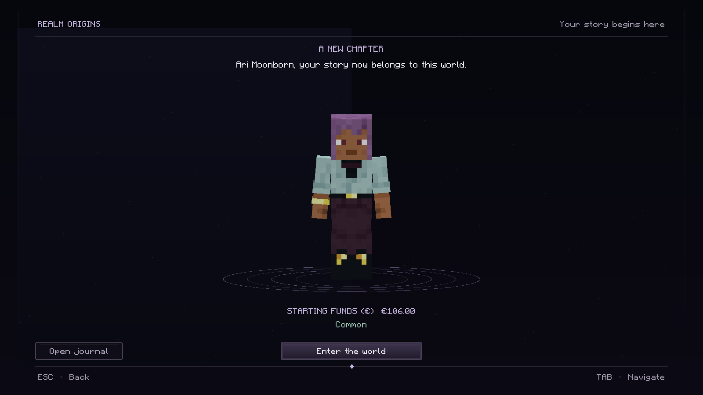

## Livro de personagem — tecla P

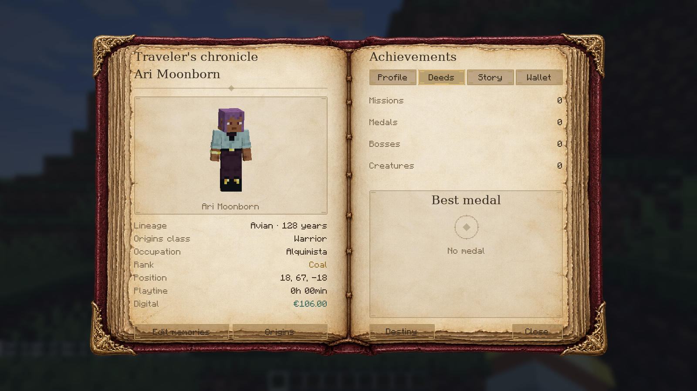

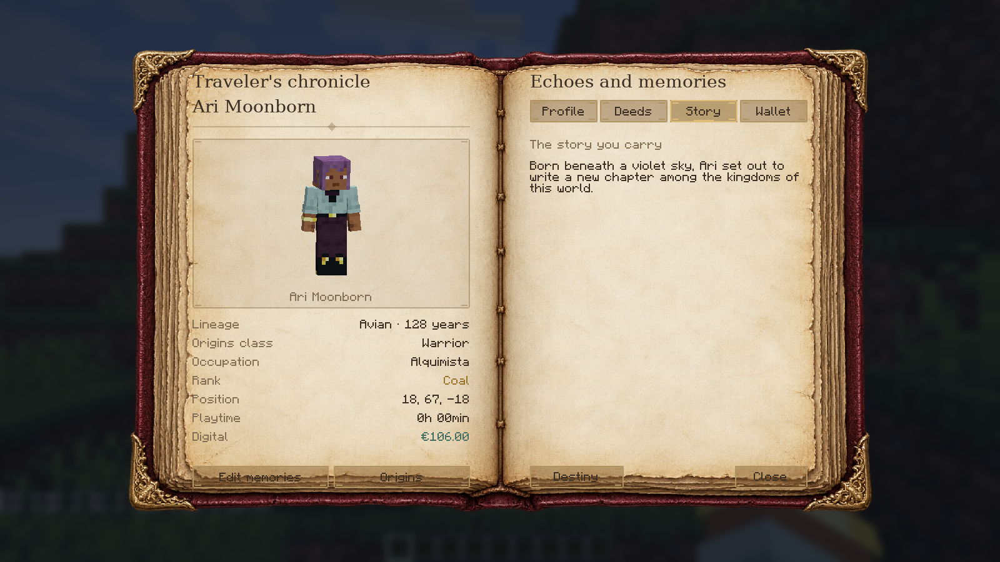

## Bolsa e câmbio

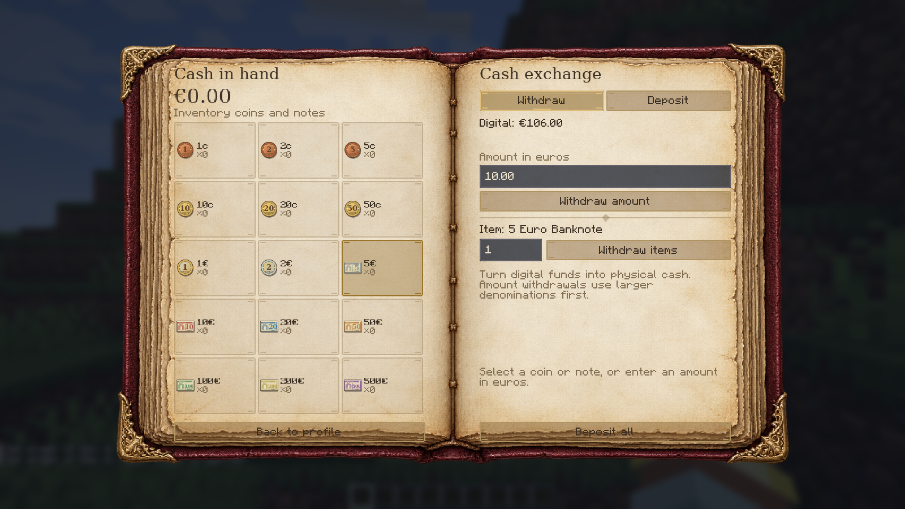

## Janelas pequenas

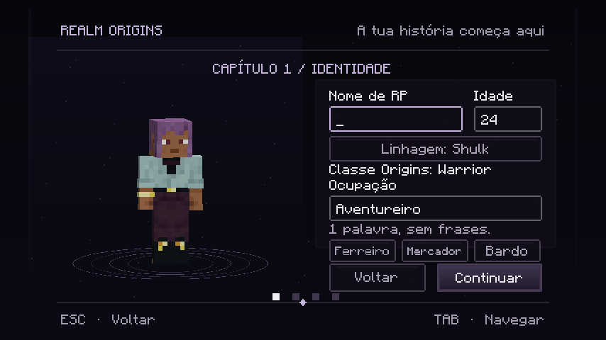

Mais capturas de edição e câmbio em janela pequena

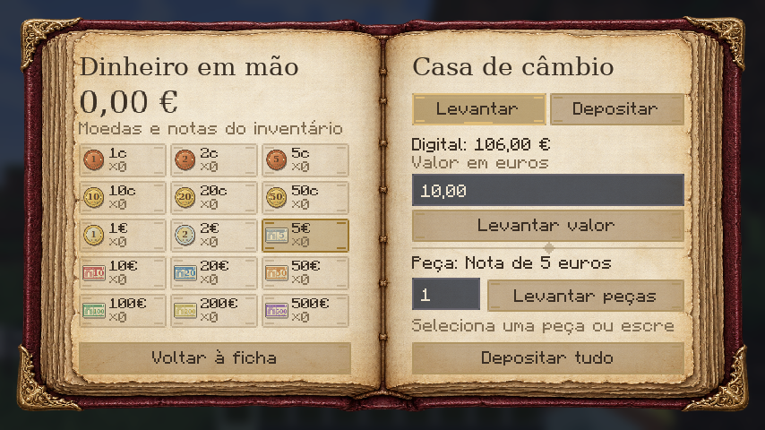

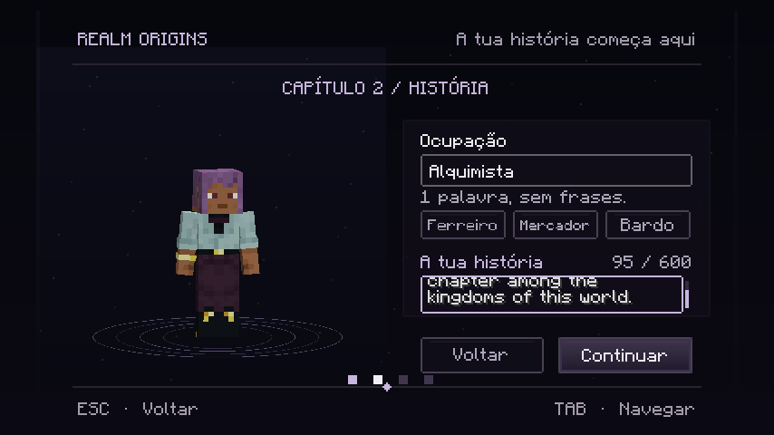

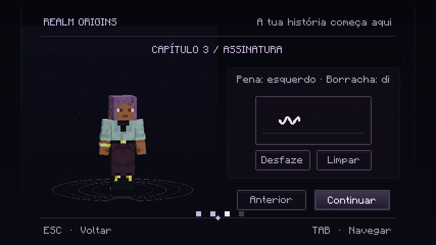

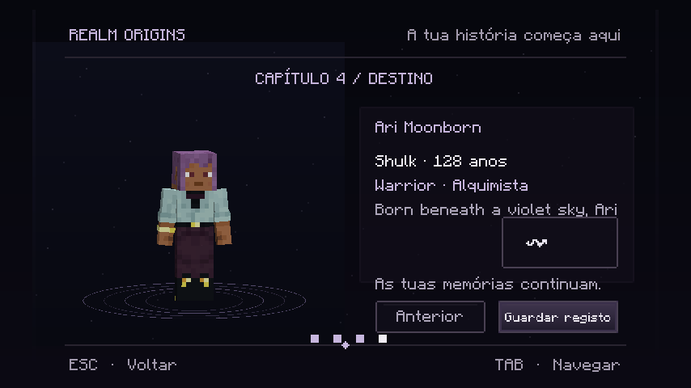

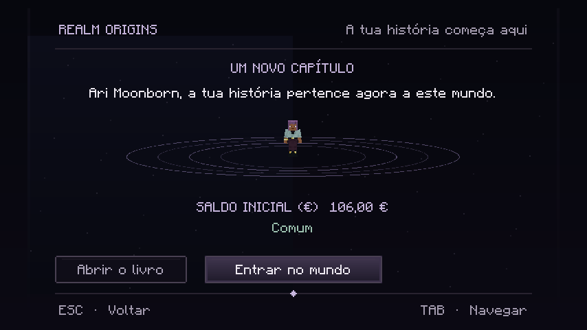

## Nomes RP no mundo, TAB e chat

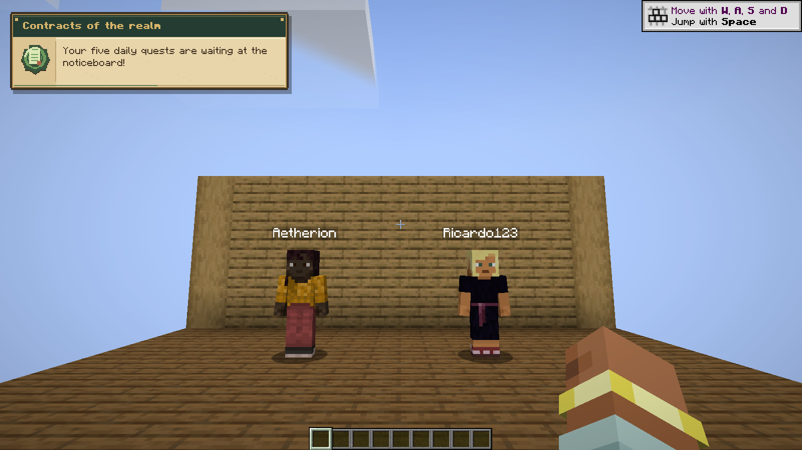

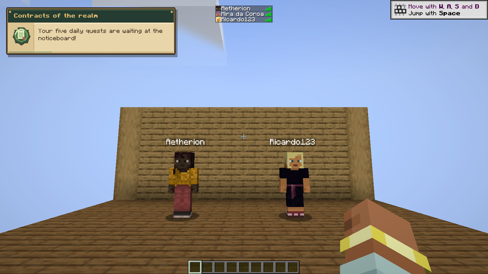

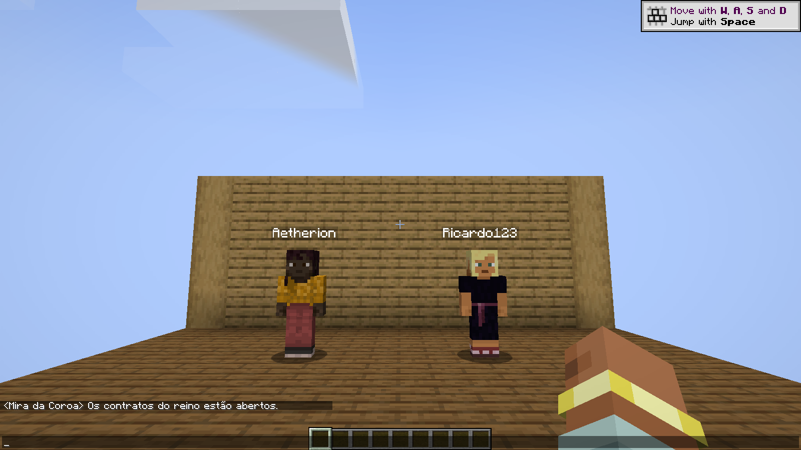

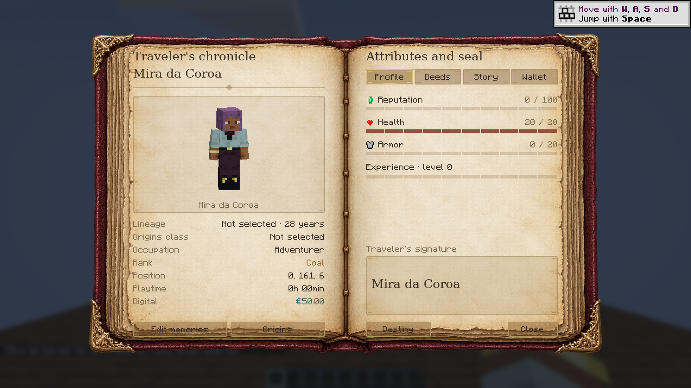

## Ícone

Os ficheiros versionados e os hashes publicados são preservados. Algumas capturas antigas conservam o prefixo histórico no nome do ficheiro. [Validação e limites](../../realm-origins/VALIDACAO.md).

[Arquivo da versão 0.5.3, publicada como Chronicles RP](0.5.3/README.md).
