# Realm Progression 0.1.0

Actual Minecraft 1.21.1 client captures with Create 6.0.10, Realm Treasury 0.4.0 and Realm Origins. Controlled fixtures seed the starting treasury and personal wallets. Production UI packets configure the second mod; an actual Treasury donation triggers research, native server crafting consumes the ingredients, two offline-identity clients connect by TCP LAN, and the world is really closed and reopened. Custom machine recipes and every other mod are not covered.

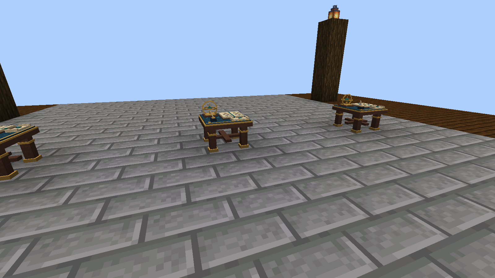

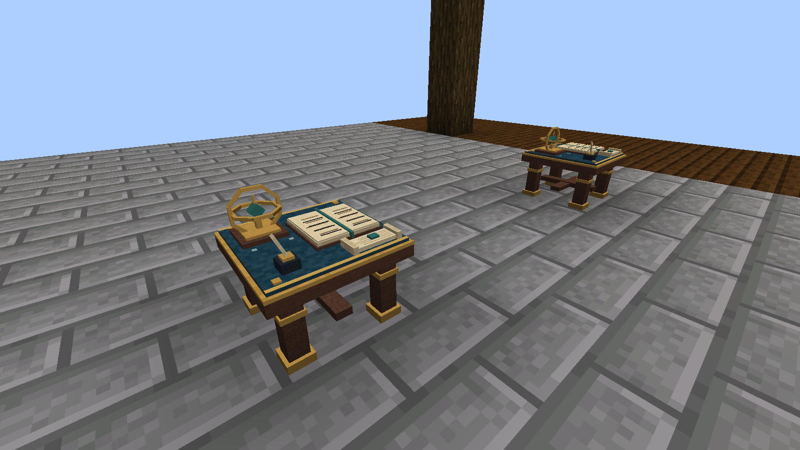

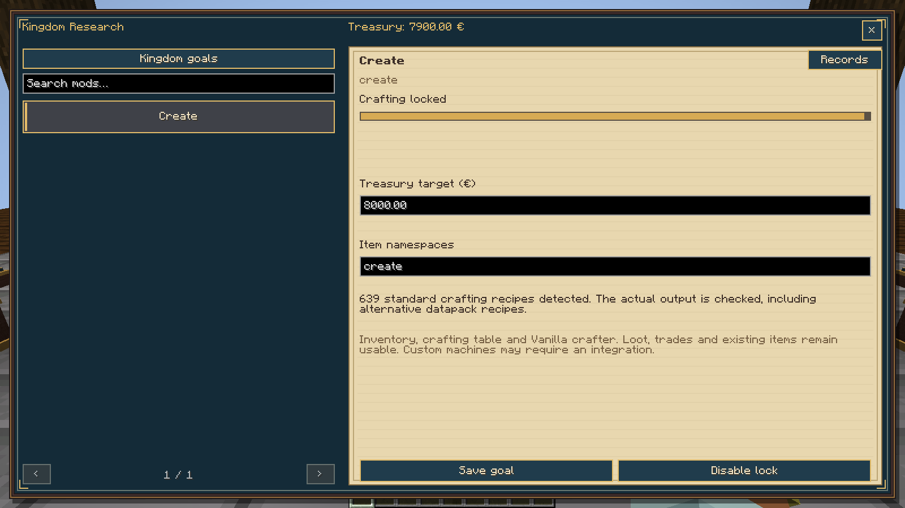

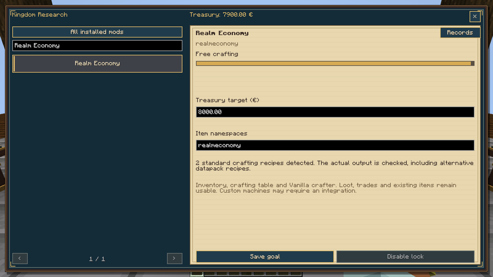

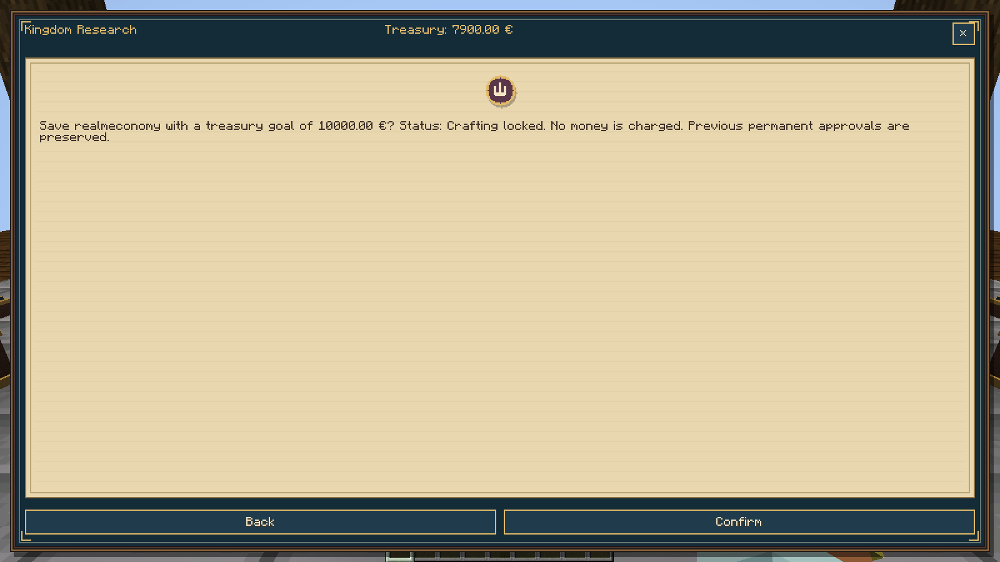

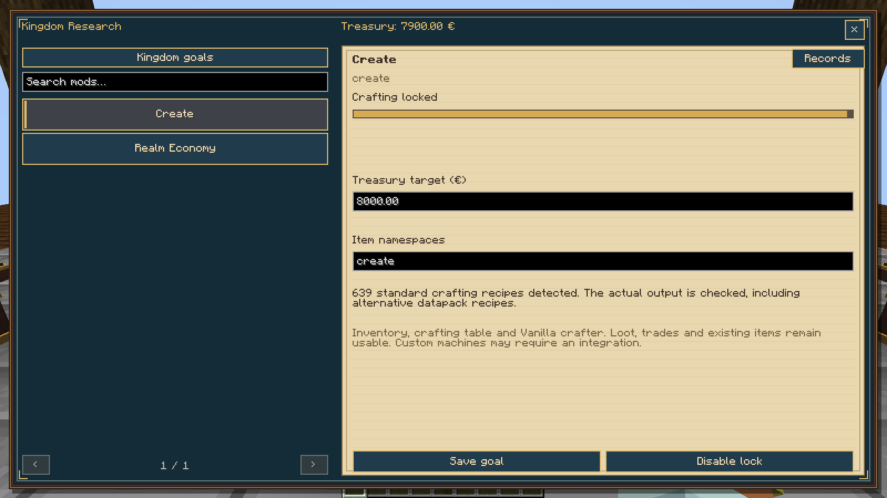

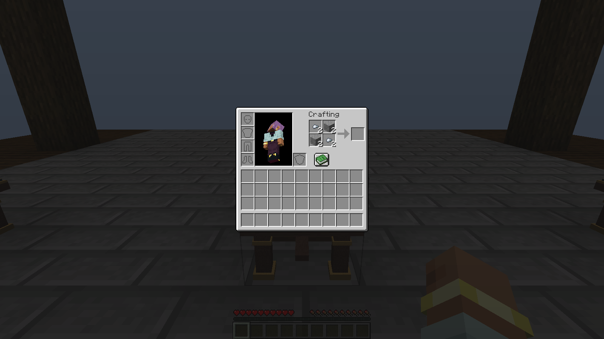

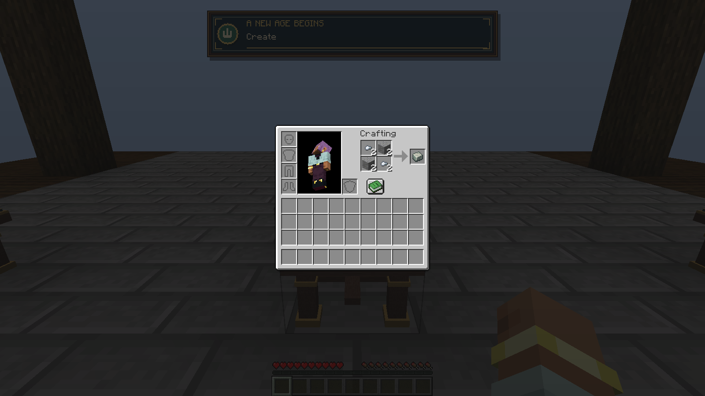

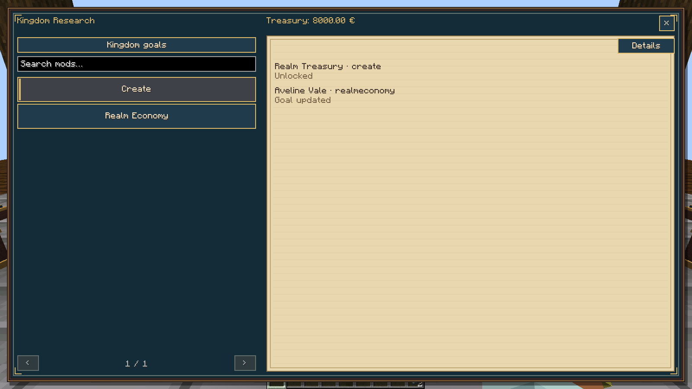

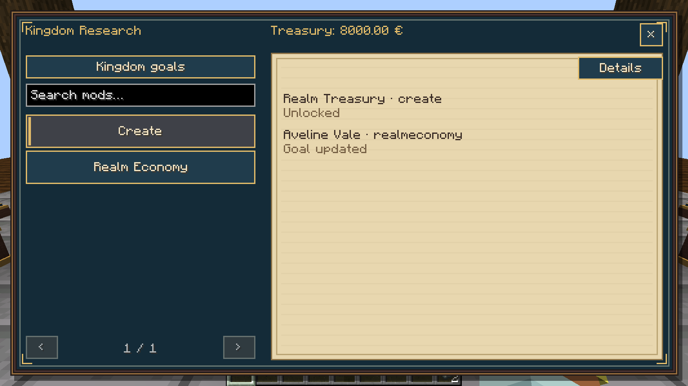

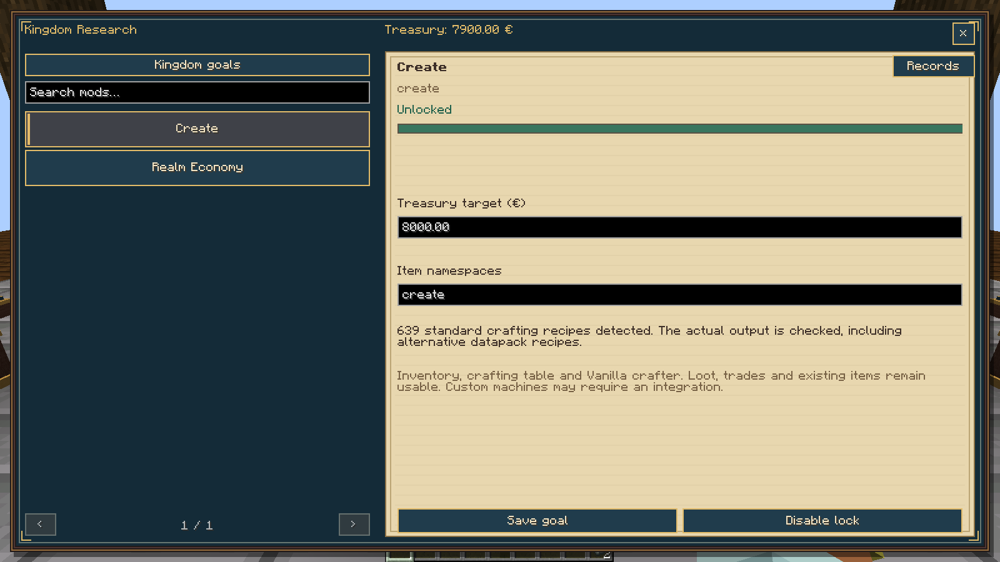

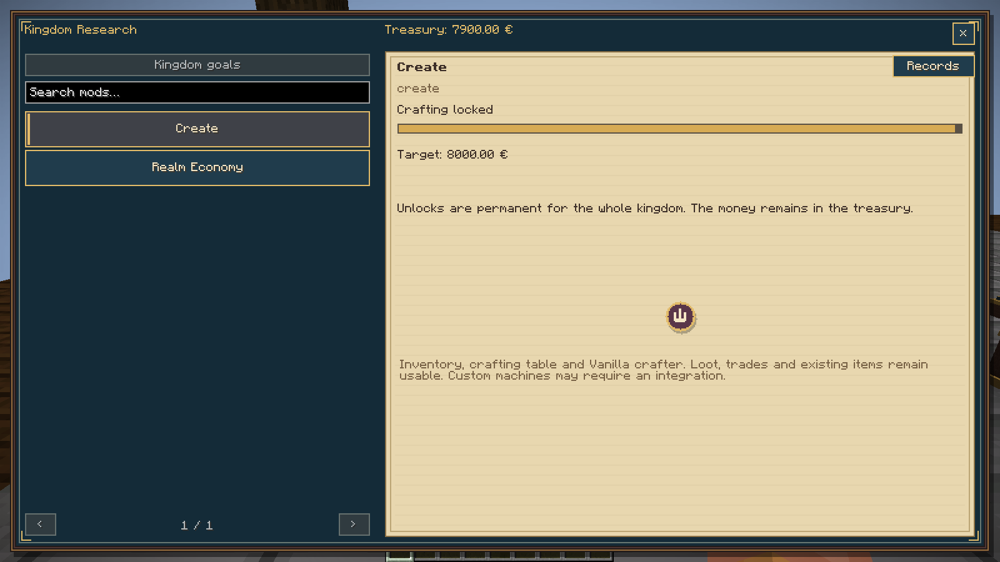

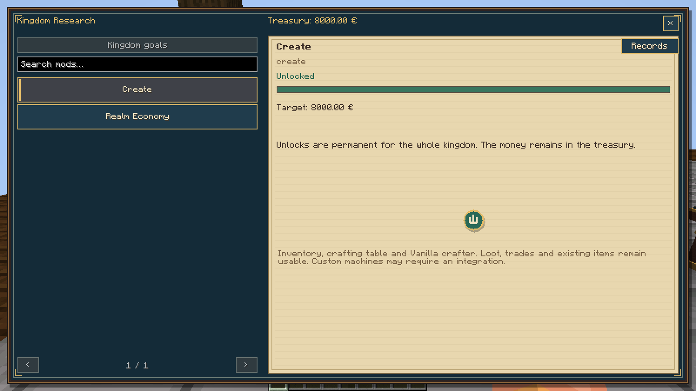

