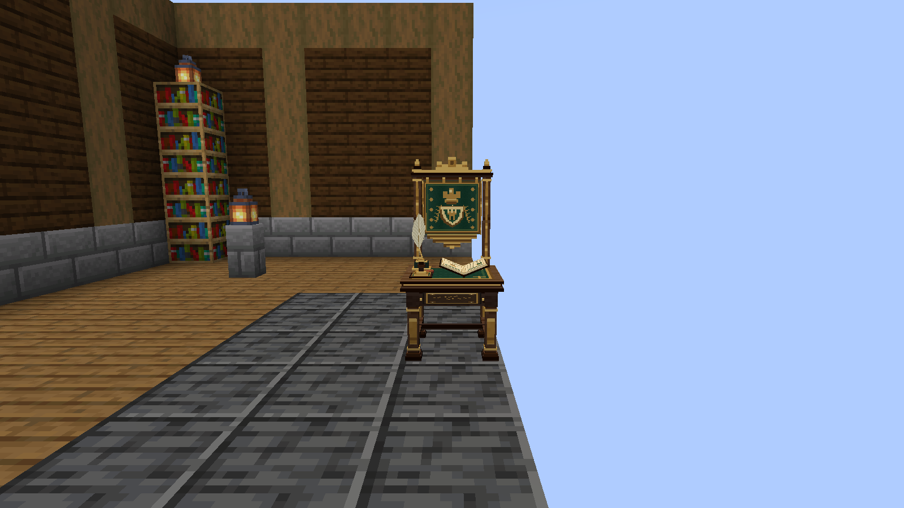
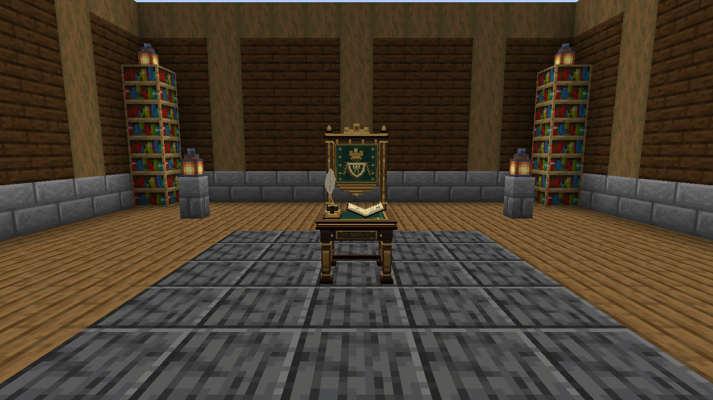
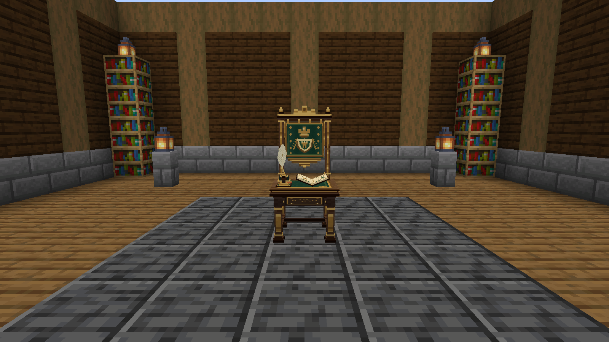
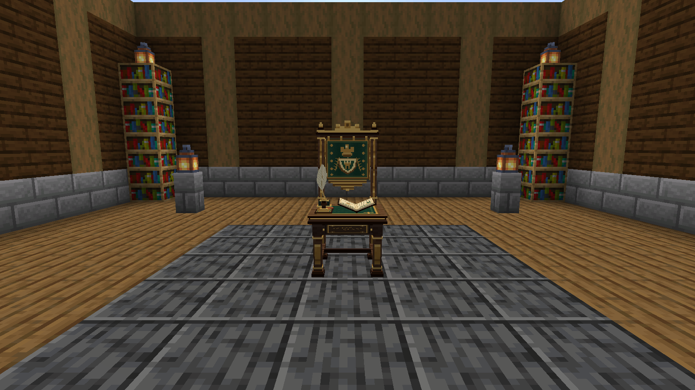
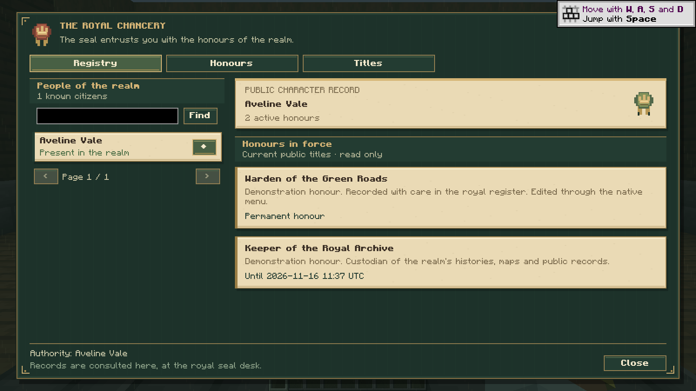
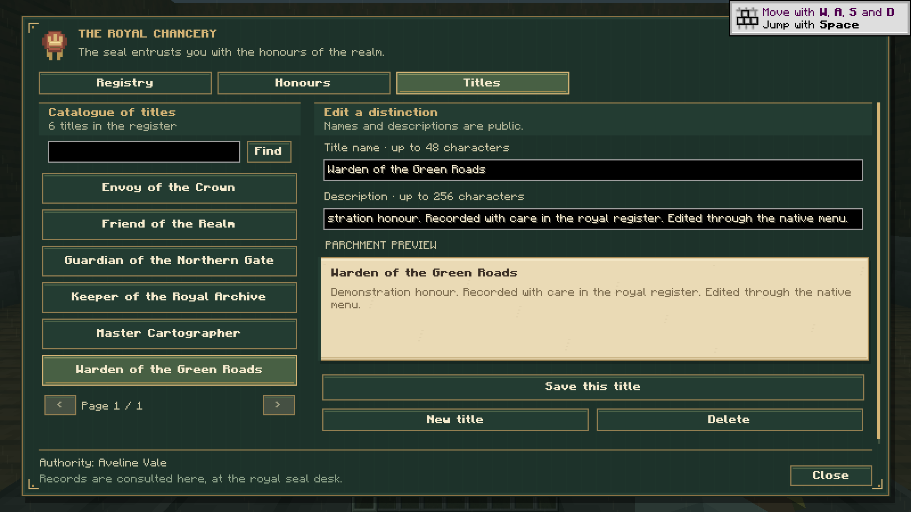
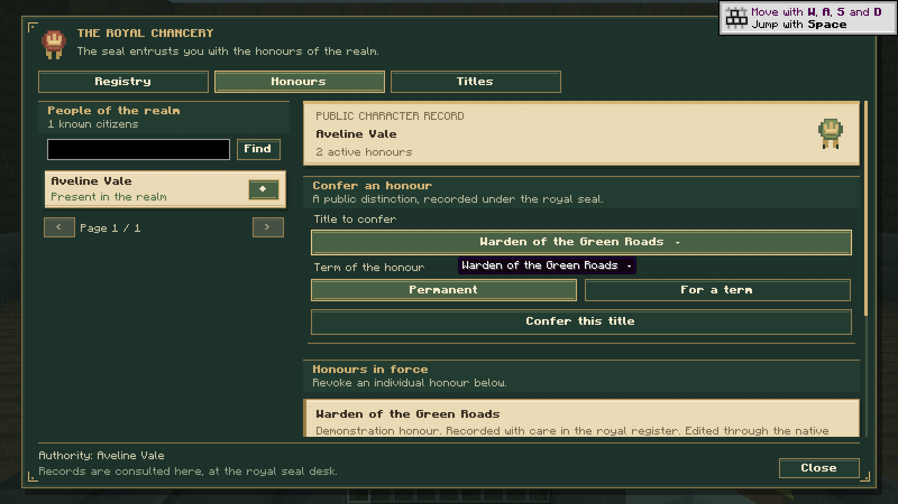
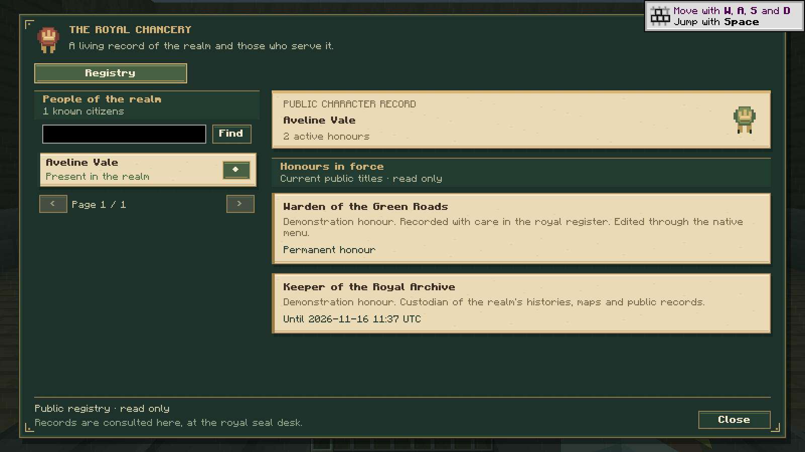
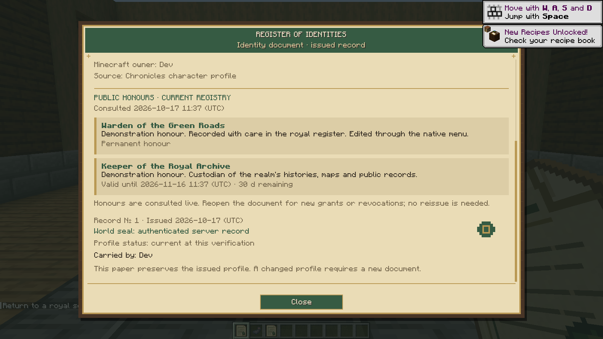
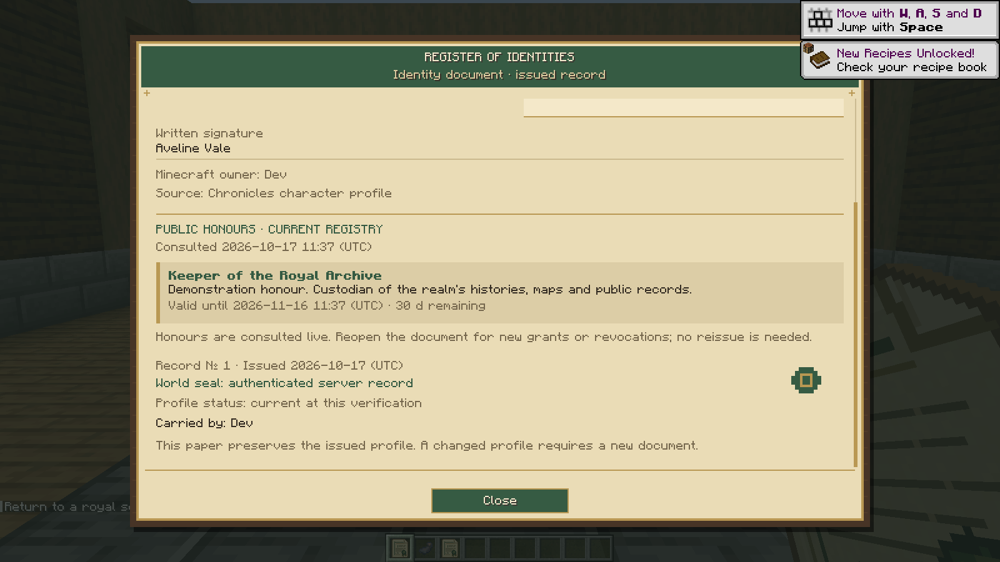

# Realm Titles

Actual Minecraft 1.21.1 NeoForge integrated-client captures of the royal seal desk and honours menus, with demonstration characters and titles. The accompanying native server suites test authority, sessions, persistence and authentic Identity documents. These captures do not establish authenticated multiplayer compatibility.

