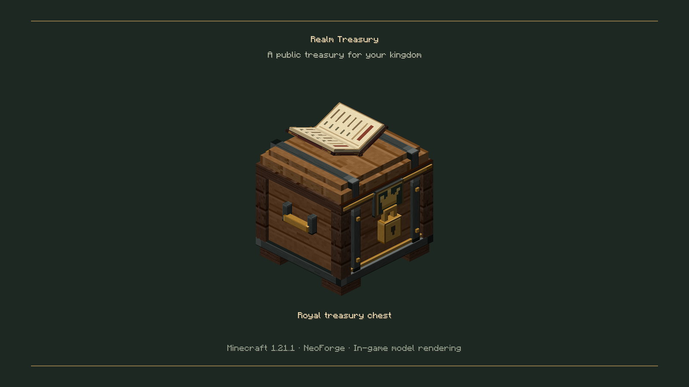
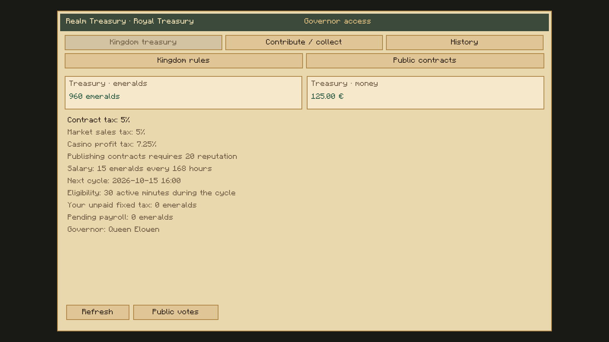
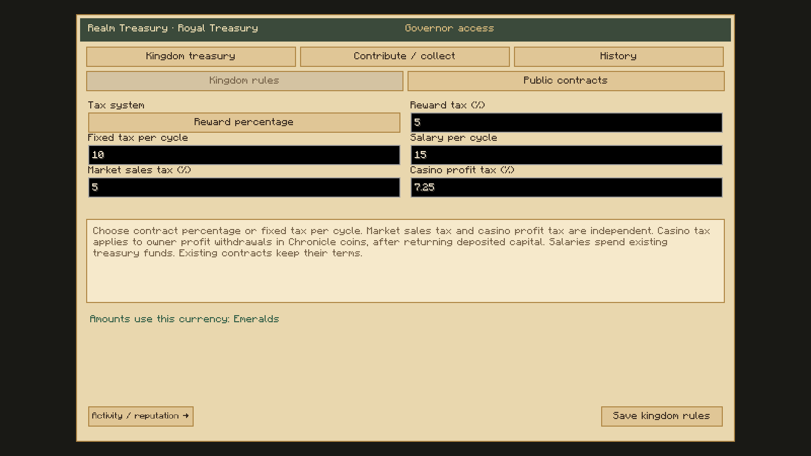
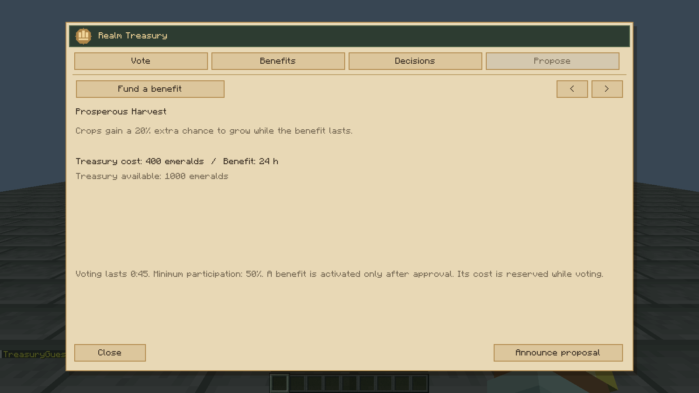
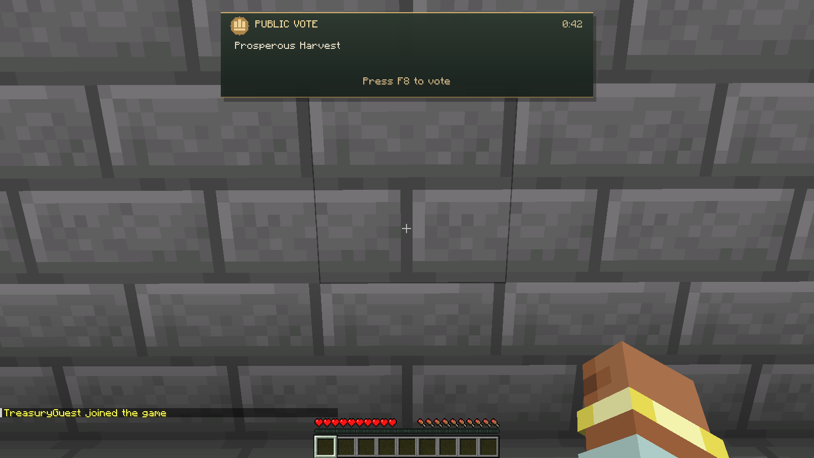
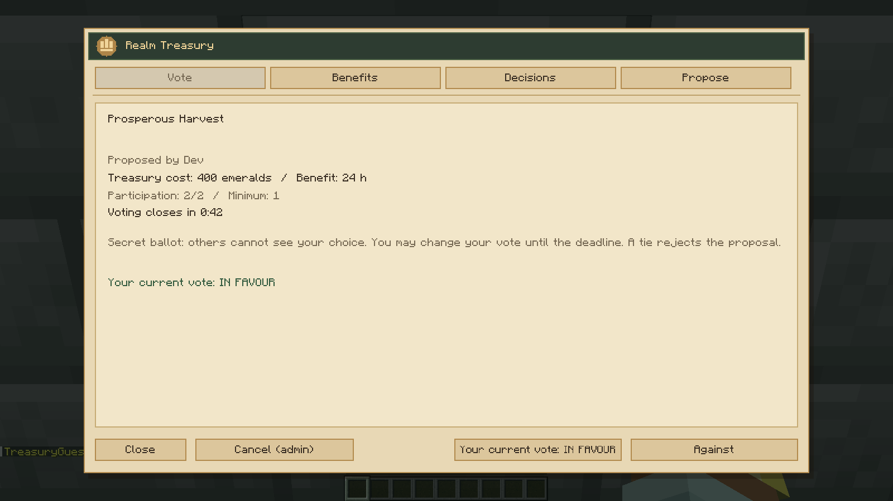
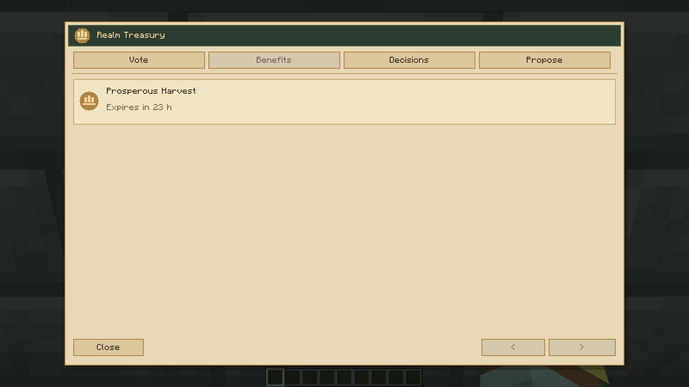
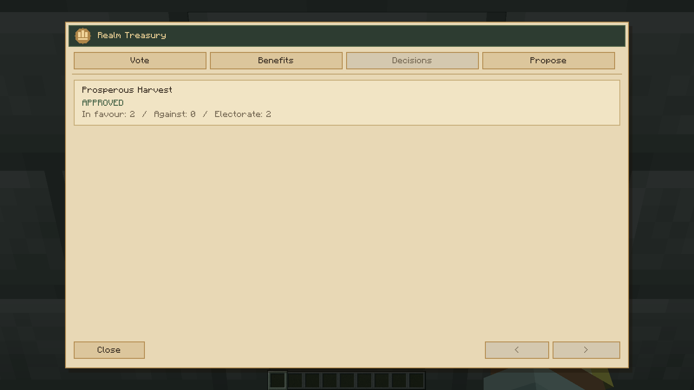

# Realm Treasury 0.3.0

New voting images show real menus and real ballots between two Minecraft processes connected by TCP LAN, using offline QA identities and controlled starting funds. The three legacy chest/account/policy images use demonstration balances in the production interface. No concept art is presented as gameplay.

