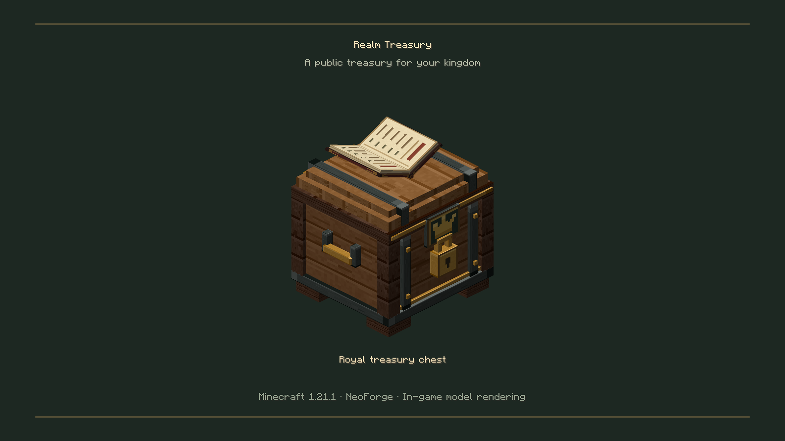
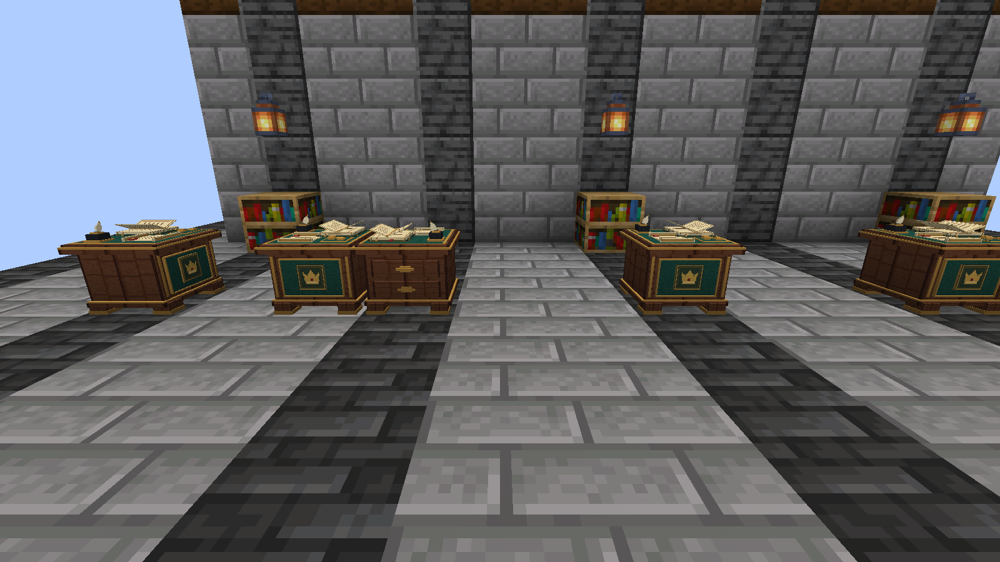
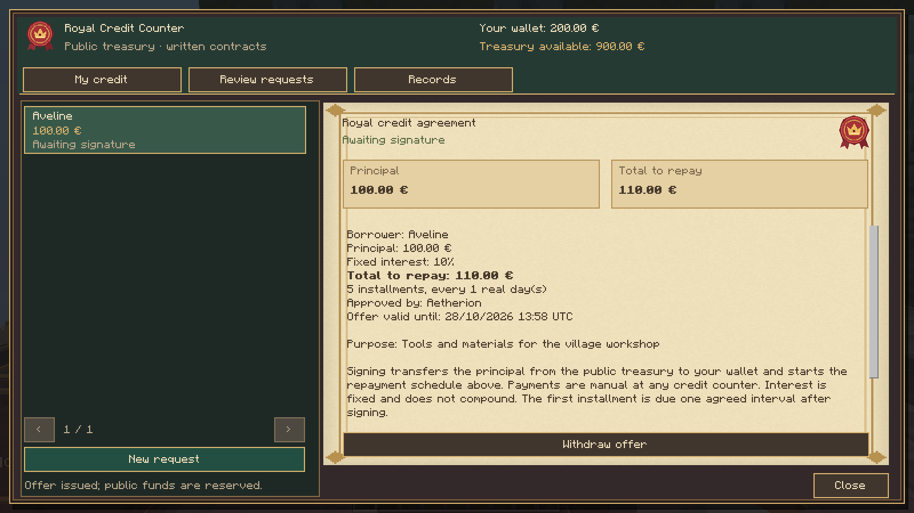
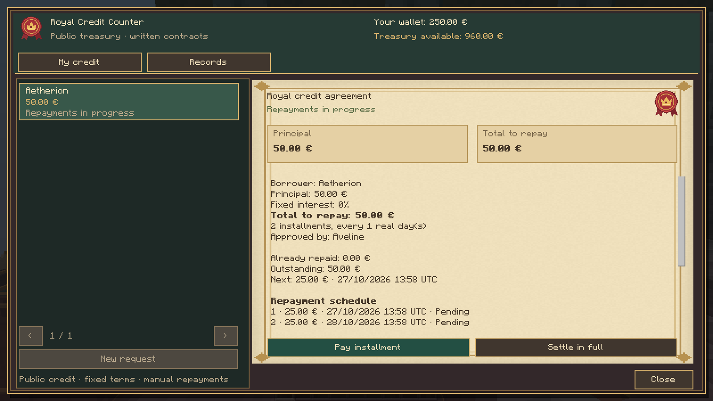
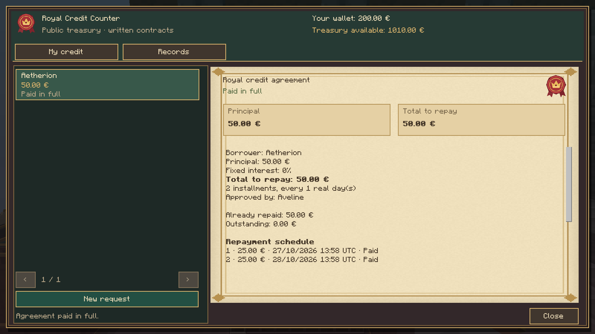
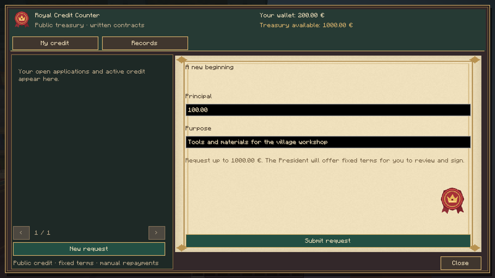
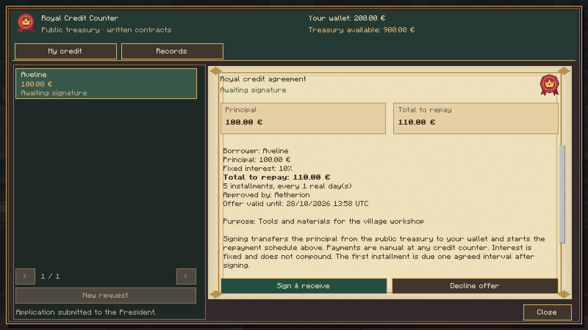
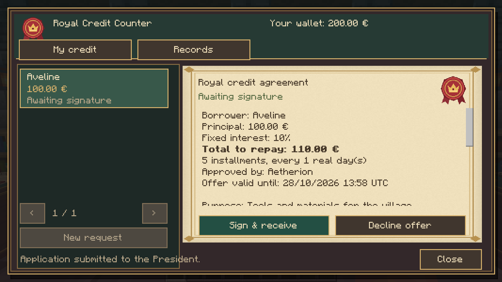
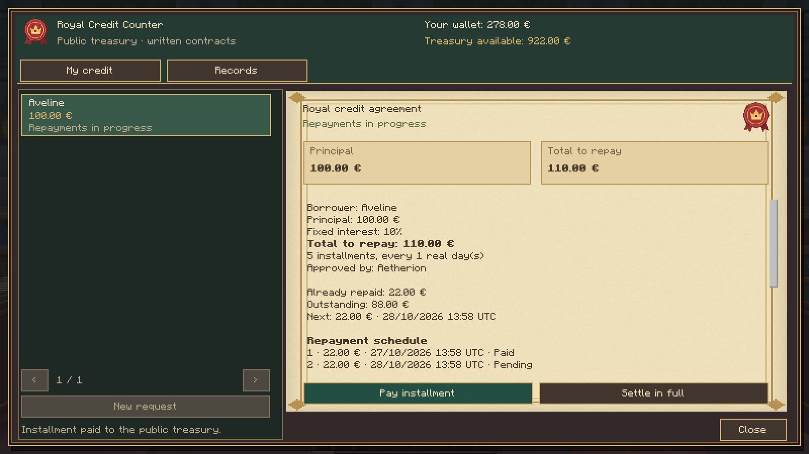
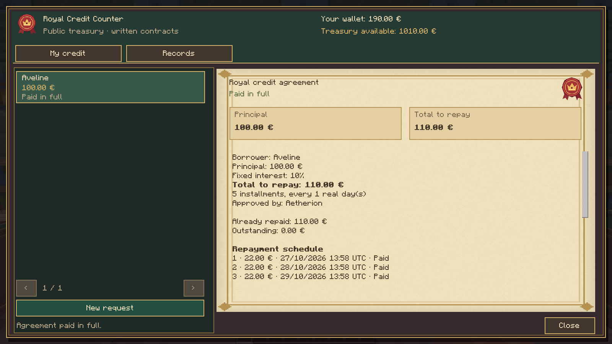

# Realm Treasury 0.4.0

Actual Minecraft captures. Credit images show the original 66-element counter and real loan menus, native packets, Realm Origins wallets and Realm Council mandates between two Minecraft processes over TCP LAN. Starting funds, characters and applications are controlled QA fixtures. The world was closed and reopened with an active debt. Voting images use two native LAN clients; the three legacy chest/account/policy images use demonstration balances. No concept art is presented as gameplay.

