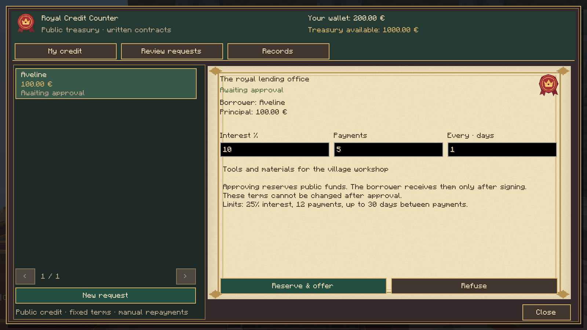
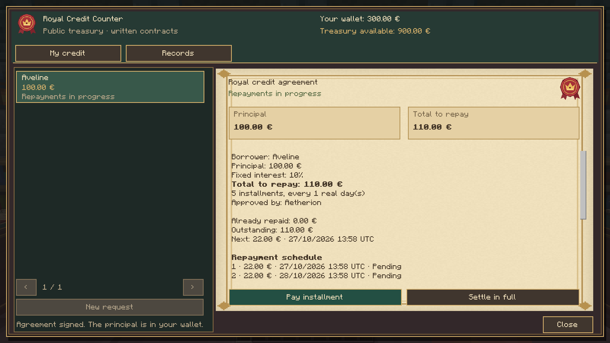
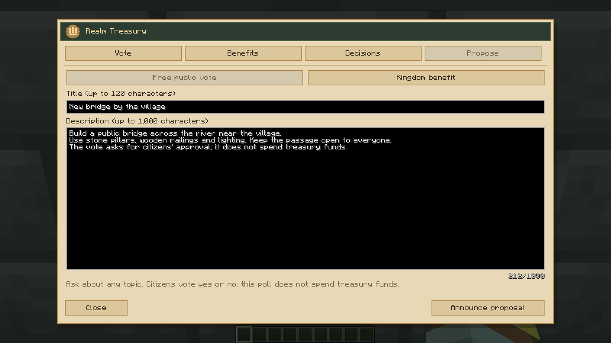
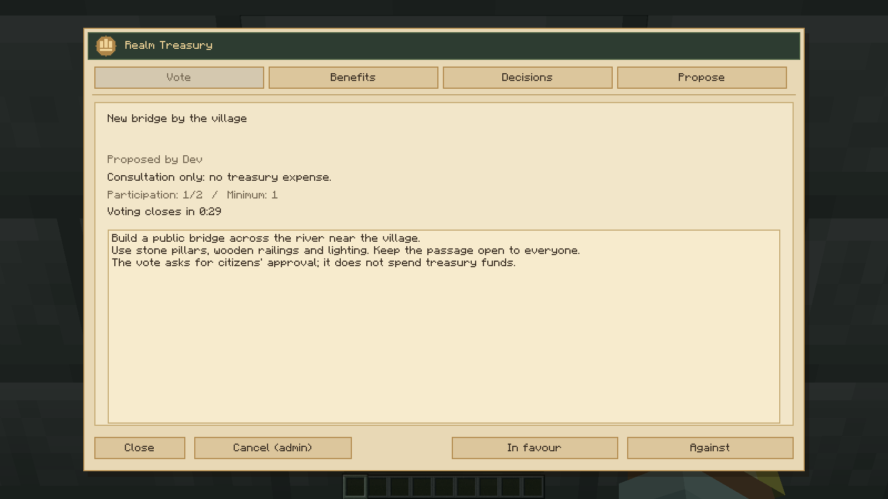
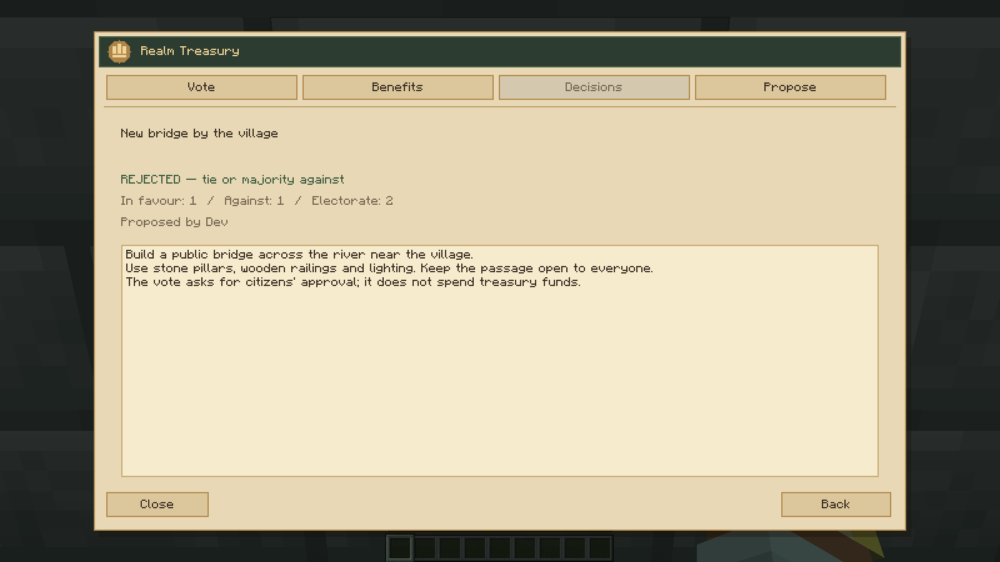
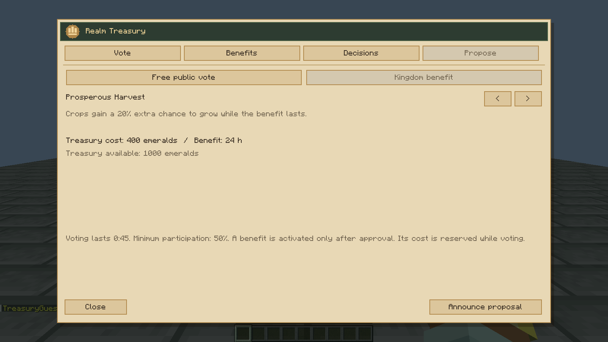
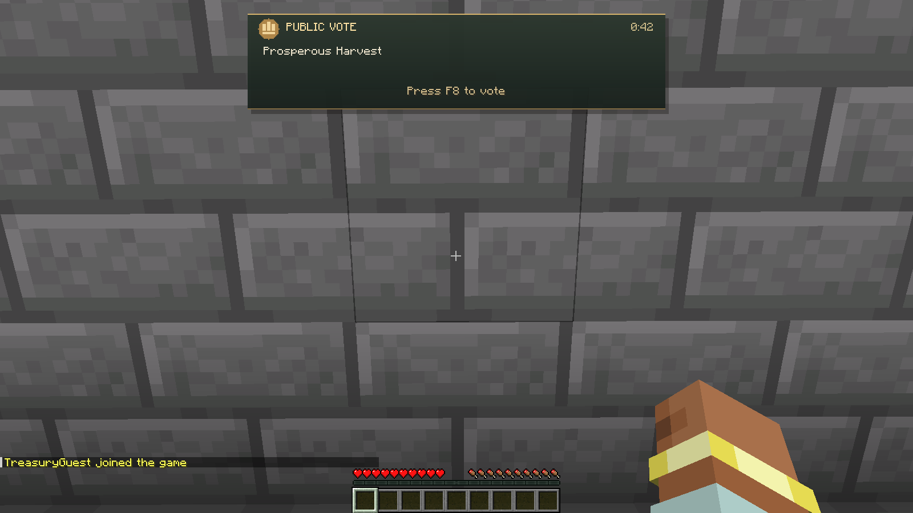
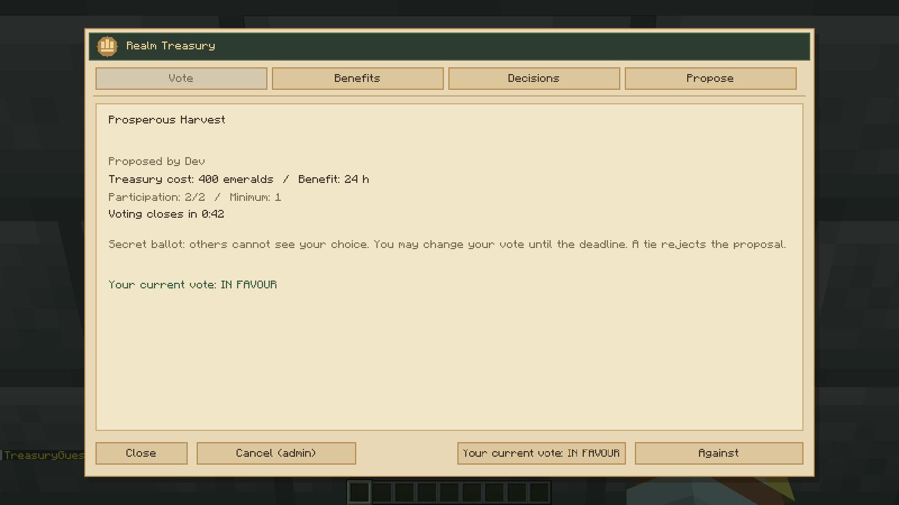
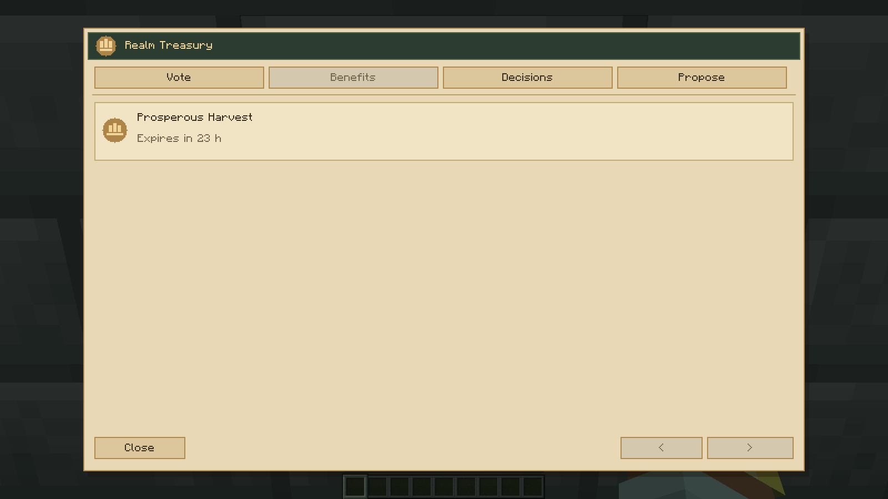
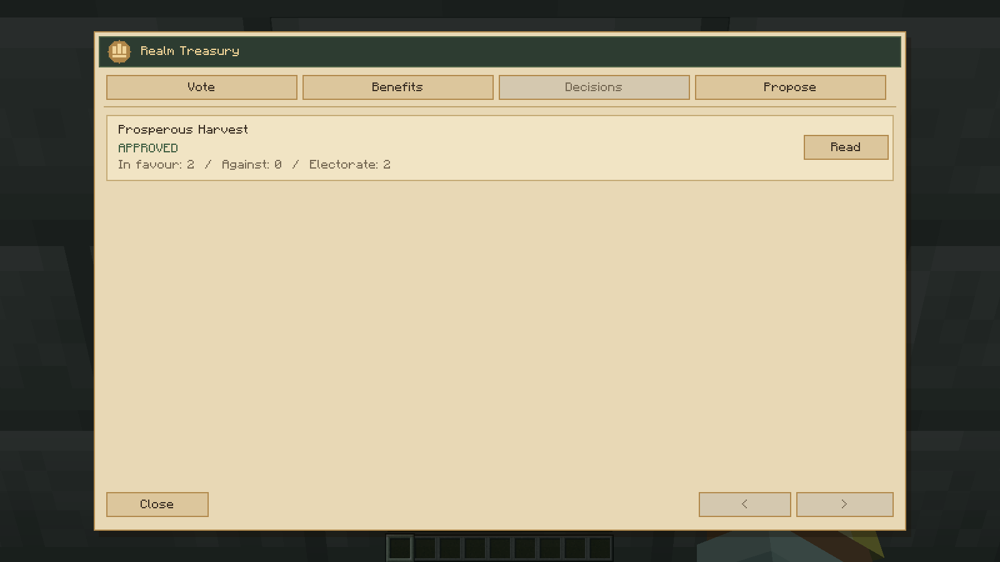

# Realm Treasury

## Balcão de Empréstimos

Modelo de 66 elementos e texturas originais. As capturas mostram o Minecraft real: balcões colocados no mundo, aprovação do Presidente, contrato em pergaminho, prestações e liquidação. Os fundos, nomes e pedidos são fixtures de demonstração; as carteiras, pacotes e gravações são os de produção. O teste usa dois clientes LAN e encerra/reabre o mundo com uma dívida ativa.

[Galeria completa 0.4.0](0.4.0/README.md) · [Guia dos empréstimos](../../crown-ledger/README.md#balcão-de-empréstimos) · [Validação](../../crown-ledger/VALIDACAO-0.4.0.md)

Realm Treasury is the new name of Crown Ledger. The existing treasury chest is preserved.

[0.4.0 — Actual Minecraft voting, benefits and treasury screenshots](0.4.0/README.md).

[Previous Crown Ledger gallery](../crown-ledger/0.2.5/README.md).
