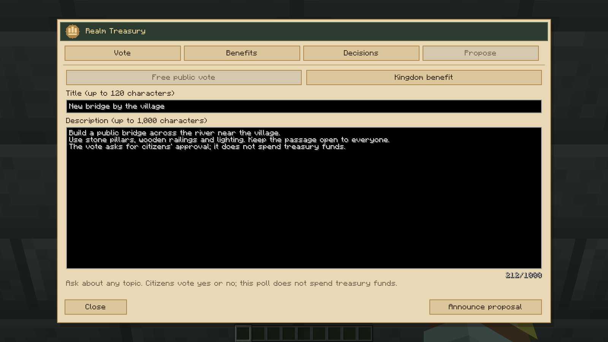
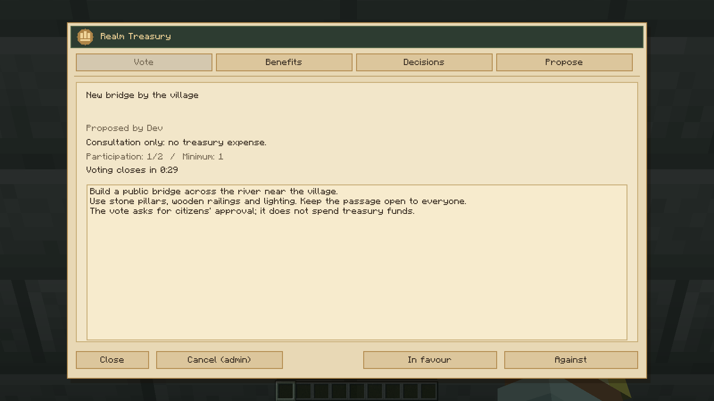
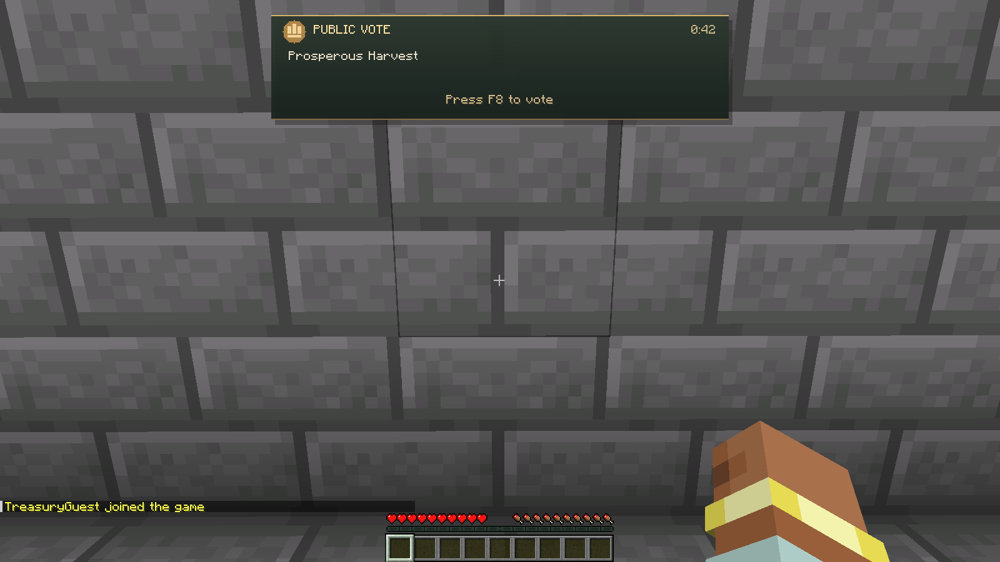
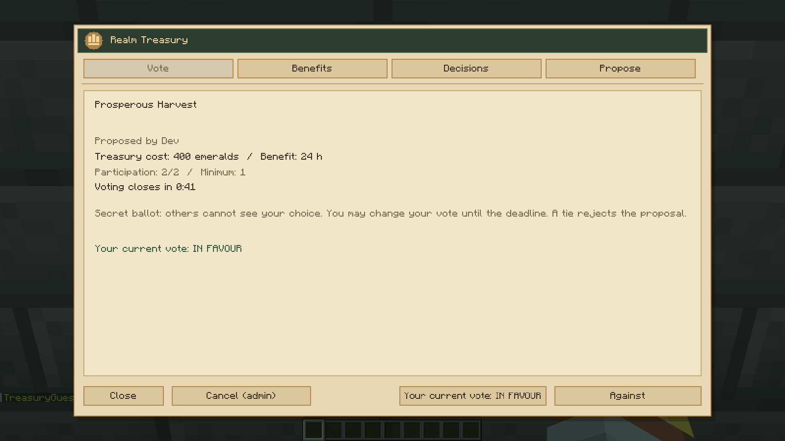
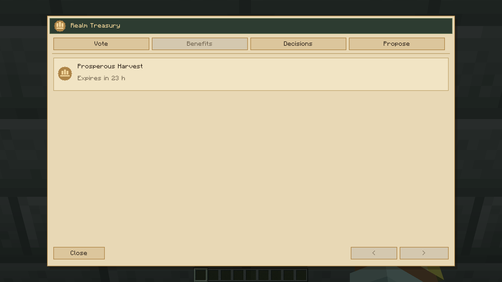
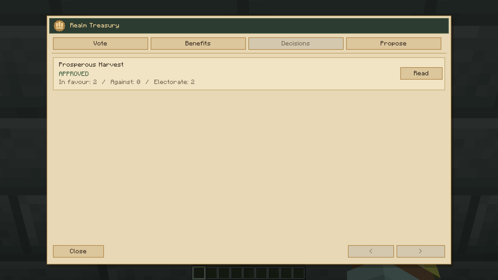

# Realm Treasury

Realm Treasury is the new name of Crown Ledger. The existing treasury chest is preserved.

[0.3.1 — Actual Minecraft voting, benefits and treasury screenshots](0.3.1/README.md).

[Previous Crown Ledger gallery](../crown-ledger/0.2.5/README.md).
