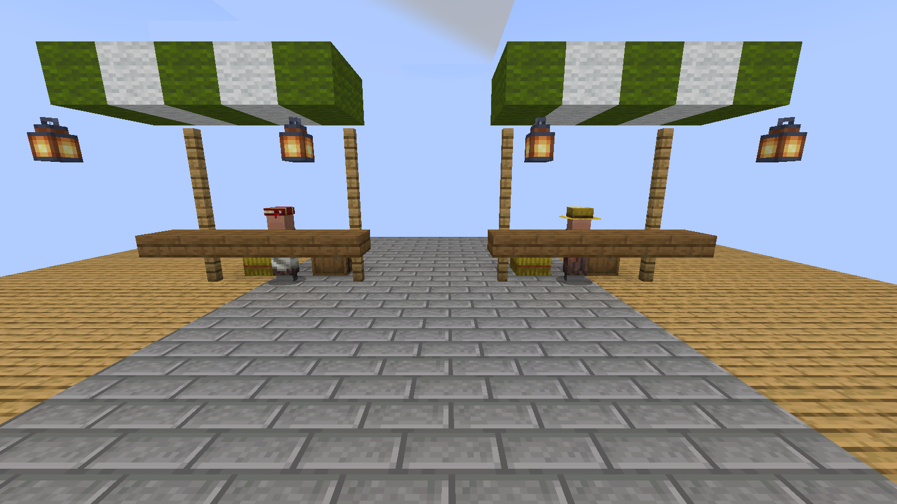
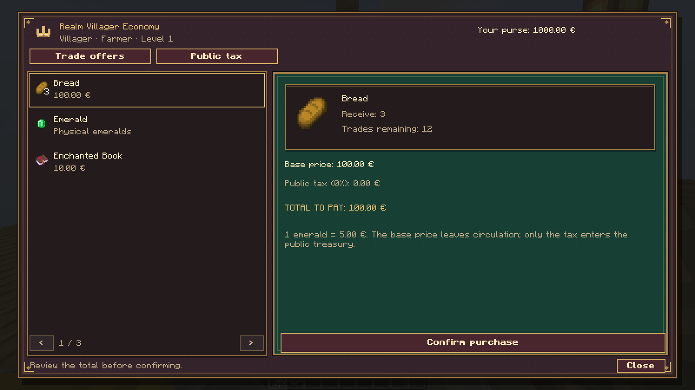
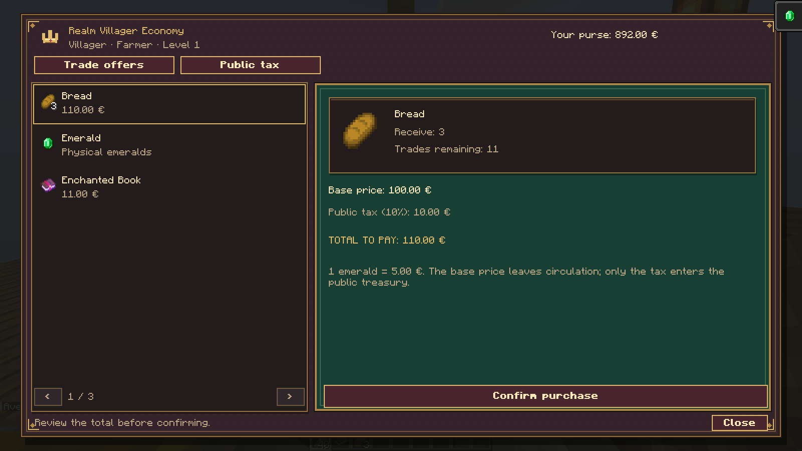
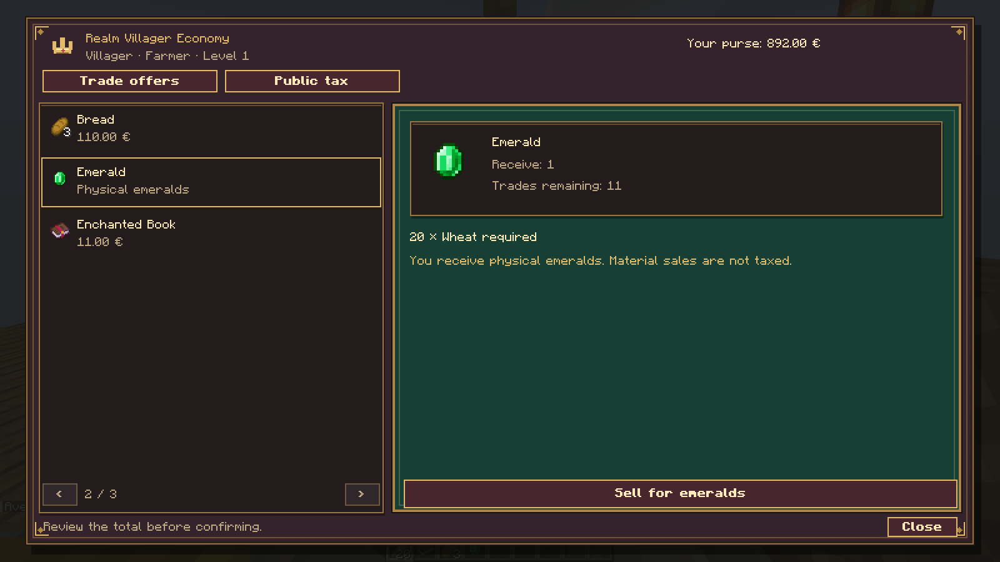
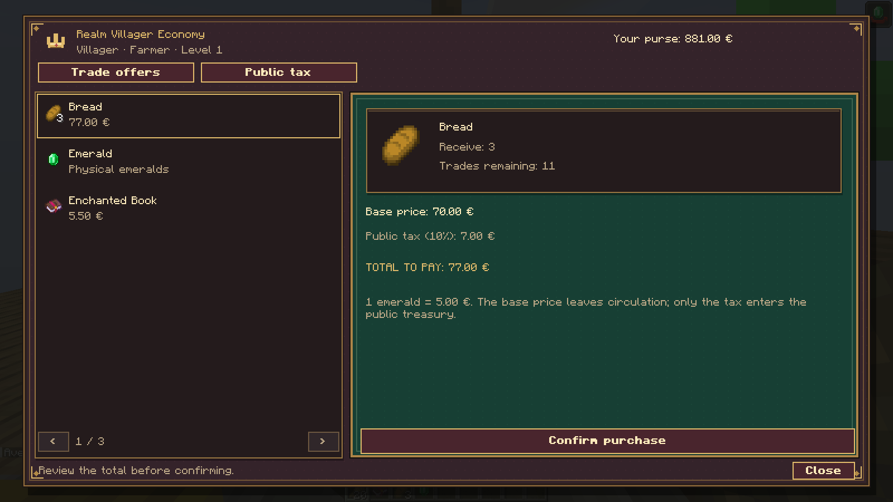
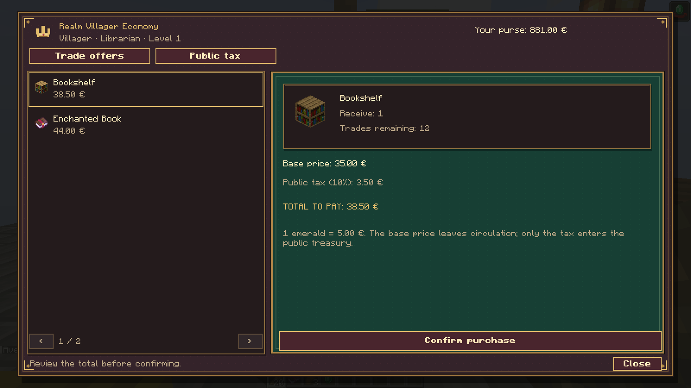

# realm-villager-economy 0.1.0

Actual Minecraft 1.21.1/NeoForge integrated-host captures. Characters, offers and funds are fixtures; financial screens use real server state, native C2S/S2C, the actual Chronicles wallet and Crown treasury. These checks do not establish two authenticated clients.

