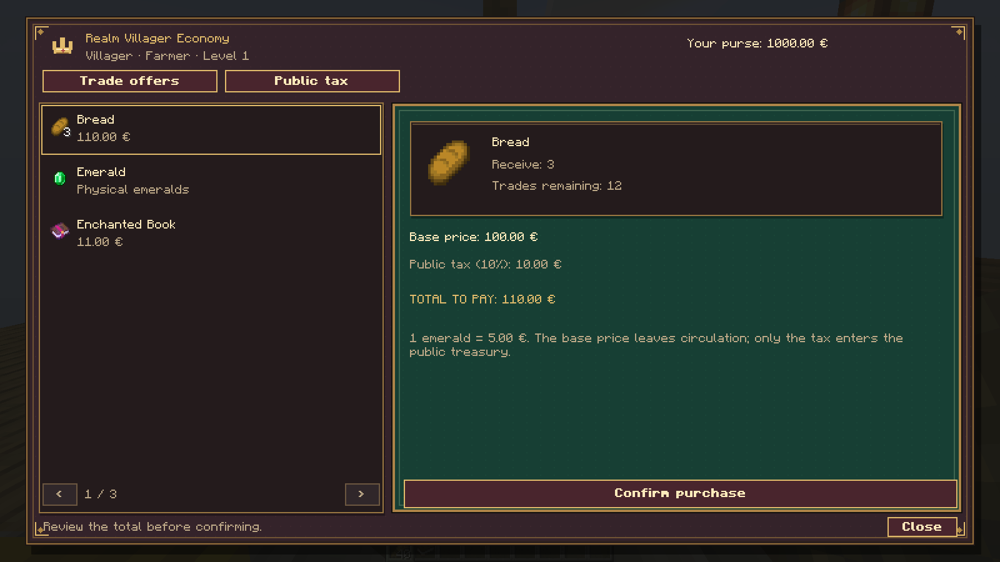
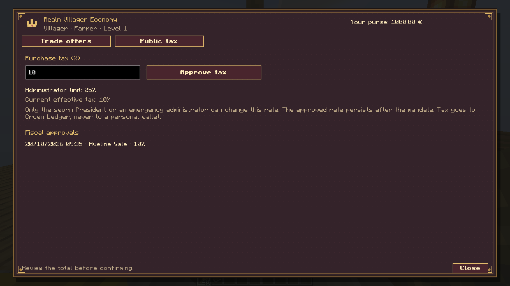
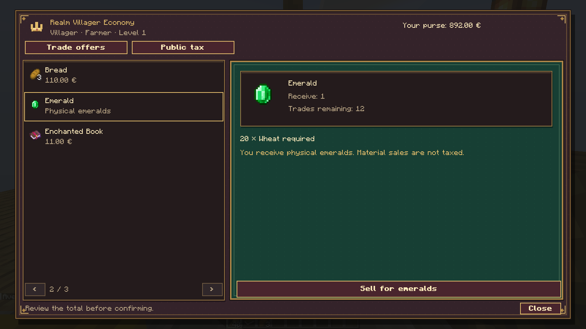
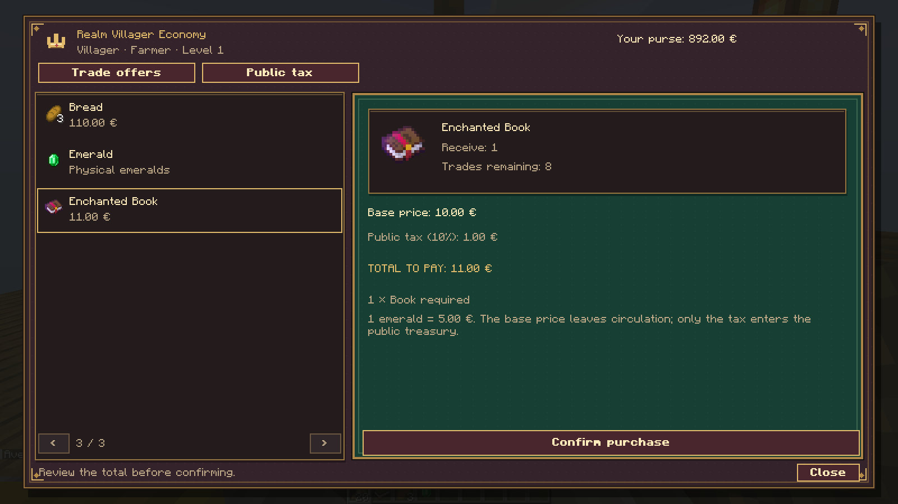
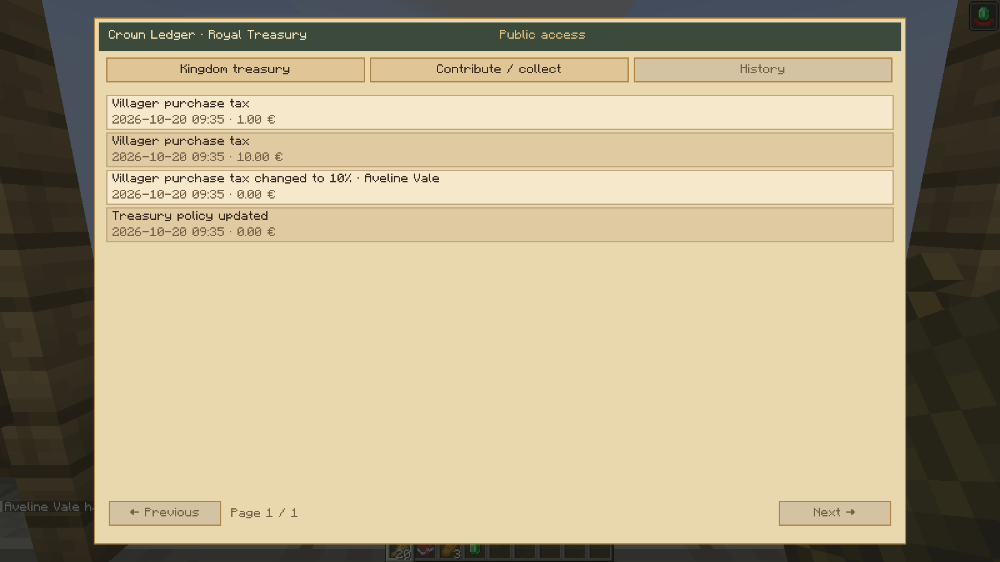

# Realm Villager Economy — galeria

[Download dos 11 PNGs](0.1.0/realm-villager-economy-0.1.0-media.zip) · [Todas as capturas](0.1.0/README.md) · [Guia](../../realm-villager-economy/README.md)

Capturas reais do cliente Minecraft 1.21.1 com os menus de produção. A aldeia, as personagens, os fundos iniciais e as ofertas são demonstrações. As compras, os débitos, as vendas por esmeraldas e os impostos atravessam os canais reais do servidor integrado e usam os dados verdadeiros do Chronicles RP e Crown Ledger.

## Preço base, imposto e total

Suggested title: **Clear purchase prices**. Caption: Review the base price, public tax and total before confirming a purchase with your Chronicles RP wallet.

## Gestão fiscal do Presidente

Suggested title: **Public purchase tax**. Caption: The sworn President approves the tax within administrator limits. The history records the author, date and percentage.

## Vendas por esmeraldas físicas

Suggested title: **Vanilla material sales**. Caption: Selling materials still pays physical emeralds and does not charge purchase tax.

## Materiais adicionais

Suggested title: **Keep the original trade requirements**. Caption: Purchases convert the emerald cost into euros while preserving additional materials, such as the book used for an enchanted book.

## Impostos no tesouro público

Suggested title: **Public treasury receipts**. Caption: Purchase tax reaches Crown Ledger with durable receipts; the President's personal wallet does not receive it.
