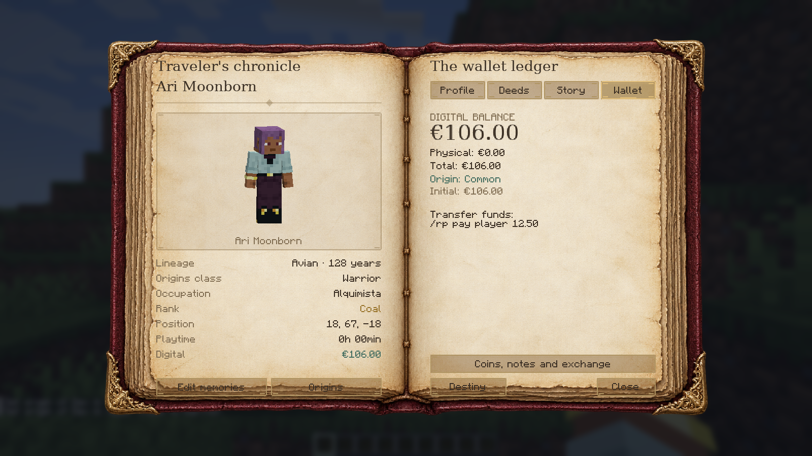

# Realm Origins — 0.5.7

[Português](README.md) · [Download JAR](../mod-pronto/realm-origins-0.5.7.jar) · [Download ZIP](../mod-pronto/realm-origins-0.5.7.zip) · [Screenshot gallery](../media/realm-origins/README.md)

Realm Origins is the new name of **Chronicles RP**. The internal mod ID remains `cronicasrp`, preserving existing characters, wallets, items, configuration files and companion integrations. The source project is now `realm-origins/`.

Fantasy characters, cinematic character creation, a parchment journal and an exact digital/physical euro economy for Minecraft Java 1.21.1, NeoForge 21.1.256+ (21.1 branch), and Java 21.

## Install

Back up your world and replace the previous Realm Origins JAR with `realm-origins-0.5.7.jar`. Update the server and every client to 0.5.7. Keep only one Realm Origins JAR in each `mods` directory.

| Dependency | Tested version | Requirement |
| --- | --- | --- |
| [Origins (NeoForge), by IAFEnvoy](https://www.curseforge.com/minecraft/mc-mods/origins-neoforge/files/8758523) | 0.3.2 | Required |
| [Jupiter for NeoForge 1.21.1](https://www.curseforge.com/minecraft/mc-mods/jupiter/files/7738312) | 2.3.7 | Required by Origins |
| [Origins: Classes (NeoForge), by IAFEnvoy](https://www.curseforge.com/minecraft/mc-mods/origins-classes-neoforge/files/8758587) | 0.3 | Optional; install for classes |

This release declares the Origins 0.3.2 API and, when installed, Classes 0.3. These are the reference dependency versions; see `VALIDACAO.md` for this release's actual validation status. Gradle downloads these dependencies for development runs. External mods are not bundled in the Realm Origins JAR.

[Version 0.5.7 validation passed](https://github.com/ROCKABITS/Mods/actions/runs/39794991947): 70 unit tests, 38 native GameTests in each of three mod configurations, and checks in the actual Minecraft client. See [VALIDACAO.md](VALIDACAO.md) for release provenance, test scope and limitations.

## Character names in the world

Once a character has been created, its RP name replaces the account username above the player's head, in TAB, as the author of ordinary chat messages, and in the identity shown by the Realm Origins character book. An account named **Ricardo123** with a character named **Aetherion** is displayed as **Aetherion**. Players without a created character, or with an invalid name in a legacy profile, keep their normal username.

Public name updates send only a player UUID and the character's public name. They do not share backstories, signatures, balances or other private profile fields. Updates follow profile changes and reach joining or newly tracking players. Existing team visibility and formatting rules still apply. Chat hover identity and Shift-click insertion also use the RP name; clicking to send a private message retains the real account target.

The account UUID and `GameProfile` are unchanged. RP names are not unique identifiers: commands and administration still use real account usernames when selecting a player. External mods that read raw account names may continue to show those names. This feature does not add titles or change skins, and it does not require Realm Titles.

## Compatibility fix retained from 0.5.1

This version retains the correction to the Elytrian claustrophobia definition supplied by Origins 0.3.2 so its Weakness and Slowness effects can load. The fix is an included data resource and requires no manual file edits or extra datapack. Original power values and conditions are retained. See `CHANGELOG_0.5.1_EN.md` and `VALIDACAO.md`.

## Create your character

The dark, lilac chapter-based creator opens first, with a live 3D preview of your character. Start entering your RP name and age, then click **Lineage** to open the native Origins race selector. If Classes is installed, its choice follows the race; otherwise this step is skipped. The same RP form then returns with your name and age kept. Enter an occupation (one word, up to 24 characters, with quick suggestions), complete your backstory and drawn signature, then confirm your oath. The server validates custom occupations on creation and editing. Advancing the first step requires the Origins choices to be finished. The server rolls your starting wealth once; the animation reveals the saved result.

Press **P** to open the character book. Lineage and the new Origins class row follow the actual choices in Origins. The **Origins** button opens the native lineage/class/powers information. **Back** returns to the same book or unfinished draft.

Server datapack origins are discovered from the real Origins registries. There is no fixed four-race list in the RP creator. Datapacks must match this NeoForge port's format; Fabric datapack formats differ.

**Origins class, RP occupation and economic background are separate.** A Warrior can be a Blacksmith in RP, and neither choice rerolls starting wealth. Origins owns its powers and selection rules; RP only mirrors the selected identity. Without Classes, Origins still works and the profile identifies the missing optional add-on.

## Existing characters

Name, age, backstory, signature, occupation, reputation, achievements, initial wealth and digital balance are preserved from 0.4.1. Lineage follows the selected Origins origin, including later Orb of Origin or administrative changes. Class persistence remains owned by Origins.

Network protocol is now **8**; update the server and every client together to 0.5.7. Versions 0.5.6 and earlier cannot decode arbitrary occupations; update the server and every client together. The RP record keeps its existing fields, with the race field storing a canonical origin identifier. This update does not reset characters, reroll starting wealth or convert money.

## Economy and stats

The book retains Profile, Deeds, History and Wallet pages, actual player skin, drawn signature, real Minecraft play time, health, armor, experience, position and kill statistics. Reputation, missions and medals are RP progress data. Operators and integrated Contracts & Bounties quests can award progress; Realm Origins does not generate its own daily quests.

Withdraw digital money into 1, 2, 5, 10, 20 and 50-cent coins, €1/€2 coins and €5/€10/€20/€50/€100/€200/€500 banknotes. Deposit items back with exact change. Invalid transactions leave inventory and balance unchanged. There are no survival cash recipes or exchange fees. Digital money persists on death; physical items follow inventory rules.

Open **P → Wallet → Coins, notes & exchange**, or `/rp exchange`. Existing English and Portuguese commands remain supported: `/rp profile`, `/rp balance`, `/rp destiny`, `/rp withdraw`, `/rp deposit`, `/rp pay`, and operator commands under `/rp admin`.

Realm Origins supports English, Portuguese (Portugal) and Portuguese (Brazil). Origins/add-ons/resource packs supply their own lineage/class translations. Player-written text is not translated.

## Development

Open `realm-origins` in IntelliJ and use JDK 21 for both the project and Gradle. Run `gradlew.bat runClient`, `test`, `runGameTestServer -PrpGameTests`, then `clean build` without QA properties to produce `build/libs/realm-origins-0.5.7.jar`. Add `-PrpWithoutClasses` to test Origins alone. QA classes and datapack fixtures are excluded from release JARs.

For an existing IntelliJ project, replace `build.gradle`, `gradle.properties` and `src` with the new versions, and keep your `run` directory. The source project is under `realm-origins` in this repository; installation ZIPs contain the ready-to-use JAR.

Do not put the packaged Realm Origins JAR in development `run/mods`; development runs load the source. Preserve the world directory when updating. Restore an earlier world copy to downgrade worlds converted from 0.3.0 or earlier. Existing currency conversion and exact integer storage are unchanged.
