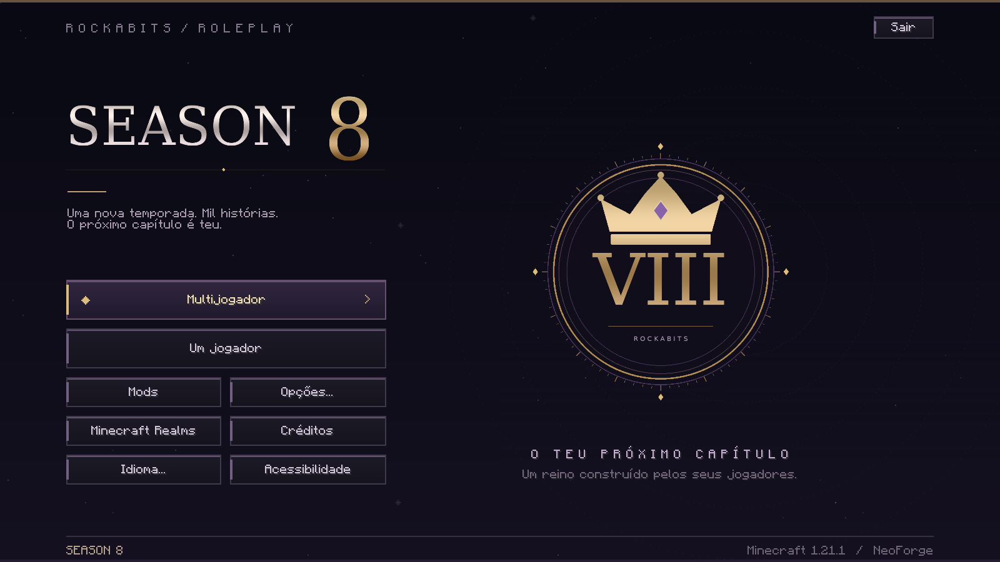

# Season 8

Apresentação própria do modpack ROCKABITS para **Minecraft 1.21.1, NeoForge 21.1.256+ e Java 21**. Mod exclusivamente de cliente, separado dos mods de jogo.



## Instalar

Descomprime `season-eight-0.1.0.zip` e coloca o JAR na pasta `mods` de **cada jogador**. Não necessita de instalação no servidor nem de FancyMenu, Drippy Loading Screen ou bibliotecas adicionais. Inclui o JAR no modpack para distribuir o visual.

Se já personalizas o menu com FancyMenu ou outro mod, usa apenas um responsável por cada ecrã. Os controlos independentes em `config/seasoneight-client.toml` permitem desativar o menu ou o carregamento da Season 8. Reinicia o jogo depois de alterar a configuração.

## Apresentação

- Menu com fundo escuro, estrelas discretas, anéis, acentos lilases e dourados e um brasão original de coroa e número romano VIII.
- Botões de multiplayer, singleplayer, mods, opções, Realms, créditos, idioma, acessibilidade e sair. Os botões executam as ações originais do Minecraft, preservando os avisos e as restrições da conta.
- Português de Portugal, português do Brasil e inglês, seguindo o idioma do Minecraft.
- Ecrã de carregamento dos recursos durante o arranque do Minecraft e nos recarregamentos, com o mesmo brasão e uma barra associada ao progresso real do carregador.
- Título da janela `Season 8`, inclusive quando o Minecraft atualiza o título ao entrar num mundo ou servidor.
- Ícones originais de 16, 32 e 48 px na janela, nas plataformas suportadas por GLFW: Windows e Linux/X11. Wayland e macOS não suportam esta operação de ícone de janela pelo GLFW; o mod preserva o comportamento normal nessas plataformas.

**Âmbito do carregamento:** a janela técnica do NeoForge anterior à inicialização do Minecraft permanece original. O mod personaliza `NeoForgeLoadingOverlay` e `LoadingOverlay`, depois de o renderizador do Minecraft estar disponível. A geração de chunks e os ecrãs de ligação a servidores continuam normais. Não apresenta um progresso fictício, não adiciona atrasos e não altera os callbacks de conclusão ou de erro do carregador.

O menu de demonstração e subclasses de `TitleScreen` de outros mods não são substituídos. O mod não regista pacotes de rede, carteiras, blocos, comandos ou dados de mundo.

## Configuração

O ficheiro é criado automaticamente no primeiro arranque:

```toml
customMenu = true
customLoading = true
customWindowTitle = true
customWindowIcon = true
animatedBackground = true
windowTitle = "Season 8"
```

`animatedBackground = false` mantém as estrelas e o brasão imóveis. Cada funcionalidade pode ser desativada separadamente. O título aceita até 64 caracteres sem controlos.

## Compilar e verificar

```bash
./gradlew build
./gradlew -PseasonQa runClient
python3 tools/release.py install
./gradlew -PseasonQa -PseasonIntegration runClient
```

As execuções de cliente são testes automatizados que abrem o Minecraft real, interagem com os controlos e guardam capturas e `result.json` em `qa-results/client/`. Copia esse diretório para `qa-results/standalone/` e `qa-results/integration/` após as respetivas execuções. Os testes precisam de um ambiente gráfico; no Linux pode ser X11/Xvfb e renderização por software.

O script `tools/cloud_gradle.py` serve apenas para este ambiente cloud. Fora dele, utiliza o wrapper `gradlew` com Java 21. A arte original pode ser regenerada com `python3 tools/generate_art.py`, usando Pillow e fontes DejaVu; os PNGs já estão incluídos, e estas ferramentas não são dependências do mod.

O pipeline `.github/workflows/build-season-eight.yml` executa os testes, verifica as capturas, exclui o código de QA do JAR e publica JAR, ZIP, hashes, relatórios e imagens apenas após aprovação das verificações. Ver [VALIDATION.md](VALIDATION.md) para o âmbito efetivamente executado.
